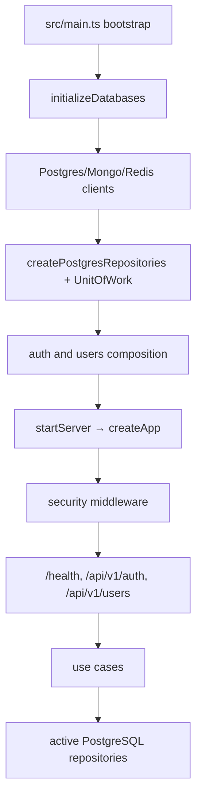
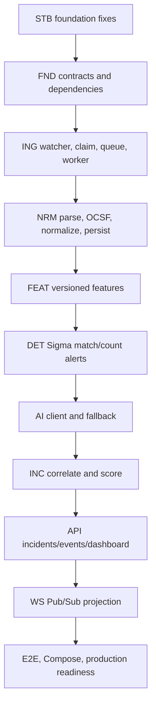

# AI-SIEM Implementation Roadmap
## Current Backend → Target Architecture

**Audit basis:** `BACKEND(6).zip` extracted under `backend_audit/`, audited against the supplied project documents on 2026-08-29. The `src/` tree is treated as the implementation source of truth; `dist/` and design documents are not evidence that a feature runs.

**Important source limitation:** the requested `ADR-002-final-architecture-review` file was not present in the supplied files, upload directory, or backend archive. The supplied `Trivikrama_Collector_Architecture_Review(1).md` is a corrected collector specification, but it is not named ADR-002. ADR-001 is present and frozen. The user-stated ADR-002 requirements for the threat-classification endpoint and authenticated WebSocket are retained as target requirements; other ADR-002-specific decisions not repeated in the supplied SRS/HLD/security/API documents require confirmation before they override this roadmap.

## 1. Executive Summary

The current backend is a functioning foundation, not a functioning SIEM pipeline.

What is genuinely wired today:

- Node/Express startup in `src/main.ts`, `src/server.ts`, and `src/app.ts`.
- Startup connectivity checks for PostgreSQL, MongoDB, and Redis.
- PostgreSQL migrations, seed scripts, transaction support, and a broad repository factory.
- Cookie-based JWT authentication, PostgreSQL-backed sessions, logout/revocation, refresh, `/me`, bcrypt password verification, CSRF protection, and a Redis-backed login rate limiter.
- User management use cases and HTTP routes with unit/integration tests.
- A health endpoint and database verification/smoke-test tooling.

What is not wired today:

- Collector directory watching, file claiming, HMAC verification, queueing, workers, parsing, OCSF validation, normalization, or feature extraction.
- Sigma rule execution, AI HTTP integration, incident correlation, risk scoring, Redis Pub/Sub, or WebSocket delivery.
- Dashboard, incident, event, rule, collector, asset, audit, and configuration APIs.
- A Docker Compose deployment or a production-ready worker/runtime topology.

The most efficient implementation sequence is therefore:

```text
Stabilize active foundation
  → define ingestion contracts
  → watcher/claim/queue/worker
  → parse/validate/normalize/features
  → rule alerts
  → AI enrichment/fallback
  → correlation/risk/persistence
  → REST/WebSocket surfaces
  → security hardening and end-to-end verification
```

Do not rebuild the authentication, user-management, PostgreSQL schema, or repository foundation. Extend and correct them at their existing seams.

## 2. Current Implementation Assessment

### 2.1 Project structure actually present

| Area | Actual implementation | Assessment |
|---|---|---|
| Entry points | `src/main.ts`, `src/server.ts`, `src/app.ts`, `src/index.ts` | ✅ Implemented and active |
| HTTP modules | `src/modules/health`, `src/modules/auth`, `src/modules/users` | 🟡 Partial; only these modules are mounted |
| Controllers | No `src/controllers/` directory; route handlers are in module route files | 🟡 Valid modular style for current scope, but most target modules are absent |
| Application services/use cases | Auth use cases and user use cases exist; `HealthService` exists | 🟡 Partial; no detection/incident/dashboard application layer |
| Repositories | PostgreSQL and Mongo repository interfaces/classes; PostgreSQL factory creates 12 repository groups | 🟡 Persistence surface exists, but most repositories have no caller in the runtime feature flow |
| Entities/domain models | Auth/user contracts and DTOs; no event/rule/alert/incident domain modules | 🔴 Missing for core SIEM behavior |
| Middleware | Error middleware, Helmet/CORS/body limits, CSRF, auth, RBAC, login rate limiter | 🟡 Partial security surface |
| Configuration | Zod-validated environment configuration in `src/config/env.ts` | 🟡 Strong base; several values are not passed to runtime clients and collector settings are unused |
| Database layer | PostgreSQL/ MongoDB/Mongoose connection wrapper / Redis/ioredis client, migrations, bootstrap, seeds, verification | 🟡 Broad foundation; only part is feature-active |
| Workers/queues | No `src/workers/`, no queue adapter, no BullMQ dependency | 🔴 Not implemented |
| Utilities/observability | Winston logger, redaction, database maintenance and verification scripts | 🟡 Useful foundation; no pipeline metrics/tracing |
| Tests | Auth/users unit tests, repository integration tests, migration/config/smoke scripts | 🟡 Good foundation coverage; no pipeline/API/WS/E2E coverage |
| Deployment | `.env.example`, migration/seed scripts; no Compose files in the archive | 🔴 MVP deployment incomplete |

### 2.2 Major component inventory

| Component | Current status | Evidence | Target gap |
|---|---|---|---|
| Application startup | ✅ Implemented | `src/main.ts` calls `initializeDatabases`, constructs repositories/UoW, composes auth/users, calls `startServer` | Add workers, Mongo repositories, pipeline services, and orderly store shutdown to the composition root |
| Express initialization | ✅ Implemented | `src/app.ts`, `src/server.ts` | Mount the remaining module routers and WebSocket upgrade handling |
| Health checks | ✅ Implemented | `src/modules/health/health.service.ts`, `health.routes.ts`; checks all three stores | Add readiness/liveness distinction and queue/worker/AI/collector health |
| PostgreSQL client | ✅ Implemented | `src/database/postgres/client.ts` | Pass the configured timeout options from `main.ts`; verify production pool behavior |
| MongoDB client | ✅ Implemented | `src/database/mongodb/client.ts` using a Mongoose connection | Bootstrap is a separate command, not startup; activate repositories in composition |
| Redis client | 🟡 Partially Implemented | `src/database/redis/client.ts`; active for auth rate limiting | Runtime omits configured key prefix; no queue, Pub/Sub, cache, session-cache, or correlation state |
| PostgreSQL migrations/schema | ✅ Implemented | `migrations/postgres/*`; tables include users, sessions, rules, incidents, alerts, audit, assets, configuration, collector/queue monitoring, incident events | Confirm every future repository query against the migrated schema and add missing indexes only when query paths exist |
| PostgreSQL transactions | ✅ Implemented | `src/database/transactions/postgres-unit-of-work.ts` | Reuse for alert/incident/audit atomicity; do not introduce cross-database transactions |
| PostgreSQL repositories | 🟡 Partially Implemented | `src/database/repositories/postgres-repository.factory.ts` constructs users, audit, configuration, rules, sessions, assets, collector status, queue metrics, incidents, alerts, notes, incident events | Build module ports/use cases and call them; construction alone is not feature completion |
| Mongo repositories | 🟡 Partially Implemented | `createMongoRepositories` constructs normalized events, AI results, and raw archive repositories | `src/main.ts` never calls the factory; no ingestion/AI caller writes to them |
| Authentication | ✅ Implemented for current routes | `src/modules/auth/*`; login/logout/refresh/me, JWT HS256, session validation, cookies, bcrypt | Expand route coverage, refresh semantics verification, session lifecycle tests, and full security policy |
| User management | 🔧 Implemented but requires refactoring | `src/modules/users/*`, active `/users` routes and tests | Fix org-scoped deactivation before any broader admin API work; clean stale imports/optional dependency paths |
| RBAC | 🟡 Partially Implemented | `src/modules/auth/http/permissions.ts`, `rbac.middleware.ts` | Current permissions cover only five actions; implement the frozen endpoint matrix |
| Collector handoff | 🔴 Not implemented in backend | `COLLECTOR_DIR` and `COLLECTOR_HMAC_SECRET` are parsed in `src/config/env.ts` only | Add atomic-file watcher/claim, envelope identity, HMAC, size/age limits, and quarantine |
| Processing queue | 🔴 Not implemented | No `IProcessingQueue`, BullMQ import, or queue adapter; Redis verification only tests generic Pub/Sub/BullMQ requirements | Add the ADR-001 queue interface and BullMQ infrastructure adapter |
| Worker | 🔴 Not implemented | No `src/workers/` directory | Add an independently startable Node worker runtime with retry/DLQ and graceful shutdown |
| Parsing/validation | 🔴 Not implemented | No batch parser or OCSF validator under `src/` | Implement before normalization and rule evaluation |
| Normalization | 🔴 Not implemented | Mongo collection schema contains normalized-event shape, but no normalizer class/caller exists | Map accepted inputs to OCSF and enrich without embedding persistence in the normalizer |
| Feature extraction | 🔴 Not implemented | No feature extractor symbols/classes | Define a versioned feature contract and deterministic MVP feature set |
| Rule engine | 🔴 Not implemented | Rule table/repository and builtin seed exist; no Sigma parser/compiler/evaluator/engine | Implement match/count MVP first; sequence remains post-MVP |
| AI client/engine | 🔴 Not implemented in archive | `AI_ENGINE_URL`/timeout configuration and Mongo AI-result repository exist; no HTTP client or Python service | Implement backend port/client, Python FastAPI process, timeout/circuit breaker/fallback, and SHAP persistence |
| Incident correlation | 🔴 Not implemented | Incident/alert/event-link repositories and seed/configuration exist; no correlator caller | Implement entity + 15-minute window correlation and standalone incident behavior |
| Risk scoring | 🔴 Not implemented | Risk thresholds appear in configuration seed; no scorer | Implement `rule_weight × ML_confidence × asset_criticality` with neutral missing values |
| REST API | 🟡 Partially Implemented | Health, auth, and users are mounted in `src/app.ts` | Add all documented domain routes with validation, authorization, pagination, and consistent errors |
| WebSocket/Pub/Sub | 🔴 Not implemented | No `ws` dependency/server; Redis verification has only a test utility | Add authenticated WS upgrade, Redis subscriber, event projection, connection/frame limits |
| Frontend | 🔴 Not present in backend archive | Only `frontend.md` describes the target | Track as a separate Next.js integration stream after API contracts stabilize |

### 2.3 Runtime flow traced from source



Observed details:

1. `src/main.ts` validates environment configuration through `src/config/env.ts` on import.
2. `initializeDatabases` creates all three clients, connects/pings them, and closes them on startup failure.
3. `createPostgresRepositories` constructs all PostgreSQL repositories, but only users, sessions, and audit are injected into active auth/user modules.
4. `createMongoRepositories` is not called by `main.ts`.
5. `startServer` creates the Express app and listens; there is no worker startup and no WebSocket server.
6. `createApp` mounts `/health`, `${API_PREFIX}/auth`, and `${API_PREFIX}/users`, then the error middleware.
7. Auth and user routes use Zod, use cases, repository ports/adapters, and PostgreSQL. No route reaches Mongo, queue, detection, incident, or AI code.
8. `gracefulShutdown` closes only the HTTP server and calls `process.exit`; it does not call `closeDatabases`, stop workers, drain queues, or close future subscribers.

### 2.4 Clean Architecture boundary assessment

The auth and users modules are directionally compliant: domain contracts are injected into application use cases, infrastructure adapters wrap database implementations, and the composition root creates concrete objects. The following are the important corrective actions:

- Keep repository interfaces at module/domain/application seams when implementing new modules. Do not make a new use case depend directly on `PostgresIncidentRepository`, `MongoNormalizedEventRepository`, or Knex.
- Treat the central `src/database/repositories/*` interfaces as infrastructure contracts for the existing database foundation. Add module ports around them rather than allowing future application code to import the database folder directly.
- Fix `UserManagementRepositoryAdapter.deactivateUserById`: it calls `IUserRepository.deactivate(userId)` without `orgId`, then checks the organization after the mutation. This can mutate a user from another organization before returning `null`.
- Remove or retire the unused `src/modules/auth/composition/auth-dependencies.ts` after confirming no external consumer requires it. `main.ts` uses `auth-application-dependencies.ts`, so the duplicate composition path is a drift risk.
- Standardize error translation. Auth routes use an `{ error: ... }` shape while the global middleware uses `{ success: false, error: ... }`; new modules should use one shared error contract.
- Keep business decisions out of routes and repositories. The route layer should parse/authorize/map; use cases should decide; repositories should persist/query.
- Do not move to microservices. A Node API runtime and a Node worker runtime remain parts of the ADR-001 modular monolith; the C++ collector, Python AI engine, and Next.js frontend remain the other defined processes.

## 3. Current Architecture / Runtime Flow

### 3.1 Backend pipeline audit

The requested pipeline was traced by searching actual imports, construction sites, calls, dependencies, and tests. The absence of a caller is material: repository/schema presence alone does not make a stage implemented.

| Stage | Exists? | Actual implementation / owner / wiring | Data in → out | Errors/tests | Target gap |
|---|---|---|---|---|---|
| Collector directory | No | No backend collector adapter; `COLLECTOR_DIR` is configuration only | Planned atomic `.json` batch → claimed file | No runtime error path or tests | Add collector handoff boundary; collector process itself is outside this archive |
| Directory watcher | No | No `chokidar`, watcher class, or composition call | Planned directory events → file-claim jobs | None | Implement claim-before-enqueue and restart-safe scanning |
| Processing queue | No | No `IProcessingQueue`, BullMQ dependency, or queue object | Planned `QueueJob` → job ID/status | Redis verification is not a queue implementation | Add BullMQ adapter behind ADR-001 interface |
| Worker | No | No `src/workers/`, worker constructor, or startup call | Job ID/file → processing result | None | Add independent worker runtime and shutdown/drain |
| Validation | No | No batch envelope or OCSF validator caller | File bytes → accepted/rejected batch | None | Add schema validation, limits, quarantine |
| Parsing | No | No JSON/batch parser | Atomic file → raw event records | None | Add bounded, deterministic parser |
| Normalization | No | Mongo schema/repository only; no normalizer | Source event → OCSF normalized event | None | Add source adapters and OCSF mapping |
| Feature extraction | No | No feature extractor implementation | Normalized event → versioned numeric/categorical features | None | Add deterministic MVP feature set |
| Rule engine | No | Rule repository and seed only; no parser/compiler/evaluator | Event/features/rules → alerts | None | Implement Sigma match/count and engine orchestration |
| AI client | No | `AI_ENGINE_URL` is read; no client object or caller | Features → anomaly/confidence/SHAP | None | Add timeout, schema validation, fallback, and metrics |
| Incident correlation | No | Incident/alert/event-link repositories exist but are not called | Alerts → incident grouping | None | Add entity/window correlator |
| Risk scoring | No | Threshold seed only; no scorer | Alert + AI + asset → composite score/severity | None | Add scorer and neutral-missing-value rules |
| Persistence | Partial | PostgreSQL and Mongo persistence classes exist; no pipeline invokes them | Planned events/alerts/incidents → stores | Repository integration tests exist; no pipeline test | Wire application ports and idempotent writes |
| Redis Pub/Sub | No for product flow | `src/database/redis/verification.ts` tests Pub/Sub; no application publisher/subscriber | Planned domain event → channel → WS projection | Verification utility only | Add publisher/subscriber with channel/key conventions |
| REST/WebSocket | Partial | Health/auth/users REST only; no `ws` package/server | Requests → auth/user responses | Auth/users tests exist | Add domain APIs and authenticated WS |
| Frontend | Not in backend | No frontend source in archive | API/WS → UI | Not verifiable here | Implement as a separate consumer after contracts stabilize |

### 3.2 Database flow audit

| Store/capability | Current evidence and actual flow | Status | Required next change |
|---|---|---|---|
| PostgreSQL connection | `main.ts` passes `DATABASE_URL`, pool min/max to `initializeDatabases`; `createPostgresClient` pings and closes | ✅ Active | Pass configured acquire/query/connection timeouts and verify under load |
| PostgreSQL migrations/schema | Migration runner and migrations create relational schemas, tables, indexes, triggers, partitions, audit immutability, and constraints | ✅ Implemented | Treat as foundation; add only query-driven migrations |
| PostgreSQL users | `createPostgresRepositories` → `repositories.users` → auth/user adapters/use cases → `public.users` | ✅ Active | Fix org-safe deactivation and retain tests |
| PostgreSQL sessions | Auth composition injects `repositories.sessions`; middleware calls `findByJwtId`; logout/revocation calls session operations | ✅ Active | Keep as current session source until the absent ADR-002 resolves the SRS-vs-security wording |
| PostgreSQL audit | Auth audit adapter and user use cases write audit rows; immutability is enforced by migration trigger | 🟡 Active but incomplete | Audit all domain mutations and decide whether audit failure blocks the mutation; current auth audit service swallows write failures |
| PostgreSQL rules | `PostgresRuleRepository` and rules table/seed exist; no rule use case/route/engine caller | 🟡 Repository-only | Add rule domain/application services and API after evaluator contracts |
| PostgreSQL incidents/alerts | Repositories and migrations exist; no correlator or API calls them | 🟡 Repository-only | Add transactional alert/incident application service |
| PostgreSQL incident events/notes | Repositories and tables exist; no incident module calls them | 🟡 Repository-only | Wire event links and note/lifecycle use cases |
| PostgreSQL assets/configuration | Repositories, tables, and configuration seed exist; no API/service callers | 🟡 Repository-only | Add asset/config ports, RBAC, and routes |
| PostgreSQL collector/queue metrics | Repositories/tables exist; no watcher/worker writes operational data | 🟡 Schema-only | Add heartbeat, queue lifecycle, retry, and throughput writes |
| MongoDB connection | `createMongoDbClient` uses `mongoose.createConnection`, configured pool/server selection options, and admin ping; startup initializes it | ✅ Connection active | Keep connection ownership in the database composition; verify options in deployment |
| MongoDB collections/schema | `src/database/mongodb/bootstrap.ts` creates `normalized_events`, `ai_results`, `raw_events_archive`, validators, indexes, and TTLs; bootstrap is a command | 🟡 Operationally separate | Run/verify bootstrap in deployment and test schema drift |
| MongoDB repositories | Native collection repositories and factory exist for normalized events, AI results, raw archive | 🟡 Implemented but not wired | Construct them in composition and inject application ports |
| MongoDB models | No Mongoose model classes; repositories use native collection operations through the Mongoose connection | ⚠️ Documentation mismatch | Either document native collections as intentional or add a direct `mongodb` dependency/typed adapter; do not rely on a transitive package accidentally |
| Redis connection | `createRedisClient` connects/pings with ioredis timeouts/retry; `main.ts` passes only URL | 🟡 Active but under-configured | Pass key prefix/options and separate base client from BullMQ connections |
| Redis auth rate limiting | `POST /auth/login` creates a fixed-window `INCR/EXPIRE` limiter | ✅ Active, narrow scope | Add policy-specific global/user/search/export/write limiters and headers |
| Redis BullMQ | No BullMQ dependency or queue construction | 🔴 Missing | Implement only behind `IProcessingQueue` |
| Redis caching/session cache | No product cache/session-cache caller | 🔴 Missing | Add only where measured; PG session validation remains current |
| Redis Pub/Sub/correlation state | Verification utility can publish/subscribe, but product code does not | 🔴 Missing | Add incident/event publication and count/sequence state where needed |

### 3.3 API implementation audit

The documented API contains approximately 48 backend REST operations across auth, dashboard, incidents, events, rules, collector, users, assets, audit, and configuration, plus separate AI-engine endpoints. The current Express application mounts 10 application endpoints plus health.

| Endpoint group | Documented | Implemented | Working flow | Missing/incorrect pieces |
|---|---:|---:|---|---|
| Health | Backend health is documented; AI health is separate | `GET /health` | HealthService checks all three stores and returns 200/503 | HLD/API conventions also describe `/api/v1/health`; choose and document the canonical path. |
| Auth | 4 | 4 | Zod → auth use case → JWT/PG session → cookie response | Refresh is behind `authenticate`; verify expired-access-token refresh behavior against the missing ADR-002. No Redis session cache. |
| Users | 6 | 6 | Zod → user use case → repository/UoW → PG | Deactivation mutates before org check; unexpected list errors bypass centralized error middleware; some imports omit `.js`. |
| Dashboard | 4 | 0 | None | Implement aggregations only after incident/event persistence exists. |
| Incidents | 10 | 0 | None | Requires incident domain, correlator, risk, persistence, authorization. |
| Events | 3 | 0 | None | Requires Mongo normalized-event queries, filters, pagination, and export limits. |
| Rules | 10 | 0 | None | Requires rule domain/compiler/evaluator/application service. |
| Collector | 3 | 0 | None | Requires collector status/quarantine/retry and watcher persistence. |
| Assets | 5 | 0 | None | Repository exists; add application ports, use cases, RBAC, validation. |
| Audit | 1 | 0 | Auth/user writes exist, but no read route | Add read-only, filtered, paginated admin/engineer endpoint. |
| Configuration | 2 | 0 | Seed/repository exist, no route | Add allowlisted key/value update use case and audit. |
| AI engine | 5 documented separately | 0 in this archive | No Python service or Node client | Implement the separate FastAPI process and backend client; retain `/classify/threat` as a required final target surface, while scheduling it after the core anomaly/SHAP MVP if the SRS optional scope is used. |

Undocumented or discrepant surface:

- Actual `GET /health` is mounted at the root, not under `API_PREFIX`.
- The current API returns inconsistent error envelopes between auth route helpers and global `errorMiddleware`.
- The actual auth login returns a JSON result and sets cookies; keep that behavior only if the final API contract accepts both, otherwise remove the token from the body to reduce exposure.

## 4. Current → Target Gap Analysis

| Current implementation | Architectural gap | Required change | Dependencies | Implementation task |
|---|---|---|---|---|
| Startup composes only health/auth/users | Target composition root must also own ingestion, worker, detection, AI, correlation, API, and WS dependencies | Add explicit module factories and worker bootstrap without moving business logic into `main.ts` | Foundation contracts | `STB-002`, then phase-specific composition work |
| All PostgreSQL repositories are constructed | Construction is mistaken for runtime capability if no application caller exists | Wrap repositories with module ports and build use cases around actual flows | Domain/application contracts | `STB-004`, `DET-001`, `INC-003`, `API-*` |
| Collector settings are parsed but unused | No secure, restart-safe backend handoff | Implement atomic-file claim, HMAC, identity, limits, quarantine, and ack semantics | Queue contracts, config | `ING-001` through `ING-005` |
| Redis connects and rate-limits login | No BullMQ, Pub/Sub, cache, or correlation state | Add dedicated Redis connections and key/channel conventions | Redis dependency/config | `FND-002`, `ING-003`, `DET-004`, `WS-001` |
| Mongo schema/repositories exist but are not constructed | Pipeline cannot persist normalized/raw/AI records | Wire factory in composition and inject ports | `STB-004`, normalization/AI ports | `NRM-003`, `AI-004` |
| Rule table/seed exists | No executable detection | Implement Sigma parse/validate/compile/match/count/alert orchestration | Normalized events/features | `DET-001`–`DET-005` |
| AI URL and result repository exist | No AI request/response path | Implement `IAIClient`, FastAPI endpoints, timeout/circuit breaker, fallback, result persistence | Features and rule output | `AI-001`–`AI-004` |
| Incident tables/repos/config exist | No grouping or score | Implement entity/window correlator, risk scorer, transaction, lifecycle | Alerts + assets + AI result | `INC-001`–`INC-004` |
| Auth and users work | Permission matrix is incomplete and deactivation is unsafe | Fix tenant scoping, expand permissions, apply middleware to every route | Existing auth middleware | `STB-001`, `SEC-001` |
| Helmet/CORS/CSRF/basic JSON limit exist | Target security policy is broader | Add policy-specific rate limits, explicit CORS/header policy, WS auth/frame limits, audit coverage | API/WS routes | `SEC-002`, `SEC-003`, `WS-001` |
| Database scripts and tests exist | No reproducible four-process deployment | Add Compose, health/readiness, migration/bootstrap ordering, backups/retention | Full runtime path | `DEP-001`–`DEP-003` |

### Document contradictions to preserve, not silently resolve

1. **ADR-002 is unavailable.** Do not claim its decisions were independently checked. The roadmap treats the user-stated threat-classification endpoint and WebSocket cookie-auth requirement as target requirements, but flags the missing ADR for confirmation.
2. **Session storage wording differs.** SRS FR-805 mentions a Redis session store; `security.md` specifies PostgreSQL sessions, and the actual code implements PostgreSQL sessions. The roadmap keeps PostgreSQL sessions and uses Redis for rate limits/queue/Pub/Sub until ADR-002 is supplied.
3. **Windows collection wording differs.** SRS/older collector documentation mention ETW; the supplied corrected collector review describes Windows Event Log/WEC `ForwardedEvents`. The collector implementation must follow the corrected/frozen source once ADR-002 is available; backend only consumes the defined handoff.
4. **MongoDB implementation style differs.** `database.md` describes Mongoose models; the code uses native Mongo collection operations through a Mongoose connection. Decide whether this is intentional infrastructure style; do not rewrite it merely for aesthetics.

## 5. Dependency Graph



The rule engine can begin after normalized-event and feature contracts exist; AI client work can begin in parallel after the feature contract, but AI integration cannot be accepted until real features and fallback behavior are tested. API shell/security work can proceed in parallel, but domain endpoints must wait for their use cases and repositories.

## 6. MVP Critical Path

The minimum working MVP path is:

```text
STB-001/002
  → FND-001/002
  → ING-001/002/003/004
  → NRM-001/002/003/004/005
  → DET-001/002/003/004/005
  → INC-001/002/003
  → API-001/002/005
  → WS-001 (dashboard live updates)
  → TST-003/004
  → DEP-001/002
```

`AI-001`/`AI-003` should be on the MVP path for the SRS anomaly/SHAP success criterion. The rule-only fallback must be usable if the Python engine is unavailable. `AI-002` is a separate process deliverable and can be developed in parallel with normalization/detection contracts.

### Safe parallel work

- `SEC-001`–`SEC-003` after the existing auth baseline; they do not need the detection pipeline.
- `API-001` shared error/pagination/validation shell while domain services are built.
- `AI-002` Python FastAPI endpoints after the feature/AI schema is agreed.
- `DET-002` rule parser/compiler while `NRM-002` is implemented, provided both use the frozen event/rule contracts.
- Frontend API client and static dashboard layout after endpoint schemas are frozen; live integration waits for `API-002`, `API-005`, and `WS-001`.
- `DEP-001` Compose scaffolding can start early, but acceptance waits for the final service commands and health checks.

## 7. Detailed Implementation Roadmap

### Phase 0 — Current-State Stabilization

Goal: make the active foundation safe and reproducible before adding pipeline complexity.

Tasks: `STB-001` → `STB-002` → `STB-003` → `STB-004`.

Definition of done:

- [ ] User mutations are organization-scoped before the database write.
- [ ] Only one auth composition path is active and stale paths are removed or documented.
- [ ] Store options and shutdown are wired from configuration.
- [ ] Mongo repositories have an explicit composition owner.
- [ ] Baseline unit/typecheck/build/database verification commands are recorded and repeatable.

### Phase 1 — Pipeline/Foundation Contracts

Goal: define stable ports and add only the dependencies required by the frozen modular-monolith design.

Tasks: `FND-001` → `FND-002` → `FND-003`.

Definition of done:

- [ ] Queue, batch envelope, collector identity, normalized event, feature, alert, and application-event contracts compile.
- [ ] BullMQ/chokidar/YAML/WebSocket dependencies are pinned only if used by an accepted task.
- [ ] The API process and worker process can share contracts without importing infrastructure into domain code.

### Phase 2 — Collector Handoff, Queue, and Worker

Goal: turn an atomically published collector batch into an acknowledged, retryable backend job.

Tasks: `ING-001` → `ING-002` → `ING-003` → `ING-004` → `ING-005` → `ING-006`.

Definition of done:

- [ ] A `.tmp` file is never processed as a published batch.
- [ ] Claiming is restart-safe and duplicate delivery is safe.
- [ ] HMAC, size, age, identity, and batch limits are enforced before queueing.
- [ ] Queue retry/backoff/DLQ/quarantine behavior is observable.
- [ ] Worker shutdown drains or explicitly requeues in-flight jobs.

### Phase 3 — Parsing, OCSF Normalization, and Features

Goal: produce queryable, validated OCSF events with deterministic features.

Tasks: `NRM-001` → `NRM-002` → `NRM-003` → `NRM-004` → `NRM-005`.

Definition of done:

- [ ] Invalid batches are quarantined with reason and source identity.
- [ ] Accepted records have stable event/batch/source IDs, UTC timestamps, and OCSF class/category/severity fields.
- [ ] Raw archive and normalized-event writes are idempotent.
- [ ] Features are versioned and contain no database/client dependencies.
- [ ] A synthetic collector batch reaches Mongo normalized events through the worker.

### Phase 4 — Rule Detection

Goal: deliver the MVP Sigma match/count detection path.

Tasks: `DET-001` → `DET-002` → `DET-003` → `DET-004` → `DET-005`.

Definition of done:

- [ ] YAML rules are validated and compiled into typed evaluators.
- [ ] Match and count rules work against the normalized event contract.
- [ ] Redis state is bounded and namespaced for count windows.
- [ ] Alerts contain rule, event, entity, confidence/weight, and evidence references.
- [ ] Sequence detection is explicitly deferred unless MVP acceptance requires it.

### Phase 5 — AI Enrichment

Goal: add Isolation Forest/SHAP enrichment without making the pipeline unavailable when AI is down.

Tasks: `AI-001` → `AI-002` → `AI-003` → `AI-004`.

Definition of done:

- [ ] The backend calls a typed FastAPI contract with a bounded timeout.
- [ ] AI results validate before persistence.
- [ ] Circuit breaker/fallback produces rule-only alerts when the engine is unavailable.
- [ ] SHAP contributions are queryable through the AI result repository.
- [ ] The final target `/classify/threat` endpoint is implemented; if the core MVP is time-boxed to the SRS anomaly/SHAP criterion, its delivery is explicitly scheduled immediately after that gate.

### Phase 6 — Incident Correlation and Risk

Goal: turn alerts into deduplicated, scored, lifecycle-managed incidents.

Tasks: `INC-001` → `INC-002` → `INC-003` → `INC-004`.

Definition of done:

- [ ] Alerts sharing an entity within the configured 15-minute window correlate.
- [ ] Standalone alerts create incidents.
- [ ] Score calculation uses the documented formula and neutral `1.0` for missing optional factors.
- [ ] Incident/alert/event-link writes are transactionally consistent in PostgreSQL.
- [ ] Lifecycle and notes/assignment ports are ready for API use.

### Phase 7 — REST API and WebSocket

Goal: expose the completed use cases with the documented contract and secure live updates.

Tasks: `API-001` → `API-002`/`API-003`/`API-004`/`API-005`/`API-006` → `WS-001`.

Definition of done:

- [ ] Every mounted endpoint has Zod validation, auth, permission checks, consistent errors, and tests.
- [ ] Incident/event/rule/collector/dashboard routes use application ports, not repositories directly.
- [ ] WebSocket upgrade verifies the `siem_token` cookie before accepting the connection.
- [ ] Redis subscriber events are filtered by authorization and do not leak cross-organization data.
- [ ] Connection count and frame-rate limits are enforced.

### Phase 8 — Security Completion

Goal: close the gap between current basic controls and the target security policy.

Tasks: `SEC-001` → `SEC-002` → `SEC-003`.

Definition of done:

- [ ] The full frozen RBAC matrix is represented in code and tested per route.
- [ ] Global/auth/search/export/write limits are enforced with safe failure behavior.
- [ ] CORS, Helmet, cookie, CSRF, request-size, secrets, NoSQL, and audit policies are explicit.
- [ ] All state-changing use cases create immutable audit records or fail according to the agreed policy.

### Phase 9 — Verification and Test Expansion

Goal: prove the system works through the actual runtime composition.

Tasks: `TST-001` → `TST-002` → `TST-003` → `TST-004`.

Definition of done:

- [ ] Domain/application coverage is at least the SRS target of 80%.
- [ ] Tests run against PostgreSQL, MongoDB, and Redis rather than only mocks for store behavior.
- [ ] A file-to-incident test covers retry, duplicate delivery, AI timeout, and restart.
- [ ] API/WS security tests cover unauthorized, forbidden, expired, revoked, CSRF, and rate-limited cases.
- [ ] Load measurements determine whether the collector/worker design meets the target event rate.

### Phase 10 — Deployment and Frontend Integration

Goal: make the MVP reproducible with the four-process architecture and connect the frontend consumer.

Tasks: `DEP-001` → `DEP-002` → `DEP-003` → `FE-001`.

Definition of done:

- [ ] Docker Compose starts the collector, Node API/worker runtime(s), Python AI engine, Next.js frontend, PostgreSQL, MongoDB, and Redis as specified.
- [ ] Migration/bootstrap/seed order is deterministic and safe on restart.
- [ ] Health/readiness and graceful shutdown cover all dependencies.
- [ ] Frontend uses the tested REST/WS contracts and handles auth expiry/reconnect.

## 8. Task-by-Task Implementation Plan

The task cards below are intentionally small enough to implement independently. Paths beginning with “create” are planned files; existing paths are current evidence.

### Phase 0 tasks

#### STB-001 — Fix organization-scoped user deactivation

- **Current State:** `UserManagementRepositoryAdapter.deactivateUserById` calls `IUserRepository.deactivate(userId)` and checks `orgId` only after the mutation. `PostgresUserRepository.deactivate` is also ID-only.
- **Required Change:** Add `deactivateByIdAndOrg(userId, orgId)` to the user persistence port/implementation, perform the organization predicate in the SQL `UPDATE ... WHERE`, and return `null` without mutation on mismatch.
- **Files / Modules:** Modify `src/database/repositories/users/user.repository.ts`, `src/database/repositories/users/postgres-user.repository.ts`, `src/modules/users/infrastructure/user-management.repository.adapter.ts`; extend `tests/unit/users/user-management.repository.adapter.test.ts` and repository integration coverage.
- **Dependencies:** None.
- **Implementation Details:** Keep single-tenant `default` behavior; preserve public response shape; test same ID with wrong org and inactive user.
- **Acceptance Criteria:** A wrong-org request changes zero rows; same-org deactivation returns the updated user; route returns the existing not-found behavior for wrong org.
- **Tests:** Unit adapter, PostgreSQL integration, HTTP authorization regression.
- **Risk:** High.

#### STB-002 — Consolidate composition and close all stores on shutdown

- **Current State:** `src/main.ts` uses `auth-application-dependencies.ts`, leaves the older `auth-dependencies.ts` unused, passes only partial DB options, and `gracefulShutdown` closes only HTTP.
- **Required Change:** Remove or explicitly deprecate the stale composition path, pass configured PostgreSQL/Mongo/Redis options, register one shutdown coordinator, and close workers/subscribers/stores in dependency order.
- **Files / Modules:** Modify `src/main.ts`, `src/database/index.ts`, `src/database/postgres/client.ts`, `src/database/redis/client.ts`; update composition exports and add `src/runtime/shutdown-coordinator.ts`.
- **Dependencies:** STB-001.
- **Implementation Details:** Stop accepting new HTTP work, stop/drain workers, close Redis/Mongo/PostgreSQL, then exit; preserve startup cleanup on failure.
- **Acceptance Criteria:** SIGTERM leaves no open DB/Redis handles; all configured timeout/key-prefix values reach the clients; only one auth composition is imported.
- **Tests:** Startup/shutdown integration with fake clients; typecheck/build; signal test where practical.
- **Risk:** Medium.

#### STB-003 — Standardize module error and request boundary contracts

- **Current State:** Auth helpers return `{error: ...}` while `errorMiddleware` returns `{success:false,error:...}`; users have handlers that sometimes send 500 directly; module imports have inconsistent extensions/barrels.
- **Required Change:** Define shared `ApiErrorResponse`, `ValidationError`, pagination, and request-context contracts; route all unexpected errors through `next` and one translator.
- **Files / Modules:** Modify `src/middleware/error.middleware.ts`, `src/modules/auth/http/auth-http.errors.ts`, `src/modules/users/http/user.routes.ts`; create `src/shared/http/api-contracts.ts` and `src/shared/http/request-context.ts`.
- **Dependencies:** STB-001.
- **Implementation Details:** Do not leak stack traces; retain auth-specific error codes as fields within the shared envelope.
- **Acceptance Criteria:** Auth/users success/error snapshots are consistent; malformed input and unexpected failures have documented status/code/body.
- **Tests:** Existing auth/users HTTP tests plus shared contract tests.
- **Risk:** Medium.

#### STB-004 — Activate database repositories through explicit module composition

- **Current State:** PostgreSQL repositories are constructed in `main.ts`; `createMongoRepositories` exists but is not called; Mongo bootstrap is a separate script; direct `mongodb` types are used without a direct package declaration.
- **Required Change:** Add a database composition object that owns PostgreSQL and Mongo infrastructure adapters, add the direct driver/type dependency or remove the transitive import, and expose only module ports to application code.
- **Files / Modules:** Modify `src/main.ts`, `src/database/repositories/mongodb/mongo-repository.factory.ts`, `package.json`, `package-lock.json`; create `src/modules/events/composition/event-dependencies.ts` and `src/modules/ai/composition/ai-dependencies.ts` as contracts are introduced.
- **Dependencies:** STB-002, STB-003.
- **Implementation Details:** Do not write a normalized event yet; this task only makes ownership and injection explicit.
- **Acceptance Criteria:** Mongo repository factory is constructed once by composition; no application use case imports a concrete Mongo/Postgres class; clean install resolves all imports.
- **Tests:** Composition unit test, clean-install typecheck, Mongo repository smoke test.
- **Risk:** Medium.

### Phase 1 tasks

#### FND-001 — Define ingestion and analysis contracts

- **Current State:** No `IProcessingQueue`, `QueueJob`, collector envelope, OCSF event, feature, alert, or application-event domain contracts exist.
- **Required Change:** Create typed ports and immutable DTOs for file handoff, queue jobs, processing outcomes, OCSF events, features, alerts, and incident notifications.
- **Files / Modules:** Create `src/modules/ingestion/domain/ingestion.contracts.ts`, `src/modules/events/domain/event.types.ts`, `src/modules/detection/domain/detection.contracts.ts`, `src/shared/kernel/application-event.ts`.
- **Dependencies:** STB-003.
- **Implementation Details:** Preserve ADR-001 `enqueue/dequeue/retry/deadLetter/getStatus`; include `orgId`, `collectorId`, `batchId`, `sourceEventId`, checksum, receipt time, and schema version.
- **Acceptance Criteria:** Contracts compile without Express, Knex, Mongo, Redis, or BullMQ imports; duplicate/idempotency keys are explicit.
- **Tests:** Type-level contract tests and serialization round trips.
- **Risk:** High.

#### FND-002 — Add queue/watcher/YAML/WebSocket dependencies and configuration

- **Current State:** `package.json` has ioredis but no BullMQ, chokidar, WebSocket server, or YAML parser; queue-related config is absent.
- **Required Change:** Add pinned runtime dependencies and Zod configuration for queue prefix/concurrency/retry, watcher interval, batch limits, WS limits, and rule import size.
- **Files / Modules:** Modify `package.json`, `package-lock.json`, `src/config/env.ts`, `src/config/index.ts`, `.env.example`.
- **Dependencies:** FND-001.
- **Implementation Details:** Keep BullMQ on dedicated Redis connections as the existing Redis client comment requires; do not use a new broker.
- **Acceptance Criteria:** Missing/invalid operational values fail at startup with actionable messages; key prefixes are applied consistently.
- **Tests:** Config unit tests for defaults, bounds, and production constraints.
- **Risk:** Medium.

#### FND-003 — Build synthetic fixtures and runtime metrics ports

- **Current State:** Existing tests cover auth/users/repositories, but there is no pipeline fixture or metrics port.
- **Required Change:** Add deterministic collector batches, normalized events, rule fixtures, AI responses, and metrics/logging ports usable by unit and integration tests.
- **Files / Modules:** Create `tests/fixtures/pipeline/*`, `src/shared/observability/metrics.ts`, and `src/modules/ingestion/application/processing.types.ts`.
- **Dependencies:** FND-001.
- **Implementation Details:** Fixtures must include duplicate batch, invalid JSON, invalid OCSF, AI timeout, and multiple events sharing an entity.
- **Acceptance Criteria:** Every later pipeline task can test without inventing a new fixture format.
- **Tests:** Fixture schema validation and metric counter tests.
- **Risk:** Low.

### Phase 2 tasks

#### ING-001 — Implement atomic collector-file discovery and claiming

- **Current State:** No watcher or collector-file reader exists; only `COLLECTOR_DIR` configuration is present.
- **Required Change:** Watch the configured directory, ignore `.tmp`, accept only published `.json` batches, atomically claim each file, and support a startup scan.
- **Files / Modules:** Create `src/modules/ingestion/infrastructure/file/collector-directory-watcher.ts`, `file-claim.service.ts`, `src/modules/ingestion/application/collect-batch.use-case.ts`.
- **Dependencies:** FND-001, FND-002.
- **Implementation Details:** Separate publication acknowledgment from processing success; use rename/claim semantics and retain the original batch ID.
- **Acceptance Criteria:** A file is enqueued once per claim, `.tmp` is ignored, restart scans unclaimed files, and a failed enqueue leaves a recoverable state.
- **Tests:** Temp-directory unit/integration tests with concurrent watcher events and restart.
- **Risk:** High.

#### ING-002 — Verify handoff identity, HMAC, and limits

- **Current State:** `COLLECTOR_HMAC_SECRET` is parsed but never used; no envelope validator exists.
- **Required Change:** Validate HMAC, collector identity, batch ID/checksum, file size, event count, age, and allowed extension before enqueueing.
- **Files / Modules:** Create `src/modules/ingestion/application/validate-batch-envelope.ts`, `src/modules/ingestion/infrastructure/security/batch-hmac-verifier.ts`; modify config and quarantine contracts.
- **Dependencies:** ING-001, FND-002.
- **Implementation Details:** Use constant-time digest comparison; reject invalid files without parsing untrusted payloads; record reason and source metadata.
- **Acceptance Criteria:** Tampered, oversized, stale, unknown-collector, and malformed-envelope files are quarantined and never queued.
- **Tests:** Positive HMAC, tamper, replay/duplicate, limit, and quarantine tests.
- **Risk:** High.

#### ING-003 — Implement `IProcessingQueue` with BullMQ

- **Current State:** No queue interface or adapter exists; Redis only supports the login limiter.
- **Required Change:** Implement ADR-001 queue methods with BullMQ and a dedicated Redis connection, mapping queue states to `QueueJobStatus`.
- **Files / Modules:** Create `src/modules/ingestion/application/processing-queue.ts`, `src/modules/ingestion/infrastructure/bullmq/bullmq-processing-queue.ts`, `src/modules/ingestion/infrastructure/bullmq/bullmq.options.ts`.
- **Dependencies:** FND-001, FND-002, ING-001.
- **Implementation Details:** Configure at-least-once delivery, stable `jobId`/batch ID, bounded retries, exponential backoff, and a dead-letter queue; do not claim exactly-once semantics.
- **Acceptance Criteria:** Enqueue returns a stable job ID; retry/DLQ/status work against Redis; duplicate job IDs are handled idempotently.
- **Tests:** Redis integration tests for enqueue, retry, failure, DLQ, and status.
- **Risk:** High.

#### ING-004 — Add the processing worker and error lifecycle

- **Current State:** No `src/workers/` or worker startup exists.
- **Required Change:** Add an independently startable Node worker that consumes `QueueJob`, invokes the pipeline application service, records attempt/error metadata, retries transient failures, and quarantines permanent failures.
- **Files / Modules:** Create `src/workers/processing.worker.ts`, `src/workers/worker-main.ts`, `src/modules/ingestion/application/process-batch.use-case.ts`.
- **Dependencies:** ING-002, ING-003.
- **Implementation Details:** Worker depends on application ports, not Express; add concurrency config and graceful drain hook for STB-002.
- **Acceptance Criteria:** Worker can run without the HTTP server; one bad job does not stop other jobs; shutdown requeues or completes deterministically.
- **Tests:** Worker unit test with fake queue and application service; Redis worker integration test.
- **Risk:** High.

#### ING-005 — Persist raw batches and enforce idempotency

- **Current State:** `MongoRawEventArchiveRepository` exists but has no pipeline caller.
- **Required Change:** Add raw archive write at the worker boundary and an idempotency check keyed by collector/batch/source event identity before downstream writes.
- **Files / Modules:** Modify `src/database/repositories/mongodb/mongo-raw-event-archive.repository.ts`; create `src/modules/ingestion/application/raw-archive.port.ts`, `idempotency.service.ts`.
- **Dependencies:** STB-004, ING-004.
- **Implementation Details:** Preserve original payload and receipt metadata; treat duplicate delivery as a successful no-op with metric/log evidence.
- **Acceptance Criteria:** Replaying a batch does not duplicate normalized events, alerts, or incident links; raw archive retention follows configured TTL.
- **Tests:** Mongo integration duplicate/replay tests and worker restart test.
- **Risk:** High.

#### ING-006 — Record heartbeat, queue metrics, and quarantine operations

- **Current State:** PostgreSQL collector-status and queue-metrics repositories/tables exist but no watcher/worker writes them.
- **Required Change:** Add application ports and adapters for collector heartbeat, last batch, queue depth, attempts, failures, quarantine, and retry operations.
- **Files / Modules:** Create `src/modules/collector/application/*`, `src/modules/ingestion/application/queue-metrics.service.ts`; use existing `src/database/repositories/collector-status/*` and `queue-metrics/*`.
- **Dependencies:** ING-003, ING-004, STB-004.
- **Implementation Details:** Metrics writes must not make event processing fail; log/metric write failures and continue unless the state is security-critical.
- **Acceptance Criteria:** A batch updates heartbeat/last-batch and queue metrics; quarantine retry requeues the correct file/job.
- **Tests:** PostgreSQL integration and failure-isolation tests.
- **Risk:** Medium.

### Phase 3 tasks

#### NRM-001 — Parse batches and validate OCSF records

- **Current State:** No parser or backend OCSF validator exists; Mongo validators protect collection shape only after a write.
- **Required Change:** Parse bounded JSON batches and validate required OCSF fields before persistence or detection.
- **Files / Modules:** Create `src/modules/events/domain/ocsf.types.ts`, `src/modules/events/application/parse-batch.use-case.ts`, `src/modules/events/application/ocsf-validator.ts`.
- **Dependencies:** ING-004, FND-001.
- **Implementation Details:** Distinguish malformed JSON, invalid envelope, invalid event schema, and partial-record failures; use a policy for reject-whole-batch versus per-record quarantine.
- **Acceptance Criteria:** Valid OCSF records are returned typed; invalid records have structured reasons and never reach the rule engine.
- **Tests:** Parser/validator unit tests for all supported source classes and malformed inputs.
- **Risk:** High.

#### NRM-002 — Implement normalization and source enrichment

- **Current State:** No normalizer or source adapter exists; the target OCSF shape is described by docs and Mongo schema.
- **Required Change:** Map accepted collector records to canonical OCSF, normalize UTC timestamps/severity, preserve source identity, and add bounded enrichment fields.
- **Files / Modules:** Create `src/modules/events/application/normalize-event.use-case.ts`, `src/modules/events/domain/normalizer.ts`, `src/modules/events/infrastructure/normalizers/*`.
- **Dependencies:** NRM-001.
- **Implementation Details:** Keep collector baseline mapping compatible with the corrected central-collector review; backend owns validation/enrichment/features/detection.
- **Acceptance Criteria:** Same input produces deterministic normalized output; source event ID, collector ID, batch ID, and receipt time are preserved.
- **Tests:** Golden-file tests for syslog, file, HTTP JSON, and Windows-forwarded samples.
- **Risk:** High.

#### NRM-003 — Wire normalized-event Mongo persistence

- **Current State:** `MongoNormalizedEventRepository` supports create/list/search/filter operations but is not injected into a pipeline.
- **Required Change:** Add a normalized-event application port and persist validated normalized events with deduplication, indexes, and configured TTL.
- **Files / Modules:** Modify `src/database/repositories/mongodb/mongo-normalized-event.repository.ts`; create `src/modules/events/application/normalized-event.port.ts`, `persist-normalized-events.use-case.ts`.
- **Dependencies:** STB-004, NRM-002.
- **Implementation Details:** Do not let Mongo document types leak into domain/application; map document IDs/results at the infrastructure adapter.
- **Acceptance Criteria:** Normalized events are queryable by event/batch/collector/time; duplicate event IDs are safe.
- **Tests:** Mongo repository integration and end-to-end persistence test.
- **Risk:** High.

#### NRM-004 — Implement versioned feature extraction

- **Current State:** No feature extractor exists; Mongo schemas allow `features` fields.
- **Required Change:** Define and implement deterministic MVP features for rule/AI use, including version, missing-value policy, and source metadata.
- **Files / Modules:** Create `src/modules/features/domain/feature.types.ts`, `src/modules/features/application/extract-features.use-case.ts`, `src/modules/features/infrastructure/mvp-feature-extractor.ts`.
- **Dependencies:** NRM-002.
- **Implementation Details:** Keep numeric/categorical feature transforms stable; never call Redis/HTTP/DB from the extractor.
- **Acceptance Criteria:** Every accepted event receives a feature version and deterministic feature map; missing values are explicit.
- **Tests:** Unit golden vectors and schema/compatibility tests.
- **Risk:** Medium.

#### NRM-005 — Connect the worker through normalization and features

- **Current State:** Worker does not exist; all downstream stages are absent.
- **Required Change:** Compose parse → validate → normalize → feature extraction → raw/normalized persistence as one application pipeline with per-stage outcomes.
- **Files / Modules:** Modify `src/modules/ingestion/application/process-batch.use-case.ts`; create `src/modules/events/composition/event-dependencies.ts` and pipeline result types.
- **Dependencies:** ING-005, NRM-003, NRM-004.
- **Implementation Details:** Detection should receive typed events/features, not files or Mongo documents; stage errors must carry batch/event IDs.
- **Acceptance Criteria:** A synthetic published file produces a persisted normalized event and feature record through the actual worker runtime.
- **Tests:** Worker-to-Mongo integration test with duplicate and invalid records.
- **Risk:** High.

### Phase 4 tasks

#### DET-001 — Create rule domain ports and rule model

- **Current State:** `PostgresRuleRepository` and builtin rule seed exist, but no domain/application rule model or `IRuleEngine` exists.
- **Required Change:** Define typed rule conditions, actions, metadata, status, version, and engine ports; adapt existing repository types behind the module boundary.
- **Files / Modules:** Create `src/modules/detection/domain/rule.types.ts`, `rule-engine.ts`, `rule.repository.ts`; add `src/modules/detection/application/*` ports.
- **Dependencies:** NRM-005, STB-004.
- **Implementation Details:** Support match and count MVP; represent sequence as an explicit unsupported/post-MVP operator rather than silently ignoring it.
- **Acceptance Criteria:** A rule can be loaded as a typed domain object without importing Knex or Express.
- **Tests:** Domain validation and repository adapter contract tests.
- **Risk:** High.

#### DET-002 — Implement YAML rule parsing, validation, and compilation

- **Current State:** No YAML parser/compiler; builtin rule seed stores rules but no executable evaluator.
- **Required Change:** Parse documented Sigma-like YAML, validate allowed fields/operators, compile to typed predicates, and return actionable diagnostics.
- **Files / Modules:** Create `src/modules/detection/infrastructure/rules/yaml-rule-parser.ts`, `rule-validator.ts`, `rule-compiler.ts`.
- **Dependencies:** DET-001, FND-002.
- **Implementation Details:** Bound import size/depth; reject unknown operators; preserve rule ID/version and normalized field paths.
- **Acceptance Criteria:** Valid builtin/sample rules compile; invalid YAML/operator/path reports line/field errors and cannot be enabled.
- **Tests:** Compiler golden tests and malicious/oversized YAML tests.
- **Risk:** High.

#### DET-003 — Implement match evaluation and alert construction

- **Current State:** No match evaluator or alert builder; alert repository exists only as storage.
- **Required Change:** Evaluate compiled match predicates against normalized event/features and build evidence-rich alert candidates.
- **Files / Modules:** Create `src/modules/detection/application/evaluate-match.ts`, `alert-builder.ts`, `src/modules/detection/infrastructure/evaluators/match-evaluator.ts`.
- **Dependencies:** DET-002, NRM-005.
- **Implementation Details:** Make comparisons type-safe and deterministic; attach event ID, rule ID, matched fields, event time, asset/entity references, and rule weight.
- **Acceptance Criteria:** At least ten seeded/common patterns can produce correct positive/negative matches; no alert is emitted for disabled rules.
- **Tests:** Table-driven rule evaluation tests.
- **Risk:** High.

#### DET-004 — Implement count evaluation with Redis state

- **Current State:** Redis is active only for login rate limiting; no correlation/count state exists.
- **Required Change:** Add bounded Redis count-window state keyed by org/rule/entity/window and expose state operations through an application port.
- **Files / Modules:** Create `src/modules/detection/application/count-evaluator.ts`, `src/modules/detection/infrastructure/redis/redis-count-state.ts`.
- **Dependencies:** DET-003, FND-002.
- **Implementation Details:** Use atomic Redis operations, TTL equal to the rule window plus safety margin, and deterministic clock injection for tests.
- **Acceptance Criteria:** Count thresholds fire exactly at the configured boundary, expire, and do not cross rule/org/entity keys.
- **Tests:** Redis integration tests for windowing, expiry, concurrency, and failure behavior.
- **Risk:** High.

#### DET-005 — Compose the rule engine and persist alerts

- **Current State:** No engine orchestration; `PostgresAlertRepository` is not called.
- **Required Change:** Load enabled rules, evaluate match/count, deduplicate alert candidates, persist alerts, and emit a typed alert event for correlation.
- **Files / Modules:** Create `src/modules/detection/application/rule-engine.service.ts`, `src/modules/detection/composition/detection-dependencies.ts`; adapt `src/database/repositories/alerts/postgres-alert.repository.ts`.
- **Dependencies:** DET-003, DET-004, INC-001 contract types can be stubbed before its implementation.
- **Implementation Details:** Use repository/application ports and a transaction where alert + audit state must be atomic; do not call incident logic directly from a repository.
- **Acceptance Criteria:** Synthetic events produce persisted alerts with evidence and exactly one alert for duplicate delivery.
- **Tests:** Detection integration test from normalized event to PostgreSQL alert.
- **Risk:** High.

### Phase 5 tasks

#### AI-001 — Define the backend AI client contract

- **Current State:** `AI_ENGINE_URL` and `AI_TIMEOUT` are configured; no client/port exists.
- **Required Change:** Define typed anomaly/explanation/classification request/response contracts and implement an HTTP client adapter with timeout and response validation.
- **Files / Modules:** Create `src/modules/ai/domain/ai.types.ts`, `ai-client.ts`, `src/modules/ai/infrastructure/http/fastapi-ai.client.ts`.
- **Dependencies:** NRM-004, DET-005.
- **Implementation Details:** Use request IDs/event IDs, feature version, bounded payloads, and no raw secrets; validate confidence/SHAP bounds.
- **Acceptance Criteria:** A fake FastAPI endpoint can be called and invalid/slow responses are rejected without crashing the worker.
- **Tests:** Client unit tests with success, timeout, 4xx/5xx, malformed, and oversized responses.
- **Risk:** High.

#### AI-002 — Implement the Python FastAPI AI process

- **Current State:** No Python service exists in the backend archive; only `ai-engine.md` describes it.
- **Required Change:** Create the separate FastAPI process implementing Isolation Forest anomaly detection and SHAP explanation, plus `/health` and model metadata; keep it an ADR-001 process boundary.
- **Files / Modules:** In the AI process repository, create the documented FastAPI app/model/validation/tests; do not place Python code under Node `src/`.
- **Dependencies:** AI-001 contract, NRM-004 feature schema.
- **Implementation Details:** Add deterministic model loading/training fixture, bounded request size, model version, and no direct database access from the Node worker.
- **Acceptance Criteria:** Known fixtures produce anomaly score/confidence and SHAP output; health/model endpoints work in Compose.
- **Tests:** Python unit/API/model fixture tests and contract tests against the Node client.
- **Risk:** High.

#### AI-003 — Add timeout, circuit breaker, fallback, and result merge

- **Current State:** No AI call or fallback exists; rule-only operation is not implemented.
- **Required Change:** Wrap `IAIClient` with timeout/circuit-breaker behavior, merge rule and AI outputs, and preserve rule alerts when AI is unavailable.
- **Files / Modules:** Create `src/modules/ai/application/ai-enrichment.service.ts`, `circuit-breaker.ts`, `src/modules/detection/application/merge-analysis.ts`.
- **Dependencies:** AI-001, AI-002, DET-005.
- **Implementation Details:** Make fallback explicit in alert metadata; use configured timeout; do not retry indefinitely inside a queue attempt.
- **Acceptance Criteria:** AI timeout/5xx opens the breaker and still produces a rule-only alert; recovery closes it after successful calls.
- **Tests:** Application tests for timeout, breaker states, fallback, and merge precedence.
- **Risk:** High.

#### AI-004 — Persist AI results and implement the threat-classification target

- **Current State:** `MongoAiResultRepository` exists but is not wired; `/classify/threat` is documented and the user identifies it as an ADR-002 final correction, although SRS treats threat classification as optional/should for the core MVP.
- **Required Change:** Persist anomaly/SHAP results through an application port and implement the classification endpoint as part of the final target surface. It may follow the core anomaly/SHAP MVP gate if the optional SRS scope is kept.
- **Files / Modules:** Modify `src/database/repositories/mongodb/mongo-ai-result.repository.ts`; create `src/modules/ai/application/persist-ai-result.use-case.ts` and the classification contract/route.
- **Dependencies:** AI-003, STB-004.
- **Implementation Details:** Link result to event/batch/model/feature version; use existing TTL/bootstrap indexes.
- **Acceptance Criteria:** Latest AI result is queryable by event; missing AI result is represented without corrupting alert/incident state; `/classify/threat` has a typed, authenticated contract and its MVP/post-MVP placement is documented.
- **Tests:** Mongo integration, retention, and client contract tests.
- **Risk:** Medium.

### Phase 6 tasks

#### INC-001 — Implement entity/window incident correlation

- **Current State:** Incident/alert/event-link repositories and correlation configuration seed exist; no correlator caller exists.
- **Required Change:** Define correlator port, extract stable entities, find/open/extend incidents within the configured 15-minute window, and create standalone incidents.
- **Files / Modules:** Create `src/modules/incidents/domain/incident.types.ts`, `correlator.ts`, `src/modules/incidents/application/correlate-alert.use-case.ts`.
- **Dependencies:** DET-005, AI-003.
- **Implementation Details:** Use PostgreSQL locking/transaction strategy to avoid duplicate incident creation; keep kill-chain sequence optional.
- **Acceptance Criteria:** Two alerts sharing an entity/window share an incident; different entities/windows do not; standalone alert creates an incident.
- **Tests:** Concurrency and time-window unit/integration tests.
- **Risk:** High.

#### INC-002 — Implement composite risk scoring and severity

- **Current State:** Threshold configuration is seeded; no scorer or asset criticality lookup is active.
- **Required Change:** Implement `rule_weight × ML_confidence × asset_criticality`, neutral `1.0` for missing optional values, and configured severity thresholds.
- **Files / Modules:** Create `src/modules/incidents/domain/risk-scorer.ts`, `src/modules/incidents/application/score-incident.use-case.ts`; use existing configuration/assets repository ports.
- **Dependencies:** INC-001, AI-004.
- **Implementation Details:** Clamp/validate score ranges according to the target contract; persist explainable factor values.
- **Acceptance Criteria:** Known factor vectors produce expected score/severity; missing ML/assets do not produce zero by accident.
- **Tests:** Pure scorer table tests and configuration integration tests.
- **Risk:** Medium.

#### INC-003 — Persist incident lifecycle atomically

- **Current State:** `PostgresIncidentRepository`, `PostgresAlertRepository`, `PostgresIncidentEventRepository`, and UoW exist without an application service.
- **Required Change:** Add a transaction-aware incident application service that persists incident, alert links, event links, score, severity, and audit record consistently.
- **Files / Modules:** Create `src/modules/incidents/application/incident-persistence.service.ts`, `incident.repository.ts`, `src/modules/incidents/composition/incident-dependencies.ts`.
- **Dependencies:** INC-001, INC-002, STB-004.
- **Implementation Details:** Use `PostgresUnitOfWork`; cross-store Mongo references are IDs/ordered writes, not distributed transactions.
- **Acceptance Criteria:** A failed link/score write rolls back the relational incident transaction; retry is idempotent.
- **Tests:** PostgreSQL transaction integration and failure injection tests.
- **Risk:** High.

#### INC-004 — Add incident lifecycle, assignment, notes, and event links

- **Current State:** Tables/repositories for notes/events exist; no use cases/routes exist.
- **Required Change:** Implement status transition rules, assignment, notes, related alerts/events/context query ports, and audit events.
- **Files / Modules:** Create `src/modules/incidents/application/*use-case.ts`, domain transition policy, and infrastructure adapters over existing repositories.
- **Dependencies:** INC-003, SEC-001.
- **Implementation Details:** Enforce `Open → Investigating → Resolved → Closed` and permission checks in API/application boundary.
- **Acceptance Criteria:** Invalid transitions are rejected; notes/assignment/status changes are audited; incident detail can load all linked data.
- **Tests:** Use-case transition/authorization tests and PostgreSQL integration.
- **Risk:** Medium.

### Phase 7 tasks

#### API-001 — Add shared API composition, validation, pagination, and error handling

- **Current State:** Only auth/users/health routers are mounted; errors are inconsistent.
- **Required Change:** Add module router composition, shared request validation/pagination, response envelope, and route-level authentication helpers.
- **Files / Modules:** Modify `src/app.ts`, `src/index.ts`, `src/middleware/error.middleware.ts`; create `src/shared/http/*`.
- **Dependencies:** STB-003, FND-001.
- **Implementation Details:** Keep health path decision explicit; use application ports only from route handlers.
- **Acceptance Criteria:** New routers can be mounted from one composition object and share validation/error behavior.
- **Tests:** Router composition and contract tests.
- **Risk:** Medium.

#### API-002 — Implement incident and event REST APIs

- **Current State:** All documented incident/event endpoints are missing; repositories are not called by HTTP.
- **Required Change:** Add list/detail/timeline/alerts/context/status/assign/notes/resolve and event search/detail/export use cases/routes.
- **Files / Modules:** Create `src/modules/incidents/http/incident.routes.ts`, `incident.schemas.ts`, `src/modules/events/http/event.routes.ts`, `event.schemas.ts`.
- **Dependencies:** API-001, INC-004, NRM-003, SEC-001.
- **Implementation Details:** Add bounded query/export limits and Mongo text/filter mapping through application ports.
- **Acceptance Criteria:** Documented request/response examples pass contract tests; unauthorized/forbidden access is rejected.
- **Tests:** HTTP integration against all three stores where applicable.
- **Risk:** High.

#### API-003 — Implement rule management/test/import/export APIs

- **Current State:** Rule repository/seed exists; all rule routes are missing.
- **Required Change:** Add CRUD, enable/disable, dry-run/test, YAML import/export use cases and routes.
- **Files / Modules:** Create `src/modules/detection/http/rule.routes.ts`, `rule.schemas.ts`, application rule-management use cases.
- **Dependencies:** DET-002, DET-005, API-001, SEC-001.
- **Implementation Details:** Compile before enable; keep imports bounded; dry-run must not persist alerts.
- **Acceptance Criteria:** CRUD and enable/disable behavior is audited and permission-gated; test returns match evidence without mutation.
- **Tests:** Use-case, API contract, and rule compiler integration tests.
- **Risk:** Medium.

#### API-004 — Implement collector status/quarantine/retry APIs

- **Current State:** Collector repositories/tables exist; no routes or quarantine use cases.
- **Required Change:** Expose status, quarantine listing, and retry with admin/engineer authorization and pagination.
- **Files / Modules:** Create `src/modules/collector/http/collector.routes.ts`, schemas, application query/retry use cases.
- **Dependencies:** ING-006, API-001, SEC-001.
- **Implementation Details:** Retry must use the queue port, not call BullMQ from the route.
- **Acceptance Criteria:** Status reflects heartbeat/queue/failure state; retry produces one new job and is audited.
- **Tests:** HTTP plus Redis/PostgreSQL integration.
- **Risk:** Medium.

#### API-005 — Implement dashboard summary/timeline/asset/source aggregations

- **Current State:** Dashboard endpoints are documented but absent; no incident/event application query layer.
- **Required Change:** Add read-only dashboard query service combining PostgreSQL incident/alert/asset metrics and Mongo event/AI data with bounded time filters.
- **Files / Modules:** Create `src/modules/dashboard/application/dashboard-query.service.ts`, `src/modules/dashboard/http/dashboard.routes.ts`.
- **Dependencies:** API-002, INC-004, NRM-003, AI-004.
- **Implementation Details:** Optimize with query-driven indexes/materialized summaries only after measuring; do not put aggregation in controllers.
- **Acceptance Criteria:** Four documented dashboard endpoints return stable schemas and complete within the configured query timeout on seeded data.
- **Tests:** Query integration and response contract tests.
- **Risk:** Medium.

#### API-006 — Implement assets, audit, and configuration APIs

- **Current State:** Repositories/migrations/seeds exist; no routes/use cases are mounted.
- **Required Change:** Add validated asset CRUD, paginated audit read, allowlisted configuration read/update, and audit every write.
- **Files / Modules:** Create `src/modules/assets/*`, `src/modules/audit/*`, `src/modules/configuration/*` domain/application/http files.
- **Dependencies:** API-001, STB-004, SEC-001.
- **Implementation Details:** Configuration writes must allowlist keys and protect secrets; audit reads must never allow mutation or unbounded export.
- **Acceptance Criteria:** Asset and config RBAC matches target; all writes emit immutable audit rows; sensitive config values are redacted.
- **Tests:** Use-case/API/integration tests.
- **Risk:** Medium.

#### WS-001 — Implement authenticated WebSocket and Redis Pub/Sub projection

- **Current State:** No `ws` server or product Pub/Sub; Redis verification has only a utility test.
- **Required Change:** Add WS upgrade handling that verifies `siem_token` before accept, subscribes to authorized Redis channels, sends incident/alert updates, and enforces session/connection/frame limits.
- **Files / Modules:** Create `src/modules/realtime/http/websocket.server.ts`, `redis-event-subscriber.ts`, `realtime.types.ts`; modify `src/server.ts`, `src/main.ts`.
- **Dependencies:** API-001, INC-003, FND-002, SEC-001.
- **Implementation Details:** Reject invalid cookies before accepting upgrade; bind connection to the authenticated principal/session; never trust client-supplied org/channel names.
- **Acceptance Criteria:** Invalid/missing cookie receives 401/rejected upgrade; valid session receives only authorized events; 100-frame/minute and five-session limits are enforced.
- **Tests:** WS integration with valid/expired/revoked cookies, Pub/Sub events, rate limits, disconnect/reconnect.
- **Risk:** High.

### Phase 8 tasks

#### SEC-001 — Complete RBAC and route authorization

- **Current State:** `permissions.ts` defines only `audit.view`, `users.manage`, `rules.create`, `rules.delete`, and `incidents.assign`; middleware exists.
- **Required Change:** Implement the full target permission set for incidents, events, rules, users, assets, configuration, AI thresholds, audit, and collector operations, then apply it to every route/use case.
- **Files / Modules:** Modify `src/modules/auth/http/permissions.ts`, `rbac.middleware.ts`; add shared authorization policy tests and route middleware declarations.
- **Dependencies:** API-001; existing auth/users baseline.
- **Implementation Details:** Deny by default; distinguish view/create/edit/enable/delete/test; retain role names from current code.
- **Acceptance Criteria:** Every documented endpoint has an explicit permission; role matrix tests pass for admin, security engineer, and SOC analyst.
- **Tests:** Matrix-driven HTTP authorization tests.
- **Risk:** High.

#### SEC-002 — Add complete rate limiting and HTTP hardening

- **Current State:** Only login has a Redis fixed-window limiter; `helmet()` and basic CORS/body limits are active.
- **Required Change:** Add global/IP, auth-user, search, export, and write policies; explicit CORS methods/headers/max-age; production Helmet/HSTS/CSP policy; standard rate headers.
- **Files / Modules:** Modify `src/middleware/security/rate-limit.middleware.ts`, `security.middleware.ts`, `src/config/env.ts`; create policy-specific limiter factories.
- **Dependencies:** API-001, FND-002.
- **Implementation Details:** Fail closed for auth/security-critical limits; fail open only for non-critical telemetry if documented; use key prefix and principal/IP dimensions.
- **Acceptance Criteria:** Limits match `security.md`, are observable, and do not allow a user to bypass limits by switching between cookie/Bearer paths.
- **Tests:** Middleware unit/integration tests and concurrency tests against Redis.
- **Risk:** High.

#### SEC-003 — Harden audit, input, secrets, and cross-store defenses

- **Current State:** Zod/auth/users validation, CSRF, parameterized Knex, native Mongo filters, redacted logging, and immutable audit trigger exist; coverage is incomplete and auth audit errors are swallowed.
- **Required Change:** Add audit coverage for all mutations, explicit policy for audit-write failure, Mongo filter allowlists/sanitization, secret/config redaction, direct dependency hygiene, and production cookie/CSRF tests.
- **Files / Modules:** Modify `src/modules/auth/application/services/auth-audit.service.ts`, `src/shared/logger/*`, `src/config/env.ts`; add shared input/security tests.
- **Dependencies:** API-002–006, WS-001.
- **Implementation Details:** Do not log JWT/password/raw payloads; allowlist sort/filter fields; preserve immutable audit semantics.
- **Acceptance Criteria:** Every state-changing endpoint has an audit record; injection payloads cannot alter query shape; secrets are rejected/redacted in logs/config responses.
- **Tests:** Security regression suite for SQL/NoSQL injection, CSRF, cookies, redaction, and audit failure.
- **Risk:** High.

### Phase 9 tasks

#### TST-001 — Reach domain/application coverage target

- **Current State:** Auth/users have substantial unit coverage; detection/events/incidents/realtime domains have none.
- **Required Change:** Add unit tests for validators, normalizers, features, compiler/evaluators, AI fallback, correlator, scorer, transitions, and authorization, measured with coverage.
- **Files / Modules:** Add tests adjacent to `src/modules/*/domain` and `application`; add coverage script/config.
- **Dependencies:** NRM-005, DET-005, AI-003, INC-004, SEC-001.
- **Implementation Details:** Prefer deterministic fakes at ports; target at least 80% for domain/application as required by SRS, not blanket repository coverage.
- **Acceptance Criteria:** CI reports ≥80% line/branch target for domain/application and every high-risk error path has a test.
- **Tests:** This task is the test implementation itself; run unit suite and coverage report.
- **Risk:** Medium.

#### TST-002 — Complete three-store integration verification

- **Current State:** Repository integration harnesses and DB verification scripts exist; pipeline callers do not.
- **Required Change:** Extend integration setup for watcher/queue/worker, normalized/AI/raw Mongo writes, relational transactions, Redis state/Pub/Sub, and retention indexes.
- **Files / Modules:** Modify `tests/integration/repositories/*`, `src/scripts/db-verify.ts`, `src/scripts/repository-smoke.ts`; add `tests/integration/pipeline/*`.
- **Dependencies:** ING-006, NRM-003, DET-004, AI-004, INC-003.
- **Implementation Details:** Tests must use isolated IDs and clean up; document required service versions and commands.
- **Acceptance Criteria:** A clean Postgres/Mongo/Redis environment passes all store and pipeline integration suites.
- **Tests:** Integration suite and migration/bootstrap verification.
- **Risk:** High.

#### TST-003 — Add file-to-incident end-to-end test

- **Current State:** No test exercises the actual pipeline because no pipeline exists.
- **Required Change:** Start watcher/queue/worker with test dependencies, publish synthetic collector files, and assert normalized event, feature, alert, AI fallback/result, incident, risk, and publication.
- **Files / Modules:** Create `tests/e2e/file-to-incident.e2e.ts`, fixtures under `tests/fixtures/pipeline/*`.
- **Dependencies:** TST-002, WS-001.
- **Implementation Details:** Include duplicate delivery, invalid input quarantine, AI timeout, Redis failure, and worker restart scenarios.
- **Acceptance Criteria:** The MVP critical path is proven through real composition, not only mocked units.
- **Tests:** This task is the E2E suite plus failure scenarios.
- **Risk:** High.

#### TST-004 — Add API/WS security and throughput verification

- **Current State:** Auth/users HTTP tests exist; domain APIs/WS/load tests do not.
- **Required Change:** Add contract, RBAC, CSRF, revocation, rate-limit, WS-auth, reconnect, and bounded-load tests; measure worker throughput and queue lag.
- **Files / Modules:** Create `tests/e2e/api/*`, `tests/e2e/realtime/*`, `tests/load/*`; update npm scripts.
- **Dependencies:** SEC-003, WS-001, API-002–006.
- **Implementation Details:** Use target SRS success criteria and measured event rates; record the assumptions that determine collector/worker capacity.
- **Acceptance Criteria:** Unauthorized data access is zero in the test matrix; API/WS limits hold; throughput/latency results are documented.
- **Tests:** API/WS/load suite.
- **Risk:** High.

### Phase 10 tasks

#### DEP-001 — Create the frozen Docker Compose topology

- **Current State:** No Compose files or Dockerfiles are present in the backend archive.
- **Required Change:** Add Compose services for Node API/worker runtime(s), Python AI, Next.js frontend, PostgreSQL, MongoDB, Redis, and collector boundary according to ADR-001/HLD.
- **Files / Modules:** Create `docker-compose.yml`, service Dockerfiles, `.dockerignore`, and deployment environment templates.
- **Dependencies:** AI-002, ING-004, API/WS completion.
- **Implementation Details:** Do not add Kafka/Kubernetes/microservices; use health checks, named volumes, least-privilege networks, and explicit startup dependencies.
- **Acceptance Criteria:** `docker compose up` starts the MVP and exposes only intended ports; data volumes survive restart.
- **Tests:** Clean-machine Compose smoke test.
- **Risk:** High.

#### DEP-002 — Make migrations, bootstrap, readiness, and shutdown deterministic

- **Current State:** Migration, seed, Mongo bootstrap, verification, and graceful HTTP shutdown scripts exist independently; runtime shutdown is incomplete.
- **Required Change:** Define deployment order, readiness checks for all stores/AI/queue, migration/bootstrap commands, worker drain, and failure rollback guidance.
- **Files / Modules:** Modify `src/main.ts`, `src/server.ts`, `src/database/index.ts`, scripts; create deployment health/readiness configuration.
- **Dependencies:** STB-002, DEP-001.
- **Implementation Details:** Liveness must not depend on every store; readiness must; never run destructive rollback automatically.
- **Acceptance Criteria:** Restart and SIGTERM tests leave no half-published/claimed batch and no unclosed client; migration/bootstrap status is visible.
- **Tests:** Compose readiness/restart/shutdown tests.
- **Risk:** High.

#### DEP-003 — Add retention, backups, observability, and operating runbooks

- **Current State:** Mongo TTL/bootstrap and PostgreSQL maintenance/retention scripts exist; no complete deployment observability/runbook is present.
- **Required Change:** Configure Mongo TTL verification, PostgreSQL partition/audit maintenance, backups/restore checks, structured metrics/log dashboards, and incident runbooks.
- **Files / Modules:** Extend `src/database/maintenance/*`, `src/scripts/db-maintenance.ts`, deployment files, and project `docs/` runbooks.
- **Dependencies:** DEP-001, DEP-002, TST-004.
- **Implementation Details:** Keep raw archive shorter-lived than normalized/AI records as documented; alert on queue lag, DLQ growth, stale collector heartbeat, AI breaker, and DB health.
- **Acceptance Criteria:** Retention and restore procedures are rehearsed; key operational failure modes have actionable alerts and owners.
- **Tests:** Maintenance dry runs, restore verification, and observability smoke tests.
- **Risk:** Medium.

#### FE-001 — Integrate the Next.js frontend against tested REST/WS contracts

- **Current State:** No frontend source is in the backend archive; `frontend.md` is target documentation only.
- **Required Change:** Build the frontend API client, auth/session handling, dashboard, incident detail/timeline, event search, rule editor, collector status, and WS reconnect state against the implemented contracts.
- **Files / Modules:** In the frontend repository, create/update API client, typed DTOs, dashboard/incidents/events/rules/collector views, and WebSocket provider.
- **Dependencies:** API-002–006, WS-001, DEP-001.
- **Implementation Details:** Treat server schemas as source of truth; handle 401/403/429, token refresh, reconnect backoff, and redacted AI explanations.
- **Acceptance Criteria:** Frontend can log in, display live incident updates, inspect events/SHAP evidence, manage permitted rules, and show collector health.
- **Tests:** Component, API-client contract, and browser E2E tests.
- **Risk:** Medium.

## 9. Testing Strategy

Use a pyramid that follows the current architecture:

| Layer | What to test | Current state | Completion target |
|---|---|---|---|
| Domain unit | OCSF validation, normalization, features, rule compilation/evaluation, scorer, incident transitions, permissions | Auth/user domain coverage exists; SIEM domain absent | ≥80% domain/application coverage, deterministic fakes |
| Application unit | Use-case orchestration, fallback, idempotency, policy decisions | Auth/users exist | Every pipeline stage has success, invalid, retry, and dependency-failure tests |
| Infrastructure integration | PostgreSQL repositories/UoW, Mongo collections/TTL, Redis queue/state/Pub/Sub | Repository and DB verification harness exists | All active stores tested through real clients |
| HTTP contract | Status/body/schema/auth/RBAC/rate limits | Auth/users partially covered | All documented backend endpoints |
| WebSocket integration | Upgrade auth, revoked sessions, authorization, frame/concurrency limits, reconnect | Missing | Required before dashboard live updates |
| End-to-end | Published file → incident → REST/WS | Missing | Required MVP gate |
| Load/recovery | Queue lag, worker throughput, duplicate/restart/AI outage behavior | Missing | Required before production-inspired readiness |

Baseline commands available in the archive include:

```bash
npm run typecheck
npm run build
npm run test:auth:be01b
npm run test:auth:be01c
npm run test:auth:be01d
npm run test:repositories:integration
npm run db:verify
npm run db:mongo:bootstrap
npm run db:redis:verify
```

`node_modules` was not included in the supplied archive, so these commands were not rerun in this audit environment. The archive contains the test/source scripts and compiled `dist/`; treat the commands above as the baseline to run after installing dependencies and starting the three stores.

## 10. Security Completion Plan

Already useful and should be preserved:

- HS256 JWT with explicit issuer/expiry validation.
- `siem_token` HttpOnly cookie, production secure-cookie configuration, SameSite policy, and CSRF cookie/header checks.
- Bcrypt service enforcing 12 rounds at runtime.
- PostgreSQL session validation and revocation.
- Zod validation on auth/users routes.
- Knex query-builder parameterization and redacted logging.
- Database-level audit immutability trigger.

Must be completed before MVP release:

1. `STB-001` org-safe mutation.
2. `SEC-001` full RBAC applied to every endpoint and WS event stream.
3. `SEC-002` global/authenticated/search/export/write limits; current login-only limiter is insufficient.
4. `SEC-003` complete audit coverage and an explicit audit-failure policy; current auth audit service swallows failures.
5. Verify refresh behavior with expired access tokens; current `/auth/refresh` is behind `authenticate`.
6. Authenticate the WebSocket upgrade using the `siem_token` cookie before accept, then enforce five concurrent sessions and roughly 100 frames/minute.
7. Apply explicit CORS methods/headers/origins and production Helmet/HSTS/CSP settings.
8. Keep request/file/YAML/export limits separate; current global body limit is 1 MB while rule import is documented at 5 MB.
9. Add collector HMAC verification and replay/idempotency handling.

## 11. Deployment Completion Plan

The target remains Docker Compose and the four defined product processes. The backend may have separate API and worker commands, but they remain Node modules/processes within the modular monolith boundary.

Required deployment order:

1. Start PostgreSQL, MongoDB, and Redis with persistent volumes and health checks.
2. Run PostgreSQL migrations and core seeds.
3. Run Mongo collection/validator/index/TTL bootstrap.
4. Start the AI process and verify model health/metadata.
5. Start Node API and Node worker runtime(s); readiness must include queue connectivity.
6. Start collector and frontend after backend/AI readiness.
7. Run smoke checks for login, file handoff, normalized event, alert, incident, dashboard, and WS update.

Do not introduce Kafka, gRPC, Kubernetes, service mesh, or another broker to solve MVP deployment.

## 12. MVP Definition of Done

The MVP is complete only when all of the following are true:

- [ ] Three source families can produce collector batches accepted by the backend handoff.
- [ ] Atomic publication, HMAC/identity/limits, queueing, retry, DLQ, quarantine, and restart recovery work.
- [ ] A real worker parses and validates OCSF, normalizes events, extracts versioned features, and persists them to MongoDB.
- [ ] At least ten common Sigma-style patterns run through match/count evaluation and produce evidence-backed alerts.
- [ ] Isolation Forest/SHAP AI integration works through the separate FastAPI process, with timeout and rule-only fallback.
- [ ] Alerts correlate into incidents by entity/time window and receive the documented composite score/severity.
- [ ] Incident lifecycle, event search/detail, rules, collector status, dashboard, and required management APIs work with validation/RBAC.
- [ ] Authenticated WebSocket updates are delivered through Redis Pub/Sub with cookie auth and rate limits.
- [ ] PostgreSQL/MongoDB/Redis migrations/bootstrap/retention paths are verified.
- [ ] Domain/application tests meet ≥80% coverage target and the file-to-incident E2E test passes.
- [ ] `docker compose up` starts the documented MVP topology and survives restart.

## 13. Production Readiness Checklist

- [ ] No active repository mutation can bypass organization scope.
- [ ] No route imports a concrete repository or performs business decisions.
- [ ] All state-changing operations are audited and audit records are immutable.
- [ ] Secrets are validated, not logged, not returned by configuration endpoints, and rotated operationally.
- [ ] Queue lag, retry, DLQ, worker health, collector heartbeat, AI breaker, and DB health are observable.
- [ ] Backup/restore and Mongo/PostgreSQL retention jobs are rehearsed.
- [ ] Load tests establish safe collector/worker capacity and API/WS limits.
- [ ] Dependency vulnerabilities and direct/transitive package ownership are reviewed.
- [ ] Runbooks cover collector outage, Redis outage, AI outage, database outage, stuck jobs, and replay.
- [ ] ADR-002 is supplied or its missing decisions are explicitly resolved by the project owner.

## 14. Deferred / Post-MVP Work

Do not block the core MVP on:

- Sigma sequence/temporal detection if match/count satisfy the MVP pattern set.
- Full kill-chain visualization and advanced correlation graphs.
- Threat-intelligence enrichment, online learning, deep learning, or custom model training pipelines.
- Multi-tenancy beyond reserving `org_id`; SRS explicitly keeps MVP single-tenant.
- Kafka, Kubernetes, service mesh, cloud-native autoscaling, or microservice extraction.
- Mobile clients, external alerting integrations, and broad export/reporting features.
- Redis session cache migration while the active PostgreSQL session design remains the confirmed target.
- Threat classification is a final target requirement per the user-stated ADR-002 correction. It may be delivered immediately after the core anomaly/SHAP MVP because SRS marks it optional/should, but it must not be silently dropped.

## 15. Final Completion Scorecard

Percentages below use an evidence-weighted checklist: a capability counts only when its source implementation is both present and called by the current runtime. Repository/schema-only work receives partial credit; documentation-only work receives zero. These are implementation-completion percentages, not performance estimates.

| Area | Current completion | Target | Evidence-based gap |
|---|---:|---:|---|
| Backend foundation | 70% | 100% | Startup, Express, health, logging, config, DB clients exist; worker/runtime composition and shutdown are incomplete |
| Authentication | 75% | 100% | Login/logout/refresh/me, JWT, cookies, bcrypt, PG sessions work; refresh edge cases, full policy, Redis/session decision, and broader route application remain |
| Database | 65% | 100% | PG schema/repos/UoW and all client connections exist; Mongo factory is inactive and Redis product capabilities are mostly unused |
| Ingestion | 0% | 100% | No watcher, handoff verifier, queue, worker, quarantine, or retry path |
| Normalization | 0% | 100% | No parser, OCSF validator, normalizer, or runtime caller |
| Feature extraction | 0% | 100% | No feature contract/extractor |
| Rule engine | 10% | 100% | Rule table/repository/seed exist; no parser/compiler/evaluator/orchestration |
| AI engine | 5% | 100% | URL/config and Mongo result repository exist; no client or FastAPI process |
| Incident correlation | 5% | 100% | Incident/alert/event-link schemas/repos/config exist; no correlator use case |
| Risk scoring | 5% | 100% | Threshold config exists; no scorer/factor persistence |
| API | 25% | 100% | Health/auth/users are mounted; approximately 38 documented domain operations are missing |
| Security | 50% | 100% | Strong auth/CSRF/basic headers/input controls; incomplete RBAC/rate limits/audit/WS/HMAC hardening |
| Testing | 45% | 100% | Auth/users/repository/migration tests exist; no pipeline, domain target coverage, API/WS E2E, or load evidence |
| Deployment | 20% | 100% | Scripts/env/maintenance exist; no Compose topology/readiness/runbook/restore proof |

## 16. “What Should I Implement Next?”

**Task ID:** `STB-001`

**Task:** Fix organization-scoped user deactivation and add the regression test.

**Why now:** This is an active security defect in code that already participates in the runtime. It is small, independently verifiable, and must be safe before adding admin-facing assets, rules, incidents, or configuration APIs.

**Prerequisites:** None.

**Files to modify:**

- `src/database/repositories/users/user.repository.ts`
- `src/database/repositories/users/postgres-user.repository.ts`
- `src/modules/users/infrastructure/user-management.repository.adapter.ts`
- `tests/unit/users/user-management.repository.adapter.test.ts`
- PostgreSQL repository integration test for users

**Implementation objective:** Make the database update include `org_id` in its predicate, expose that operation through the repository interface/adapter, and ensure a wrong-organization request returns no mutation.

**Acceptance criteria:**

- Same-org deactivation changes the user to inactive.
- Wrong-org deactivation changes zero rows and returns the existing not-found result.
- The adapter never performs a mutation before checking organization scope.
- Existing auth/users tests remain green and typecheck passes.

**Tests:**

```bash
npm run typecheck
npx tsx tests/unit/users/user-management.repository.adapter.test.ts
npm run test:repositories:integration
```

After this task, proceed to `STB-002`, then `FND-001`; that is the shortest safe route from the current working foundation to the first real ingestion job.
