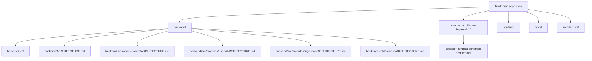
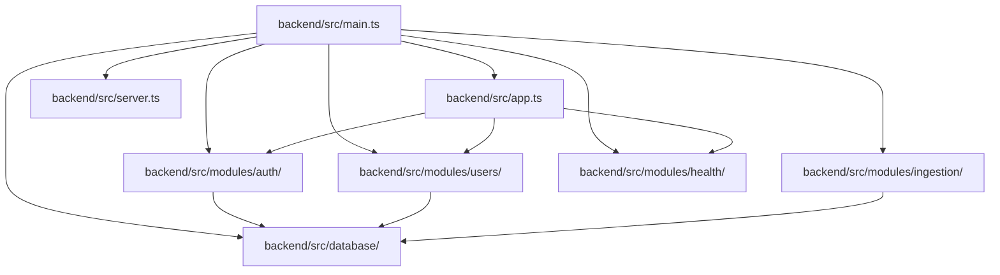
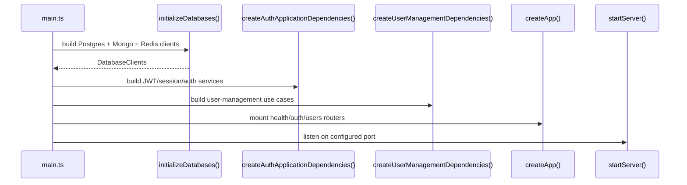

# Repository Architecture

This repository is organized around a backend runtime, a versioned collector contract package, and supporting documentation. The executable service lives in `backend/`, while the `contracts/` package defines the ingestion payloads that the backend verifies before accepting collector traffic.

## Responsibility

- Keep the runtime service, persistence layer, and feature modules in one backend boundary.
- Show how the bootstrap path wires database clients, modules, and HTTP routes.
- Keep the collector ingress contract separate from the service code so it can be versioned and validated independently.

## Boundary Map

## Startup and Runtime Wiring

## Composition Root

`backend/src/main.ts` is the real composition root. It is the only place in the bootstrap path that creates database clients, repository factories, unit-of-work wiring, and module-specific dependency objects before creating the HTTP app.

## Important Boundaries

- `backend/src/database` owns shared persistence clients and repository factories.
- `backend/src/modules/auth` owns request authentication, session validation, RBAC, and JWT issuance/refresh.
- `backend/src/modules/users` owns organization-scoped user administration and transactional audits.
- `backend/src/modules/ingestion` validates collector payload integrity before the backend trusts the message.
- `contracts/collector-ingress/v1` defines the message schema and verification fixtures consumed by the ingestion module.
