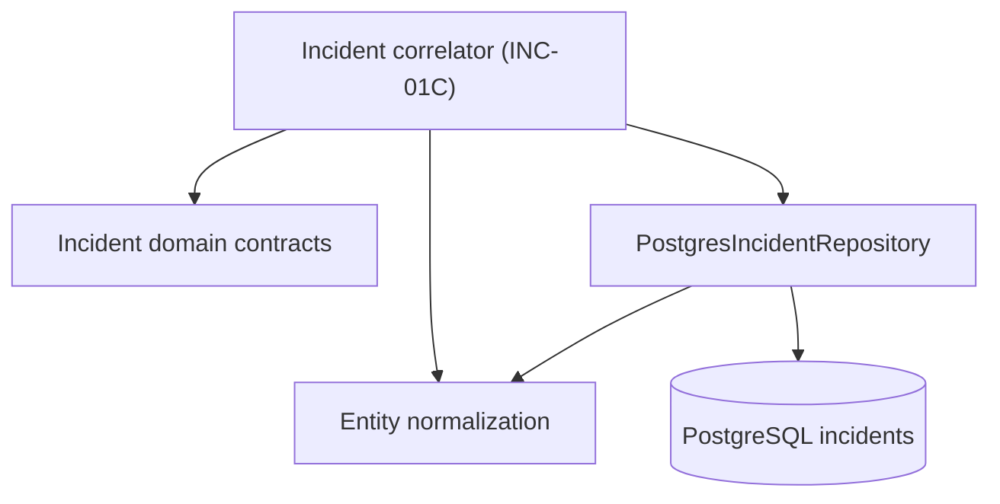

# Incidents Module

## Responsibility

This module owns the incident-domain vocabulary that will be shared by alert
merging, correlation, risk scoring, persistence, and incident-management APIs.
INC-01A provides the typed foundation only; it does not yet perform correlation
or calculate risk scores.

## Current structure

- `domain/incident.contracts.ts` defines lifecycle, severity, source, entity,
  kill-chain, score-breakdown, and correlation-candidate contracts.
- `domain/incident-entity.ts` normalizes and validates entity identities at the
  domain boundary.
- `index.ts` is the public module export surface.

PostgreSQL remains the authoritative incident store. The existing
`PostgresIncidentRepository` implements persistence and now exposes a
tenant-scoped `findOpenCandidates()` lookup for the future correlator.

## Persistence invariants

- Incident candidate queries always require an organization identifier.
- Only `open` and `investigating` incidents can be correlation candidates.
- Candidates must have activity inside the caller-provided window.
- Primary entity value and type are either both present or both absent.
- Entity and kill-chain JSONB values are arrays; score breakdown is an object.
- The correlation index starts with `org_id` to preserve the tenant boundary.

MongoDB continues to store normalized events and AI results. Incident records
and lifecycle state are stored in PostgreSQL as required by the SRS.
