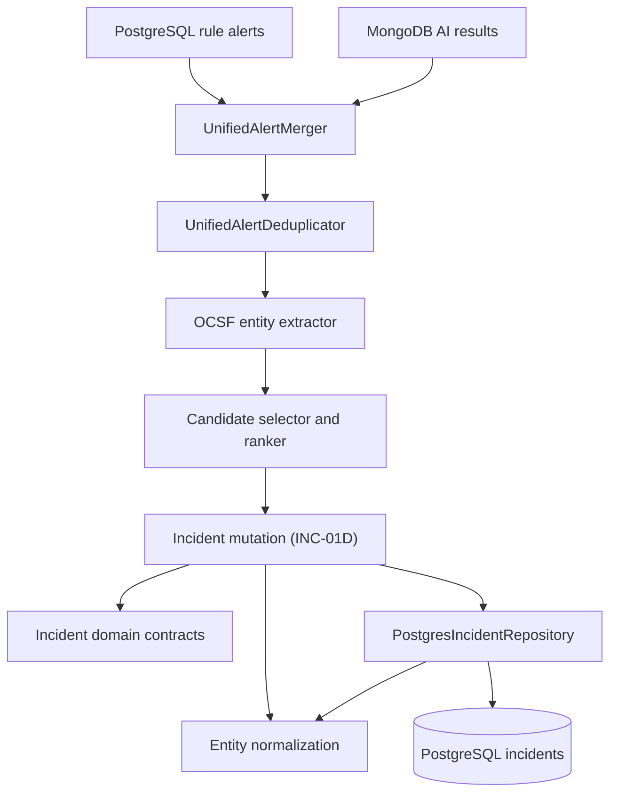

# Incidents Module

## Responsibility

This module owns the incident-domain vocabulary that will be shared by alert
merging, correlation, risk scoring, persistence, and incident-management APIs.
INC-01A provides the typed persistence foundation. INC-01B adds the boundary
that merges persisted rule detections and AI inference results into one alert
contract and removes replay duplicates. INC-01C extracts normalized OCSF
entities and selects an existing incident using tenant, entity, rolling-window,
and maximum-duration rules. Incident mutation and risk calculation remain later
milestones.

## Current structure

- `domain/incident.contracts.ts` defines lifecycle, severity, source, entity,
  kill-chain, score-breakdown, and correlation-candidate contracts.
- `domain/incident-entity.ts` normalizes and validates entity identities at the
  domain boundary.
- `domain/unified-alert.contracts.ts` defines the common rule/AI alert shape and
  structural source boundaries.
- `application/unified-alert-merger.ts` converts PostgreSQL rule alerts and
  anomalous MongoDB AI results into the common shape.
- `application/unified-alert-id.ts` derives replay-stable UUIDv8 identities for
  AI anomalies.
- `application/unified-alert-deduplicator.ts` computes deterministic SHA-256
  deduplication keys and rejects identity collisions.
- `application/unified-alert-entity-extractor.ts` joins alert event IDs to
  normalized OCSF events and attaches normalized correlation entities.
- `application/incident-candidate-ranker.ts` queries eligible PostgreSQL
  candidates, enforces the 15-minute/24-hour limits, and ranks matches.
- `index.ts` is the public module export surface.

PostgreSQL remains the authoritative incident store. The existing
`PostgresIncidentRepository` implements persistence and now exposes a
tenant-scoped `findOpenCandidates()` lookup for the future correlator.

## Persistence invariants

- Incident candidate queries always require an organization identifier.
- Only `open` and `investigating` incidents can be correlation candidates.
- Candidates must have activity inside the caller-provided window.
- Primary entity value and type are either both present or both absent.
- Entity and kill-chain JSONB values are arrays; score breakdown is an object.
- The correlation index starts with `org_id` to preserve the tenant boundary.

MongoDB continues to store normalized events and AI results. Incident records
and lifecycle state are stored in PostgreSQL as required by the SRS.

## Unified-alert invariants

- The caller supplies one organization and every source record must match it.
- Only AI results with `is_anomaly=true` become unified alerts.
- Rule and AI alerts remain distinct even when they reference the same event.
- Rule deduplication identity is rule ID plus sorted matched-event IDs.
- AI deduplication identity is model name, model version, and event ID.
- AI alert IDs are deterministic UUIDv8 values, making retries replay-safe.
- Conflicting security content under the same deduplication identity is rejected.

## Correlation matching invariants

- Alert and normalized-event organization IDs must match the requested tenant.
- OCSF users, hosts, and IP addresses are normalized before comparison.
- Only configured entity types participate in candidate lookup and ranking.
- Candidate status must be `open` or `investigating`.
- Activity at exactly 15 minutes is eligible; anything later is excluded.
- An incident at exactly 24 hours is expired and cannot receive another alert.
- Ranking order is entity overlap, recent activity, matching source, creation
  time, then incident ID for a deterministic final tie-break.
