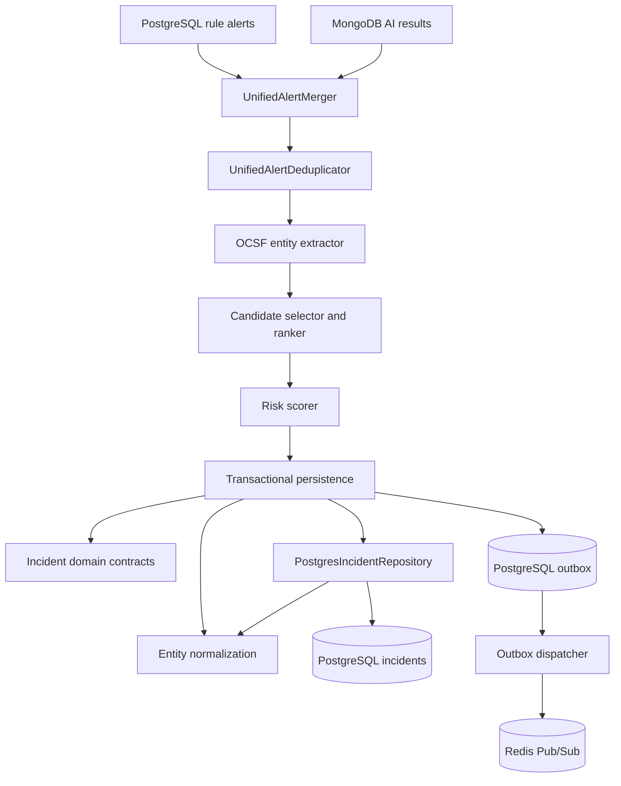

# Incidents Module

## Responsibility

This module owns the incident-domain vocabulary that will be shared by alert
merging, correlation, risk scoring, persistence, and incident-management APIs.
INC-01A provides the typed persistence foundation. INC-01B adds the boundary
that merges persisted rule detections and AI inference results into one alert
contract and removes replay duplicates. INC-01C extracts normalized OCSF
entities and selects an existing incident using tenant, entity, rolling-window,
and maximum-duration rules. INC-01D adds deterministic composite risk scoring,
severity classification, and tenant-scoped asset criticality resolution.
INC-01E adds transactional creation/update, alert and event linkage, audit
records, replay protection, and production-worker integration.
INC-01F adds a transactional PostgreSQL notification outbox, lease-based
concurrent dispatch, bounded retry/dead-letter handling, and Redis-side
publish deduplication for real-time incident channels.

## Current structure

- `domain/incident.contracts.ts` defines lifecycle, severity, source, entity,
  kill-chain, score-breakdown, and correlation-candidate contracts.
- `domain/incident-entity.ts` normalizes and validates entity identities at the
  domain boundary.
- `domain/unified-alert.contracts.ts` defines the common rule/AI alert shape and
  structural source boundaries.
- `application/unified-alert-merger.ts` converts PostgreSQL rule alerts and
  anomalous MongoDB AI results into the common shape.
- `application/unified-alert-id.ts` derives replay-stable UUIDv8 identities for
  AI anomalies.
- `application/unified-alert-deduplicator.ts` computes deterministic SHA-256
  deduplication keys and rejects identity collisions.
- `application/unified-alert-entity-extractor.ts` joins alert event IDs to
  normalized OCSF events and attaches normalized correlation entities.
- `application/incident-candidate-ranker.ts` queries eligible PostgreSQL
  candidates, enforces the 15-minute/24-hour limits, and ranks matches.
- `application/incident-risk-scorer.ts` computes the five-factor risk score,
  produces its audit breakdown, and maps the result to incident severity.
- `infrastructure/repository-asset-criticality-resolver.ts` adapts the existing
  asset repository to the scoring port without exposing SQL to domain logic.
- `application/transactional-incident-correlator.ts` owns the complete atomic
  create/update/replay flow.
- `infrastructure/postgres-incident-correlation-unit-of-work.ts` binds that flow
  to retrying SERIALIZABLE PostgreSQL transactions.
- `application/incident-notification.ts` creates deterministic notification
  identities and the documented dashboard payload.
- `application/incident-notification-dispatcher.ts` leases pending rows and
  applies bounded retry/dead-letter policy.
- `infrastructure/redis-incident-notification.publisher.ts` atomically guards
  Redis Pub/Sub publication with a stable deduplication marker.
- `infrastructure/incident-notification-dispatcher.runner.ts` polls without
  overlapping batches and drains safely during worker shutdown.
- `index.ts` is the public module export surface.

PostgreSQL remains the authoritative incident store. The existing
`PostgresIncidentRepository` implements persistence and now exposes a
tenant-scoped `findOpenCandidates()` lookup for the future correlator.

## Persistence invariants

- Incident candidate queries always require an organization identifier.
- Only `open` and `investigating` incidents can be correlation candidates.
- Candidates must have activity inside the caller-provided window.
- Primary entity value and type are either both present or both absent.
- Entity and kill-chain JSONB values are arrays; score breakdown is an object.
- The correlation index starts with `org_id` to preserve the tenant boundary.

MongoDB continues to store normalized events and AI results. Incident records
and lifecycle state are stored in PostgreSQL as required by the SRS.

## Unified-alert invariants

- The caller supplies one organization and every source record must match it.
- Only AI results with `is_anomaly=true` become unified alerts.
- Rule and AI alerts remain distinct even when they reference the same event.
- Rule deduplication identity is rule ID plus sorted matched-event IDs.
- AI deduplication identity is model name, model version, and event ID.
- AI alert IDs are deterministic UUIDv8 values, making retries replay-safe.
- Conflicting security content under the same deduplication identity is rejected.

## Correlation matching invariants

- Alert and normalized-event organization IDs must match the requested tenant.
- OCSF users, hosts, and IP addresses are normalized before comparison.
- Only configured entity types participate in candidate lookup and ranking.
- Candidate status must be `open` or `investigating`.
- Activity at exactly 15 minutes is eligible; anything later is excluded.
- An incident at exactly 24 hours is expired and cannot receive another alert.
- Ranking order is entity overlap, recent activity, matching source, creation
  time, then incident ID for a deterministic final tie-break.

## Risk-scoring invariants

- The authoritative weights are `0.30/0.25/0.20/0.15/0.10` and must sum to 1.
- Missing rule, trustworthy AI, and asset signals use the neutral value `0.5`.
- AI fallback results do not count as observed ML confidence.
- Kill-chain scoring contributes zero while the feature is disabled.
- Alert density saturates at 20 alerts by default.
- Scores are rounded to two decimal places and classified at 20/40/60/80.
- Duplicate alerts and cross-tenant inputs fail closed before scoring.

## Transactional correlation invariants

- Candidate selection uses row locks inside a retrying SERIALIZABLE transaction.
- Alerts can only transition from unassigned to one incident; reassignment is rejected.
- AI and rule alerts use stable IDs and idempotent inserts.
- Incident-event links use the database uniqueness identity and conflict-safe inserts.
- Replayed alerts short-circuit without changing counts, links, risk, or audit history.
- Incident updates, event links, alert attachment, scoring, and audit writes commit or roll back together.
- Incidents are capped at 500 alerts; overflow begins a new incident.

## Notification outbox invariants

- Incident, audit, and notification-outbox writes share one PostgreSQL transaction.
- Notification IDs and deduplication keys are deterministic per incident event and causation ID.
- Replayed alerts cannot create another outbox row.
- Claiming uses expiring leases and `FOR UPDATE SKIP LOCKED` semantics.
- Redis publication and its deduplication marker execute in one Lua script.
- A crash after Redis publication but before PostgreSQL acknowledgement does not republish while the marker exists.
- Failed rows use bounded exponential backoff and become `dead_letter` after eight attempts.
- Payloads contain the tenant ID so the WebSocket layer can enforce organization routing.
