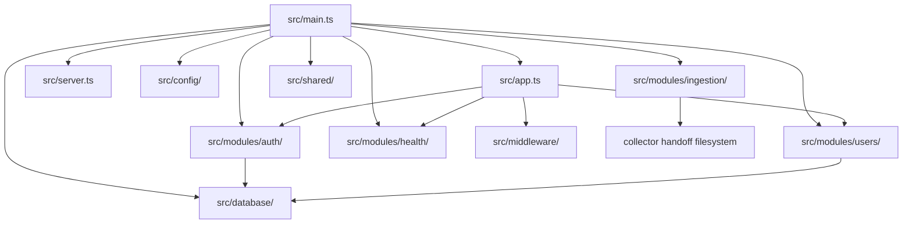
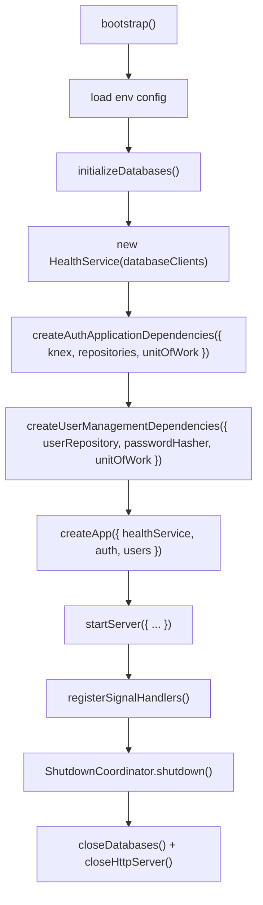
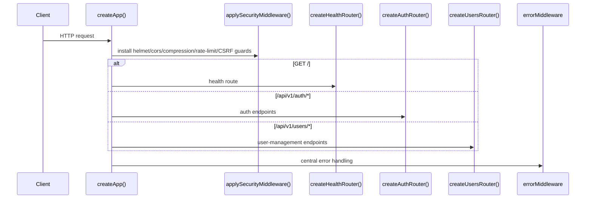
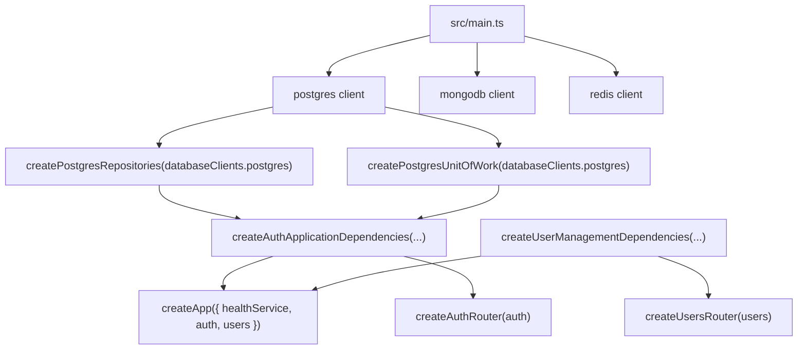

# Backend Architecture

The backend is a modular Express service with a single composition root in `src/main.ts`. It creates shared database clients and repository factories, builds module-level dependency graphs, mounts HTTP routes, and closes resources through a shutdown coordinator. The current implementation also includes a collector-ingestion security boundary that is configured from runtime trust settings.

## Responsibility

- Initialize configuration, Postgres, MongoDB, and Redis before the service listens for traffic.
- Assemble module dependencies for auth, users, health, ingestion, and incidents.
- Mount routes in `app.ts` and start the HTTP listener in `server.ts`.
- Apply global security middleware and centralized error handling.
- Handle graceful shutdown through `ShutdownCoordinator`.

## Layer Map

## Startup Flow

## Request Flow

## Dependency Injection Architecture

The actual composition root is `src/main.ts`. It creates database clients, repository objects, and module builders and then passes them into the Express app.

## Data and Security Flow

- `applySecurityMiddleware()` in `src/middleware/security/index.ts` runs before routes are mounted.
- Auth routes use Redis-backed rate limiting and then `authenticateRequest()` from the auth module to verify cookies or bearer tokens.
- User routes require a valid authenticated principal and `users.manage` permission via `requirePermission()`.
- Incident status and assignment mutations run through retrying SERIALIZABLE
  units of work. Assignment additionally requires `incidents.assign`, validates
  an active same-tenant user, and commits the mutation with immutable audit.
- Incident notes use the same tenant-scoped transaction boundary; the raw
  Markdown note and its timeline-compatible immutable audit record commit or
  roll back together.
- Incident resolution requires an investigating incident and a classified
  reason. Its status update, optional note, and immutable reason-bearing audit
  record commit through the same tenant-scoped SERIALIZABLE boundary.
- SYS-01A adds a read-only end-to-end evidence boundary. It cross-checks one
  real event across verified raw archive, normalized event, feature vector, AI
  result, alerts, incident, audit, notification outbox, Redis publication, and
  Collector heartbeat records. It emits text and JSON reports but never writes
  operational data or converts missing evidence into success.
- `initializeDatabases()` verifies Postgres, MongoDB, and Redis connectivity concurrently and aborts startup if any dependency fails.
- `env.collector.trust` now carries the collector identity, HMAC key ID, and HMAC secret used to seed the ingestion trust store.
- `ShutdownCoordinator` makes shutdown best-effort: each registered resource receives a close attempt, and failures are reported explicitly.

## Important Components

- [`src/main.ts`](./src/main.ts): bootstrap and dependency assembly.
- [`src/app.ts`](./src/app.ts): Express app creation and route mounting.
- [`src/server.ts`](./src/server.ts): HTTP listener startup.
- [`src/database/ARCHITECTURE.md`](./src/database/ARCHITECTURE.md): database lifecycle and repositories.
- [`src/modules/auth/ARCHITECTURE.md`](./src/modules/auth/ARCHITECTURE.md): authentication, tokens, and RBAC.
- [`src/modules/users/ARCHITECTURE.md`](./src/modules/users/ARCHITECTURE.md): user management and transactional mutations.
- [`src/modules/incidents/ARCHITECTURE.md`](./src/modules/incidents/ARCHITECTURE.md): incident correlation, query, and transactional command invariants.
- [`src/modules/system-proof/ARCHITECTURE.md`](./src/modules/system-proof/ARCHITECTURE.md): fail-closed end-to-end evidence verification.
- [`src/modules/ingestion/ARCHITECTURE.md`](./src/modules/ingestion/ARCHITECTURE.md): collector integrity verification.
