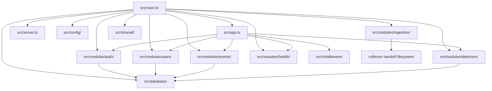
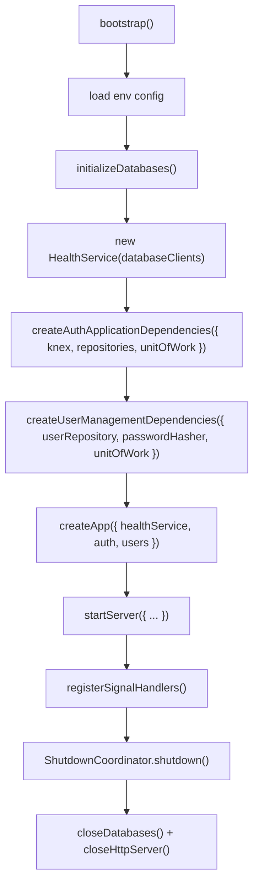
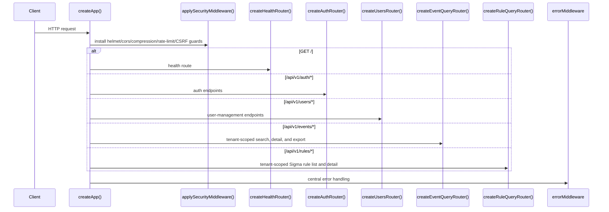
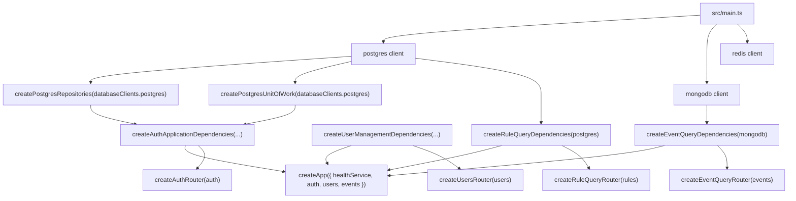

# Backend Architecture

The backend is a modular Express service with a single composition root in `src/main.ts`. It creates shared database clients and repository factories, builds module-level dependency graphs, mounts HTTP routes, and closes resources through a shutdown coordinator. The current implementation also includes a collector-ingestion security boundary that is configured from runtime trust settings.

## Responsibility

- Initialize configuration, Postgres, MongoDB, and Redis before the service listens for traffic.
- Assemble module dependencies for auth, users, health, ingestion, incidents,
  Collector monitoring, event investigation, Sigma rule queries, and system proof.
- Mount routes in `app.ts` and start the HTTP listener in `server.ts`.
- Apply global security middleware and centralized error handling.
- Handle graceful shutdown through `ShutdownCoordinator`.

## Layer Map

## Startup Flow

## Request Flow

## Dependency Injection Architecture

The actual composition root is `src/main.ts`. It creates database clients, repository objects, and module builders and then passes them into the Express app.

## Data and Security Flow

- `applySecurityMiddleware()` in `src/middleware/security/index.ts` runs before routes are mounted.
- Auth routes use Redis-backed rate limiting and then `authenticateRequest()` from the auth module to verify cookies or bearer tokens.
- User routes require a valid authenticated principal and `users.manage` permission via `requirePermission()`.
- Incident status and assignment mutations run through retrying SERIALIZABLE
  units of work. Assignment additionally requires `incidents.assign`, validates
  an active same-tenant user, and commits the mutation with immutable audit.
- Incident notes use the same tenant-scoped transaction boundary; the raw
  Markdown note and its timeline-compatible immutable audit record commit or
  roll back together.
- Incident resolution requires an investigating incident and a classified
  reason. Its status update, optional note, and immutable reason-bearing audit
  record commit through the same tenant-scoped SERIALIZABLE boundary.
- SYS-01A adds a read-only end-to-end evidence boundary. It cross-checks one
  real event across verified raw archive, normalized event, feature vector, AI
  result, alerts, incident, audit, notification outbox, Redis publication, and
  Collector heartbeat records. It emits text and JSON reports but never writes
  operational data or converts missing evidence into success.
- LOG-01A adds an authenticated event-investigation boundary. It performs
  mandatory tenant-scoped MongoDB search and detail queries, joins the latest
  same-tenant AI/SHAP evidence for detail views, and produces bounded CSV/JSON
  exports without exposing raw archives or tenant identifiers.
- RULE-02A adds authenticated Sigma rule listing and detail reads. PostgreSQL
  queries enforce the principal's organization on rules and alert aggregates;
  list DTOs omit YAML while detail DTOs expose source without tenant metadata.
- RULE-02B adds Admin/Security Engineer rule creation. It compiles bounded YAML
  before atomically committing the tenant rule and immutable audit event, then
  publishes a revisioned Redis signal so the processing worker reloads its
  organization cache without restart.
- RULE-02C adds Admin/Security Engineer rule update and enable/disable commands.
  Tenant-scoped row locks protect version increments and status transitions;
  each real mutation commits with immutable audit history before the same
  post-commit worker reload path is signaled.
- RULE-02D completes rule operations with Admin-only soft archive, bounded
  partial-result YAML import, status-filtered YAML export, and side-effect-free
  historical match/count dry-run. PostgreSQL/MongoDB reads remain tenant
  scoped, and only committed mutations trigger worker reload.
- ASSET-01A exposes the asset registry through authenticated tenant-scoped
  list/detail APIs and transactional create/update/deactivate commands. Every
  real mutation commits with immutable audit history, and ID-based reads,
  locks, and writes repeat the trusted organization predicate.
- DASH-01A adds authenticated, tenant-scoped dashboard aggregations across
  PostgreSQL incidents/alerts, MongoDB normalized events, and the existing
  cached AI health monitor. Time ranges, bucket counts, and top-entity results
  are bounded, and only aggregate DTOs leave the module.
- AUDIT-01A exposes the immutable audit trail to Admin and Security Engineer
  roles through a tenant-derived, read-only investigation API. Its filters,
  time horizon, pagination, and sorting are bounded; internal tenant and state
  snapshot fields never leave the query boundary.
- CONFIG-01A exposes global non-sensitive configuration to Admin and permits
  transactional managed-key updates. General changes remain Admin-only;
  Security Engineer receives only the explicit AI-threshold command. Each real
  mutation uses a row lock and commits with immutable audit history.
- WS-01A adds the `/ws` real-time gateway. Upgrade authentication revalidates
  the cookie JWT, database session, active user, and frontend origin; exact
  Redis incident channels are routed only to connections bound to the payload
  organization. Frame, message, heartbeat, and per-session connection limits
  protect the long-lived transport.
- `initializeDatabases()` verifies Postgres, MongoDB, and Redis connectivity concurrently and aborts startup if any dependency fails.
- `env.collector.trust` now carries the collector identity, HMAC key ID, and HMAC secret used to seed the ingestion trust store.
- `ShutdownCoordinator` makes shutdown best-effort: each registered resource receives a close attempt, and failures are reported explicitly.

## Important Components

- [`src/main.ts`](./src/main.ts): bootstrap and dependency assembly.
- [`src/app.ts`](./src/app.ts): Express app creation and route mounting.
- [`src/server.ts`](./src/server.ts): HTTP listener startup.
- [`src/database/ARCHITECTURE.md`](./src/database/ARCHITECTURE.md): database lifecycle and repositories.
- [`src/modules/auth/ARCHITECTURE.md`](./src/modules/auth/ARCHITECTURE.md): authentication, tokens, and RBAC.
- [`src/modules/users/ARCHITECTURE.md`](./src/modules/users/ARCHITECTURE.md): user management and transactional mutations.
- [`src/modules/incidents/ARCHITECTURE.md`](./src/modules/incidents/ARCHITECTURE.md): incident correlation, query, and transactional command invariants.
- [`src/modules/system-proof/ARCHITECTURE.md`](./src/modules/system-proof/ARCHITECTURE.md): fail-closed end-to-end evidence verification.
- [`src/modules/events/ARCHITECTURE.md`](./src/modules/events/ARCHITECTURE.md): tenant-safe OCSF event search, detail, AI evidence, and export.
- [`src/modules/detection/ARCHITECTURE.md`](./src/modules/detection/ARCHITECTURE.md): Sigma evaluation and tenant-safe rule query APIs.
- [`src/modules/assets/ARCHITECTURE.md`](./src/modules/assets/ARCHITECTURE.md): tenant-safe asset inventory queries and transactional commands.
- [`src/modules/dashboard/ARCHITECTURE.md`](./src/modules/dashboard/ARCHITECTURE.md): bounded tenant dashboard analytics across PostgreSQL and MongoDB.
- [`src/modules/audit/ARCHITECTURE.md`](./src/modules/audit/ARCHITECTURE.md): tenant-safe immutable audit investigation.
- [`src/modules/configuration/ARCHITECTURE.md`](./src/modules/configuration/ARCHITECTURE.md): secure global configuration query and transactional management.
- [`src/modules/realtime/ARCHITECTURE.md`](./src/modules/realtime/ARCHITECTURE.md): authenticated tenant-scoped Redis-to-WebSocket delivery.
- [`src/modules/ingestion/ARCHITECTURE.md`](./src/modules/ingestion/ARCHITECTURE.md): collector integrity verification.
