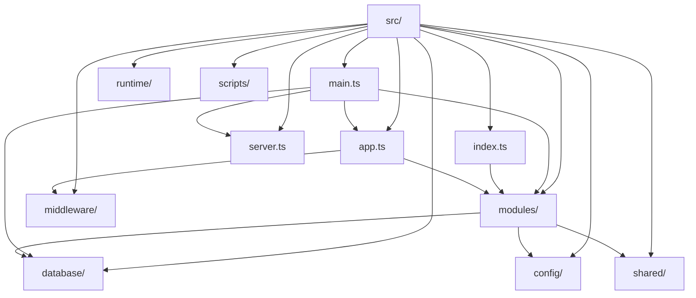
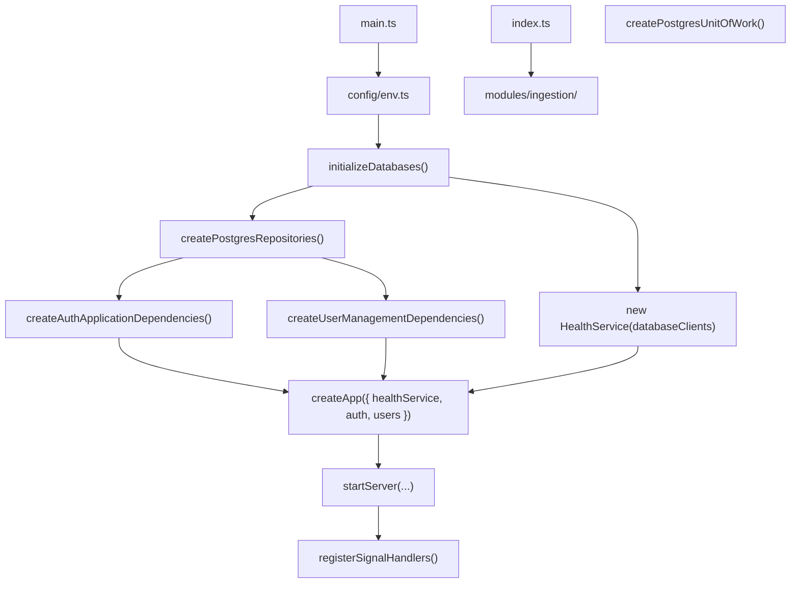
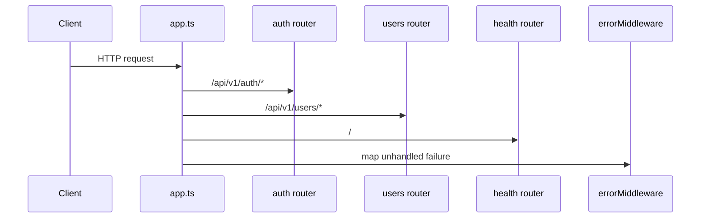
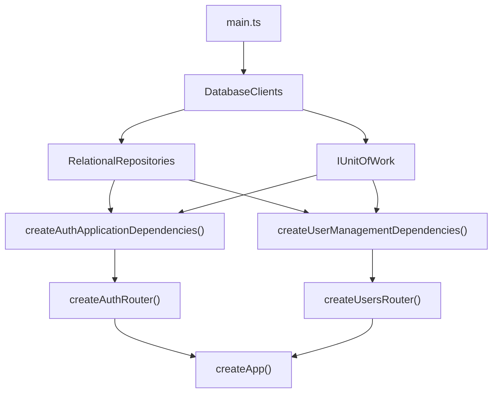

# Backend Source Architecture

`src/` is the executable service root for the backend. The entrypoint is `main.ts`, request assembly is in `app.ts`/`server.ts`, persistence is in `database/`, feature behavior is in `modules/`, and shared functions live in `config/`, `middleware/`, `runtime/`, and `shared/`. `index.ts` is the public barrel that re-exports module APIs, including the ingestion verifier and collector trust helpers. The ingestion module also consumes collector trust settings from `config/env.ts` and a filesystem handoff boundary inside `modules/ingestion/`.

## Responsibility

- Define the backend source-tree architecture and its runtime boundaries.
- Show how bootstrap code wires modules into the Express application.
- Separate infrastructure (`database/`), request handling (`middleware/`), runtime lifecycle (`runtime/`), and business features (`modules/`).

## Folder Map

## Runtime Startup Flow

## Request Path

## Dependency Injection and Wiring

The composition root is `main.ts`, not a framework container. Runtime objects are created explicitly and passed as constructor or factory dependencies.

## Important Components

- [`main.ts`](./main.ts): runtime composition root and graceful shutdown wiring.
- [`app.ts`](./app.ts): Express assembly and route mounting.
- [`server.ts`](./server.ts): application listener startup.
- [`config/`](./config): environment and runtime settings.
- [`database/`](./database/ARCHITECTURE.md): shared persistence and repository lifecycle.
- [`modules/auth/`](./modules/auth): JWT-session authentication and RBAC.
- [`modules/users/`](./modules/users): user management and transactional mutations.
- [`modules/ingestion/`](./modules/ingestion): collector verification and trust checks.
- [`middleware/`](./middleware): security and error middleware.
- [`runtime/`](./runtime): process shutdown orchestration.
- [`shared/`](./shared): logging and common utilities.
