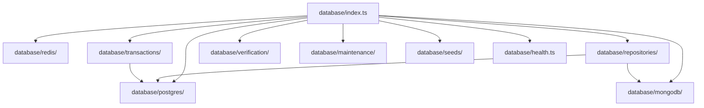
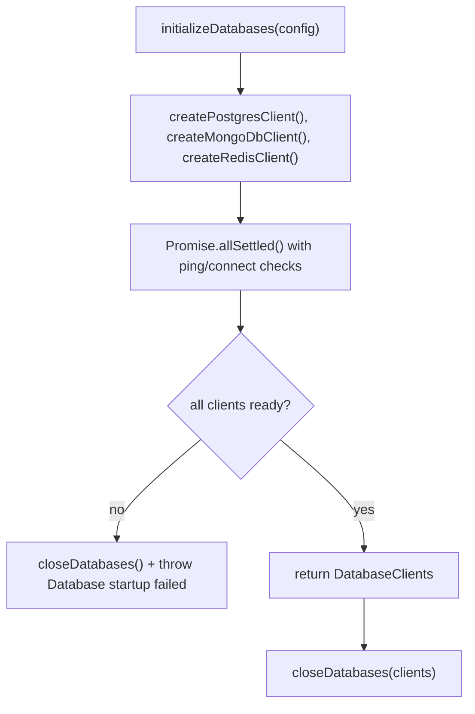
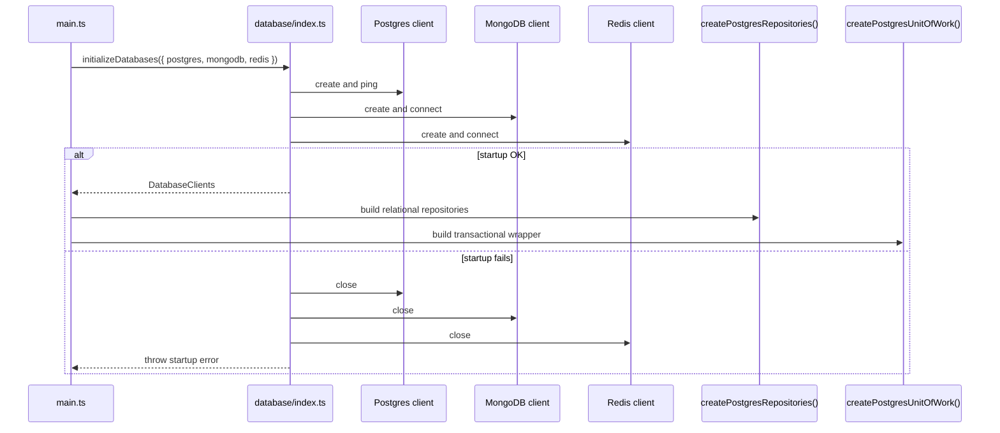
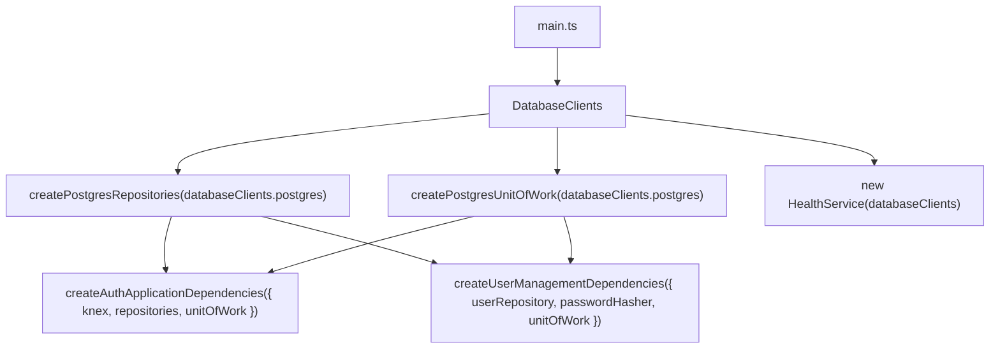

# Database Architecture

The database layer is the infrastructure boundary that owns client lifecycle, repository factories, transaction boundaries, and availability checks for Postgres, MongoDB, and Redis. It is consumed by the application modules but intentionally kept behind repository and unit-of-work abstractions.

## Responsibility

- Create and validate database clients for Postgres, MongoDB, and Redis.
- Expose repository factories for relational and Mongo collections.
- Provide a PostgreSQL `IUnitOfWork` implementation for multi-step operations.
- Support maintenance, verification, and bootstrap scripts for operational readiness.
- Persist ordered Collector heartbeat state and atomically expire stale Collectors.

## Boundary Map

## Startup and Shutdown Flow

## Runtime Sequence

## Dependency Injection and Consumption

The database layer is created in the backend composition root and then injected as shared infrastructure into feature modules.

## Concrete Data Stores

- Postgres is the primary relational store for users, sessions, audit records, roles, incidents, configuration, and queue metrics.
- MongoDB is used for event-style or document-oriented storage.
- Redis is used for rate limiting, queueing, and cache-like short-lived data.
- Higher-level modules depend on repository abstractions and the unit-of-work contract instead of directly constructing raw database clients.

## Collector Heartbeat Persistence

`PostgresCollectorStatusRepository.upsertHeartbeat()` prevents an older `last_heartbeat_at` from overwriting newer state at the database conflict boundary. Fields omitted by a heartbeat, such as `files_processed`, retain their existing values. `markStaleOffline()` atomically changes only stale `online` and `degraded` rows to `offline`, with optional organization scoping, so concurrent fresh writes remain protected by their timestamps.

## Important Components

- [`index.ts`](./index.ts): bootstrap, startup verification, and shutdown orchestration.
- [`postgres/`](./postgres): Postgres client configuration and health checks.
- [`mongodb/`](./mongodb): MongoDB client bootstrap and helpers.
- [`redis/`](./redis): Redis client and verification helpers.
- [`repositories/`](./repositories): repository abstractions and Postgres/Mongo adapters.
- [`transactions/`](./transactions): `PostgresUnitOfWork` and transaction primitives.
- [`verification/`](./verification): database readiness checks used during startup.
- [`maintenance/`](./maintenance): maintenance tasks for Postgres operations.
- [`seeds/`](./seeds): baseline and development data seeding. Development
  seeding commits the PostgreSQL transaction first and then idempotently
  reconciles the matching MongoDB normalized events and AI results. A rerun
  safely repairs a partial cross-store seed, and status reports whether all
  deterministic MongoDB demo records are present.
- [`health.ts`](./health.ts): aggregated health summary for database services.

## Incident query indexes

INC-02A adds concurrent PostgreSQL indexes that begin with `org_id` for each
allowlisted incident-list sort, plus GIN trigram indexes for title,
description, and primary-entity search. The incident query adapter always
combines these paths with a trusted organization predicate. The migration is
non-transactional only because PostgreSQL requires that for
`CREATE INDEX CONCURRENTLY`.

INC-02D adds a GIN `jsonb_path_ops` index for exact incident-entity containment
and partial active-asset indexes prefixed by `org_id` for IP address and
case-insensitive hostname/name matching. Its migration is likewise
non-transactional because every index is created concurrently.

## Incident command repository boundaries

Incident mutations use tenant-scoped repository methods even after a
tenant-scoped row lock. `transitionStatusForOrg()` and `assignForOrg()` both
include `org_id` in the update predicate as defense in depth. Assignment user
validation uses `findByIdAndOrg()` on the transaction-bound user repository,
so the incident update, user check, and immutable audit insertion share one
PostgreSQL transaction and cannot cross organization boundaries.

INC-03C creates incident notes only after `findByIdForUpdate()` confirms the
incident belongs to the trusted organization. The transaction-bound note and
audit repositories then commit together. Migration
`20261020000100_inc_03c_incident_notes.js` adds the timeline-compatible
`incident_note_added` audit action and enforces the 10,000-character content
limit at the database boundary.

INC-03D resolves incidents through the same locked, tenant-scoped command
boundary. The status update, optional `incident_notes` insert, and immutable
reason-bearing audit share one transaction. Migration
`20261020000200_inc_03d_incident_resolution.js` extends the audit action enum
with `incident_resolve`; because the incident table has no resolution-reason
column, this immutable audit event is the authoritative classification source
and is projected into the incident timeline as a status change.

