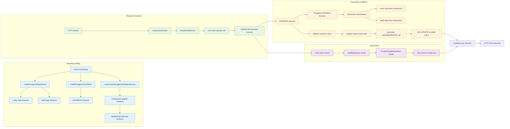

# Actual class/interface flow for PUT /users/:id

This file explains exactly when the PostgreSQL repository object is passed into the mutation flow.

## The key point

The Postgres repo object is not passed directly from the controller to the update method.

It is passed indirectly through the transaction context:

1. `main.ts` creates the real Postgres repositories.
2. `createUserManagementDependencies(...)` creates a transaction adapter.
3. `UpdateUserUseCase.execute(...)` calls `this.unitOfWork.execute(...)`.
4. Inside the transaction callback, the unit of work provides `repositories`.
5. That `repositories.users` is the actual `PostgresUserRepository` instance.
6. It is wrapped in `UserMutationRepositoryAdapter`, and only then is its `updateUser(...)` method called.



## Actual code path

### 1) Repository objects are created once at bootstrap

In [src/main.ts](../main.ts):

- `const repositories = createPostgresRepositories(databaseClients.postgres);`
- `const unitOfWork = createPostgresUnitOfWork(databaseClients.postgres);`

The actual Postgres repo instance is created here:

- [src/database/repositories/postgres-repository.factory.ts](../database/repositories/postgres-repository.factory.ts)

```ts
return {
  users: new PostgresUserRepository(client),
  audit: new PostgresAuditRepository(client),
};
```

So `repositories.users` is a real `PostgresUserRepository` instance.

### 2) The repo is passed into the app dependency container

In [src/main.ts](../main.ts):

```ts
const UserManagementDependencies = createUserManagementDependencies({
  userRepository: repositories.users,
  userCreationRepository: repositories.users,
  passwordHasher: authApplicationDependencies.passwordService,
  unitOfWork,
});
```

That means the management composition layer receives the actual Postgres repo object.

### 3) The use case receives a transaction adapter, not the repo directly

In [src/modules/users/composition/user-management.dependencies.ts](../modules/users/composition/user-management.dependencies.ts):

```ts
const userMutationUnitOfWork = new PostgresUserMutationUnitOfWorkAdapter(input.unitOfWork);
const updateUserUseCase = new UpdateUserUseCase(userMutationUnitOfWork);
```

The `UpdateUserUseCase` only knows about `IUserMutationUnitOfWork`.

### 4) The actual Postgres repo is injected during transaction execution

Inside `PostgresUserMutationUnitOfWorkAdapter.execute(...)`:

```ts
return this.unitOfWork.execute(
  async ({ repositories }) => operation({
    users: new UserMutationRepositoryAdapter(repositories.users),
    audit: new UserMutationAuditWriterAdapter(repositories.audit),
  }),
  { ... }
);
```

This is the exact moment when the real repository object is handed over:

- `repositories.users` -> actual `PostgresUserRepository`
- wrapped as `new UserMutationRepositoryAdapter(repositories.users)`

Now the domain layer can call:

```ts
await users.updateUser({ userId, orgId, role, displayName });
```

### 5) That adapter calls the repo method

In [src/modules/users/infrastructure/user-mutation.repository.adapter.ts](../modules/users/infrastructure/user-mutation.repository.adapter.ts):

```ts
public async updateUser(input: UpdateManagedUserInput): Promise<MutatedManagedUser | null> {
  const user = await this.userRepository.updateByIdAndOrg(input.userId, input.orgId, {
    role: input.role,
    displayName: input.displayName,
  });
  return user === null ? null : mapUser(user);
}
```

At this point, `this.userRepository` is the actual `PostgresUserRepository` object created earlier.

### 6) The real SQL executes in the Postgres repository

In [src/database/repositories/users/postgres-user.repository.ts](../database/repositories/users/postgres-user.repository.ts):

```ts
const [row] = await this.db<UserRow>(USERS_TABLE)
  .where("id", ensureNonBlank(id, "id"))
  .andWhere("org_id", ensureNonBlank(orgId, "orgId"))
  .update(patch)
  .returning("*");
```

That is the actual database update.

## Short answer to your question

The Postgres repo object is sent into the update flow when the transaction callback runs:

- `unitOfWork.execute(...)`
- inside that callback: `repositories.users`
- then `new UserMutationRepositoryAdapter(repositories.users)`
- then `this.userRepository.updateByIdAndOrg(...)`

So the real DB object is not injected into the controller; it is injected into the transaction context at runtime and then wrapped by the repository adapter before the update executes.
