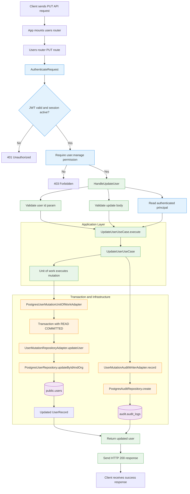

# PUT /users/:id update flow

This document explains how a request to update a user is executed end-to-end in this backend.

## Step-by-step execution

1. The app mounts the users router.
   - [src/app.ts](../app.ts) does `app.use(`${apiPrefix}/users`, createUsersRouter(users))`.
   - With default config, the route is `PUT /api/v1/users/:id`.

2. The request enters the route.
   - [src/modules/users/http/user.routes.ts](../modules/users/http/user.routes.ts)
   - `router.put('/:id', authenticateRequest(...), requirePermission('users.manage'), ...)`
   - This calls the auth middleware and RBAC check before the update handler runs.

3. Request validation happens in the HTTP layer.
   - `getUserParamsSchema.parse(req.params)` validates the UUID path param.
   - `updateUserBodySchema.parse(req.body)` validates the update payload.
   - The schema is defined in [src/modules/users/http/user.schema.ts](../modules/users/http/user.schema.ts).

4. Authenticated principal is attached to the request.
   - [src/modules/auth/http/auth.middleware.ts](../modules/auth/http/auth.middleware.ts)
   - `authenticateRequest` verifies the JWT, checks the session and user validity, and sets `request.user`.
   - `requirePermission('users.manage')` checks whether the user has the required permission.

5. The HTTP layer calls the application use case.
   - [src/modules/users/http/user.routes.ts](../modules/users/http/user.routes.ts)
   - `handleUpdateUser` calls `dependencies.updateUserUseCase.execute({...})`

6. The application layer delegates to a transactional unit of work.
   - [src/modules/users/application/use-case/update-user.use-case.ts](../modules/users/application/use-case/update-user.use-case.ts)
   - `UpdateUserUseCase.execute` runs inside `this.unitOfWork.execute(async ({ users, audit }) => ...)`.
   - This ensures the user update and audit insert happen in one transaction.

7. The repository adapter updates the users table.
   - [src/modules/users/infrastructure/user-mutation.repository.adapter.ts](../modules/users/infrastructure/user-mutation.repository.adapter.ts)
   - `UserMutationRepositoryAdapter.updateUser()` calls `this.userRepository.updateByIdAndOrg(...)`.

8. The persistence layer performs the actual SQL update.
   - [src/database/repositories/users/postgres-user.repository.ts](../database/repositories/users/postgres-user.repository.ts)
   - `updateByIdAndOrg()` builds a patch and executes:
     `UPDATE public.users WHERE id = ? AND org_id = ? RETURNING *`

9. A matching audit row is inserted.
   - [src/modules/users/composition/user-management.dependencies.ts](../modules/users/composition/user-management.dependencies.ts)
   - `UserMutationAuditWriterAdapter.record()` calls `auditRepository.create(...)`.
   - The actual insert is executed by [src/database/repositories/audit/postgres-audit.repository.ts](../database/repositories/audit/postgres-audit.repository.ts) into `audit.audit_logs`.

10. The response is returned to the client.
    - The use case maps the updated record to `{ id, role, displayName, updatedAt }`.
    - The route sends `res.status(200).json(result)`.

## Key classes interacting in this flow

- HTTP route: `createUsersRouter` / `handleUpdateUser`
- Auth middleware: `authenticateRequest`, `requirePermission`
- Application use case: `UpdateUserUseCase`
- Unit of work adapter: `PostgresUserMutationUnitOfWorkAdapter`
- Repository adapter: `UserMutationRepositoryAdapter`
- Persistence repository: `PostgresUserRepository`
- Audit writer adapter: `UserMutationAuditWriterAdapter`
- Audit repository: `PostgresAuditRepository`

## Important execution detail

The update is not performed by a direct repository call in the controller. The request goes through the full layered architecture:

HTTP route -> auth/permission middleware -> use case -> transaction/unit of work -> repository adapter -> Postgres repository -> audit repository -> HTTP response.
