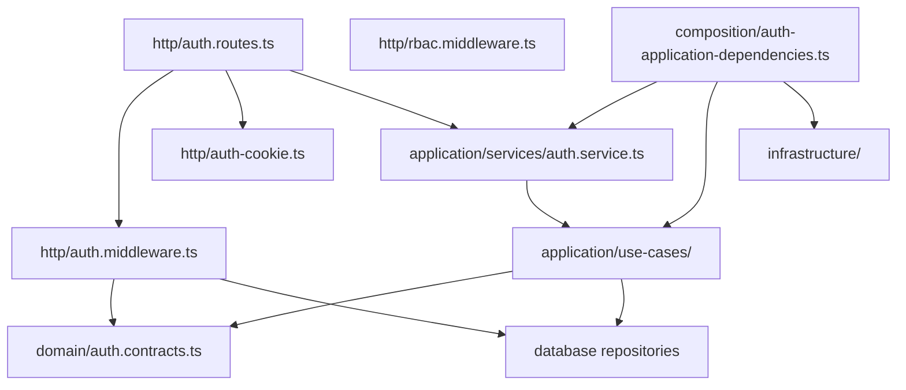
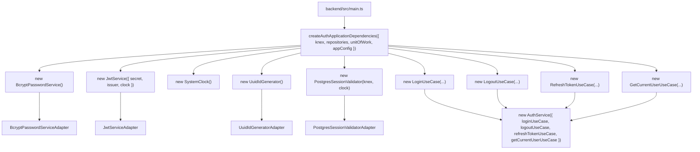
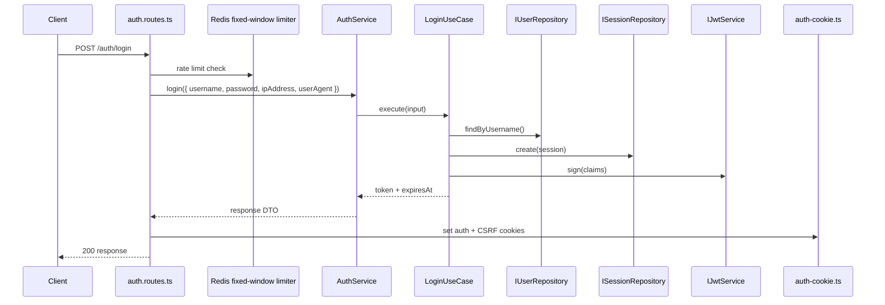
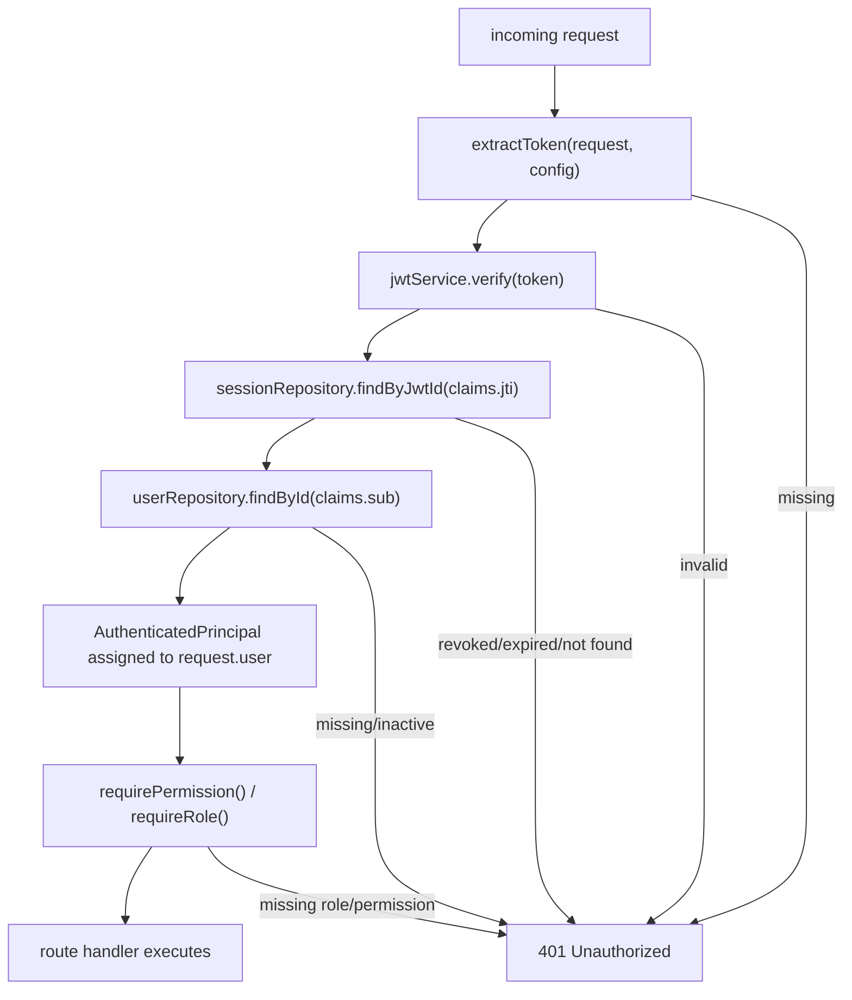

# Auth Module Architecture

The auth module owns the authentication boundary for the backend: it verifies incoming credentials, creates JWT-backed sessions, validates request tokens, and enforces role/permission checks for protected routes.

## Responsibility

- Authenticate username/password requests through `AuthService` and the login use case.
- Issue, verify, refresh, and revoke JWT-backed sessions.
- Attach an `AuthenticatedPrincipal` to valid requests via `authenticateRequest()`.
- Enforce RBAC through `requirePermission()` and `requireRole()`.
- Record auth activity in the shared audit repository.

## Folder and Runtime Map

## Composition Root and DI

`createAuthApplicationDependencies()` is the module composition root. It adapts shared database access and infrastructure services into the auth module’s own contracts.

## Request and Session Flow

## Protected Request Flow

## Data and Security Flow

- `loginRequestSchema` validates body constraints before calling `AuthService.login()`.
- `authenticateRequest()` checks the auth cookie first and falls back to the `Authorization: Bearer` header.
- A valid JWT is validated by `IJwtService`, and the `jti` is checked against the session repository.
- `AuthenticatedPrincipal` includes `userId`, `orgId`, `role`, `jwtId`, `issuedAt`, and `expiresAt` and is attached to `request.user`.
- Protected routes call `requirePermission()` and/or `requireRole()` after request authentication succeeds.

## Important Components

- [`http/auth.routes.ts`](./http/auth.routes.ts): login, logout, refresh, and `/me` endpoints.
- [`http/auth.middleware.ts`](./http/auth.middleware.ts): token extraction, JWT validation, session verification, and principal attachment.
- [`http/rbac.middleware.ts`](./http/rbac.middleware.ts): permission and role enforcement.
- [`http/auth-cookie.ts`](./http/auth-cookie.ts): cookie parsing and auth/CSRF cookie mutation.
- [`application/services/auth.service.ts`](./application/services/auth.service.ts): service facade over use cases.
- [`application/use-cases/`](./application/use-cases): `LoginUseCase`, `LogoutUseCase`, `RefreshTokenUseCase`, `GetCurrentUserUseCase`.
- [`composition/auth-application-dependencies.ts`](./composition/auth-application-dependencies.ts): module composition root.
- [`infrastructure/`](./infrastructure): `BcryptPasswordService`, `JwtService`, `PostgresSessionValidator`, `SystemClock`, `UuidIdGenerator`.
