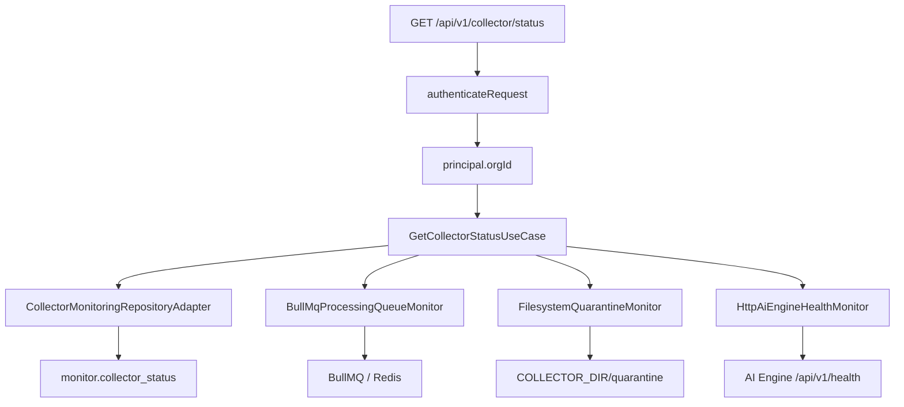

# Collector Monitoring Module Architecture

BE-CMON-01A through BE-CMON-01E expose Collector health, live processing-queue state, quarantine monitoring/listing/retry, and AI Engine health. PostgreSQL remains the source for Collector heartbeat state, BullMQ is queried for live queue state, the configured Collector handoff root is inspected for quarantined files, and the AI Engine is checked through its internal health endpoint.

## Request Flow

All authenticated roles may read the endpoint. The organization identifier comes exclusively from the verified authentication principal; callers cannot select another organization through query parameters.

## Response Boundary

The response exposes only dashboard-safe operational fields. Stored heartbeat JSON is never returned wholesale. The module explicitly projects disk availability and the last batch ID from the verified heartbeat metrics, and it never exposes HMAC material or internal organization identifiers.

Queue counts are read from BullMQ without mutating jobs. Paused jobs are included in `waiting`, while `isPaused` reports the queue control state. Because permanent ingestion failures currently terminate in filesystem quarantine rather than a separate BullMQ queue, the API's documented `queue.deadLettered` value mirrors `quarantine.count`.

The quarantine monitor resolves only the configured handoff root, refuses symbolic-link directories, and counts regular JSON files without following links. A handoff layout that has not yet been initialized reports zero.

BE-CMON-01D adds the role-protected `GET /collector/quarantine` endpoint. Its filesystem catalog lists only regular files whose names match the backend-generated quarantine contract. It never follows links, skips oversized files, reads at most the ingestion contract's eight-mebibyte limit, and exposes metadata rather than raw events or integrity material. Results are newest-first and paginated with a maximum page size of 100. Because the current quarantine handoff is filesystem-based, `quarantinedAt` is taken from the file metadata change time and the original incoming path is reconstructed from the trusted collector and batch identities embedded in the filename.

BE-CMON-01E adds `POST /collector/quarantine/:filename/retry` for Admin and Security Engineer roles. A strict parser accepts only backend-generated quarantine names and derives the trusted collector/batch destination; request input is never used as an arbitrary path. Retry creates an exclusive hard link at `incoming/<collectorId>/batch_<batchId>.json` and only then removes the quarantine link. This same-filesystem operation never overwrites an existing incoming batch and cannot expose a partially copied destination. The regular ingestion cycle subsequently claims, authenticates, validates, and queues the batch again—retry deliberately does not bypass those security boundaries by inserting the quarantine payload directly into BullMQ.

The AI health adapter uses the configured `AI_ENGINE_URL` and `AI_TIMEOUT`. It validates the health response before projecting dashboard fields, caches results for 30 seconds, and coalesces concurrent refreshes. A healthy loaded model maps to `online`; a reachable unhealthy or contract-invalid response maps to `degraded`; a timeout or transport failure maps to `offline`. AI Engine error strings and internal paths are never returned.

## Dependency Wiring and Shutdown

`createCollectorMonitoringDependencies()` constructs the queue, quarantine, and AI health adapters and injects them into `GetCollectorStatusUseCase`. `src/main.ts` supplies the configured Redis URL, Collector handoff root, AI Engine URL, and AI timeout. The returned monitoring dependency closes the BullMQ connection and aborts an in-flight AI health request during graceful shutdown.
