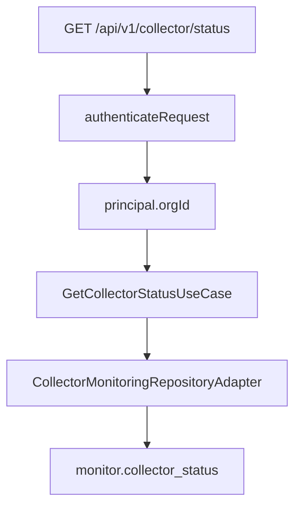

# Collector Monitoring Module Architecture

BE-CMON-01A exposes the organization-scoped Collector health information already persisted by BE-ING-01F. The module is read-only and never reads the heartbeat file directly; PostgreSQL is the API source of truth.

## Request Flow

All authenticated roles may read the endpoint. The organization identifier comes exclusively from the verified authentication principal; callers cannot select another organization through query parameters.

## Response Boundary

The response exposes only dashboard-safe operational fields. Stored heartbeat JSON is never returned wholesale. The module explicitly projects disk availability and the last batch ID from the verified heartbeat metrics, and it never exposes HMAC material or internal organization identifiers.

Queue, quarantine, and AI-engine health are intentionally deferred to later collector-monitoring slices. They can be added to the response without changing the Collector status contract introduced here.

