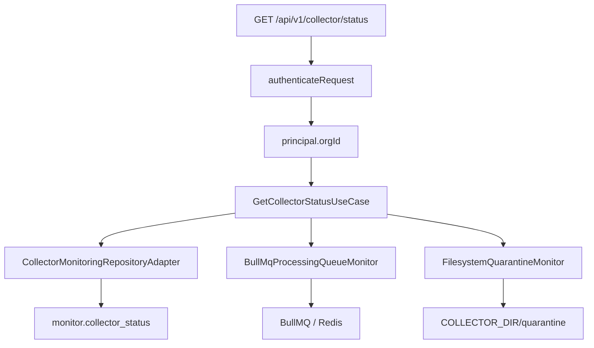

# Collector Monitoring Module Architecture

BE-CMON-01A and BE-CMON-01B expose Collector health, live processing-queue state, and the current quarantine count. The module is read-only. PostgreSQL remains the source for Collector heartbeat state, BullMQ is queried for live queue state, and the configured Collector handoff root is inspected for quarantined files.

## Request Flow

All authenticated roles may read the endpoint. The organization identifier comes exclusively from the verified authentication principal; callers cannot select another organization through query parameters.

## Response Boundary

The response exposes only dashboard-safe operational fields. Stored heartbeat JSON is never returned wholesale. The module explicitly projects disk availability and the last batch ID from the verified heartbeat metrics, and it never exposes HMAC material or internal organization identifiers.

Queue counts are read from BullMQ without mutating jobs. Paused jobs are included in `waiting`, while `isPaused` reports the queue control state. Because permanent ingestion failures currently terminate in filesystem quarantine rather than a separate BullMQ queue, the API's documented `queue.deadLettered` value mirrors `quarantine.count`.

The quarantine monitor resolves only the configured handoff root, refuses symbolic-link directories, and counts regular JSON files without following links. A handoff layout that has not yet been initialized reports zero.

AI-engine health remains deferred to a later collector-monitoring slice.

## Dependency Wiring and Shutdown

`createCollectorMonitoringDependencies()` constructs both infrastructure monitors and injects them into `GetCollectorStatusUseCase`. `src/main.ts` supplies the configured Redis URL and Collector handoff root, then registers the BullMQ monitor with `ShutdownCoordinator` so its dedicated Redis connection closes during graceful shutdown.
