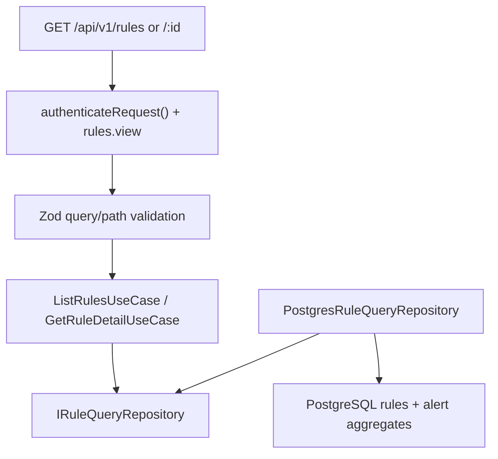
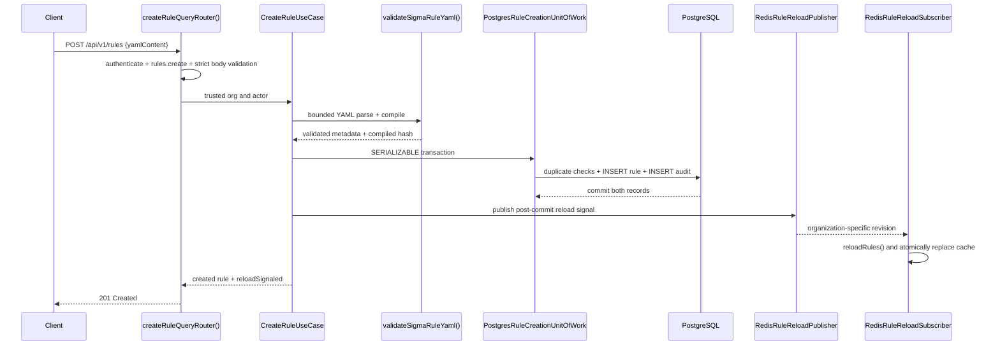

# Detection Module Architecture

The detection module compiles and evaluates the supported Sigma-inspired rule subset and exposes authenticated, tenant-scoped rule investigation reads. YAML remains the stored source of truth; compiled match/count representations are runtime artifacts.

## RULE-02A Query Boundary

`createRuleQueryDependencies(postgres)` is the module composition function. `src/main.ts` calls it with the shared PostgreSQL client and passes the resulting use cases through `startServer()` and `createApp()` to `createRuleQueryRouter()`.

## RULE-02B Transactional Creation Boundary

`createRuleCommandDependencies(unitOfWork, redis)` wires the command use case,
transaction adapter, and reload publisher. Compilation happens before the
transaction, while the rule row and immutable `rule_create` audit entry commit
or roll back together. Redis signaling is intentionally post-commit: a Redis
outage cannot undo or misreport a successful PostgreSQL transaction, and the
response exposes `reloadSignaled: false`; worker startup always performs a full
database reload as recovery.

## RULE-02C Transactional Update and Runtime Status Commands

`PUT /api/v1/rules/:id` runs the same bounded parser and compiler before a
retrying SERIALIZABLE transaction locks the tenant rule with
`findByIdForUpdate()`. The command refuses cross-tenant, built-in, archived,
and Sigma-identity-changing updates. A successful update preserves the
current runtime status, increments `version`, replaces all compiler-derived
metadata, and inserts `rule_update` audit history in the same transaction.
The audit records hashes and bounded metadata, never raw YAML.

`PUT /api/v1/rules/:id/enable` and `/disable` use the same tenant row lock and
transaction boundary. A real state change and its `rule_enable` or
`rule_disable` audit record commit together. Repeating an already-applied
command is an idempotent success without a false audit event or unnecessary
reload. Archived rules cannot be restored through these endpoints.

All three commands publish an organization-scoped Redis reload signal only
after commit. PostgreSQL remains authoritative when Redis is unavailable, and
the response reports `reloadSignaled` so operators can see whether immediate
worker convergence was requested.

## RULE-02D Archive and Operational Boundaries

- `DELETE /api/v1/rules/:id` is an Admin-only soft delete. It locks the tenant
  row, rejects built-ins, writes `status = archived`, and inserts the immutable
  `rule_delete` audit event in one SERIALIZABLE transaction. Repeated archive
  requests are idempotent. A post-commit reload removes the rule from workers.
- `POST /api/v1/rules/:id/test` compiles one tenant-visible stored rule and
  reads at most 1,000 matching-class MongoDB events from a bounded range of at
  most 30 days. Match rules evaluate directly; count rules use request-local
  in-memory windows. The dry-run never touches Redis windows/cooldowns and
  never persists alerts, incidents, audit records, or notifications.
- `POST /api/v1/rules/import` accepts at most 512 KiB and 50 YAML documents.
  Each document is alias-bounded, validated, compiled, duplicate-checked, and
  independently committed with a `rule_import` audit record. Partial results
  distinguish imported, duplicate-skipped, and validation-failed documents;
  one post-commit signal reloads all successful imports.
- `GET /api/v1/rules/export` pages through the authenticated tenant and one
  allowlisted status, sorts by name, caps output at 10,000 rules, and returns a
  `no-store` multi-document YAML attachment. It never exports another tenant.

## Security and Data Flow

- The router accepts an organization only from `AuthenticatedPrincipal.orgId`; query-string attempts to supply `orgId` are ignored.
- Every repository list, count, detail, and alert-statistics query applies the trusted organization before returning data. A cross-tenant detail lookup is indistinguishable from an absent rule and returns `404`.
- `rules.view` is granted to Admin, Security Engineer, and SOC Analyst. Authentication runs before authorization.
- `rules.create` is granted only to Admin and Security Engineer. The request cannot provide an organization, actor, built-in flag, compiled hash, or stored metadata; these are derived server-side.
- `rules.edit` and `rules.enable` are granted only to Admin and Security Engineer. Every mutation uses the authenticated principal's organization and actor; request data cannot override either value.
- `rules.delete` is Admin-only; `rules.import` is Admin/Security Engineer; `rules.test` and `rules.export` are available to all three authenticated operational roles.
- Rule YAML is limited to 50 KiB by both HTTP and application validation. Parsing accepts exactly one bounded YAML document with unique keys and guarded aliases, then the existing compiler allowlists supported fields, conditions, operators, regex complexity, count thresholds, windows, and cooldowns.
- RULE-02B supports the Rule Engine's implemented `match` and `count` subsets. Sequence documents fail closed with `RULE_VALIDATION_FAILED` rather than being stored but unusable.
- `20261023000100_rule_02b_creation_integrity.js` stores the top-level Sigma identity and adds tenant-unique Sigma-ID and case-insensitive-name indexes, closing concurrent duplicate races.
- Zod allowlists all filters and sort fields, bounds pagination, and requires UUID detail identifiers. Sort columns are selected from a fixed server-side mapping.
- List responses deliberately omit YAML, compilation hashes, false-positive guidance, references, and actor identifiers. Detail responses include full YAML and compilation metadata but never `org_id`.
- Alert counts and last-triggered timestamps come from a same-tenant aggregate of `public.alerts`; rules without alerts return zero and `null`.
- `20261022000100_rule_02a_query_indexes.js` adds tenant-first rule listing and alert-statistics indexes plus a GIN tag index.
- Priority is read from a bounded top-level YAML scalar when available, with the stored rule weight supplying a stable compatibility fallback for historical rows. Listing does not invoke compilation or execute rule content.

## Existing Evaluation Boundary

The rule engine loaders retrieve active rules per organization, validate and compile YAML, atomically replace the organization cache, and retain last-known-good rules when a reload candidate fails. Match rules are stateless; count rules use Redis-backed rolling windows and cooldown state. Alert persistence is handled separately from RULE-02A reads.

## Important Components

- `http/rule-query.routes.ts`: authenticated HTTP handlers and error mapping.
- `http/rule-query.schemas.ts`: query/path allowlists and bounds.
- `application/list-rules.use-case.ts`: pagination DTO and list-field minimization.
- `application/get-rule-detail.use-case.ts`: full rule detail DTO.
- `application/validate-sigma-rule.ts`: safe YAML parsing, compiler dispatch, and metadata extraction.
- `application/create-rule.use-case.ts`: duplicate checks, transactional create/audit orchestration, and post-commit reload signaling.
- `application/update-rule.use-case.ts`: built-in/identity/status guards, versioned recompilation, transactional audit, and reload signaling.
- `application/change-rule-status.use-case.ts`: idempotent enable/disable transactions and audit behavior.
- `application/archive-rule.use-case.ts`: built-in-safe, idempotent soft archive and audit transaction.
- `application/import-rules.use-case.ts` and `application/sigma-rule-import.parser.ts`: bounded partial-result multi-document import.
- `application/dry-run-rule.use-case.ts`: side-effect-free match/count historical evaluation.
- `application/export-rules.use-case.ts`: bounded, stable tenant YAML export.
- `infrastructure/mongo-rule-dry-run-event.repository.ts`: tenant/class/time-scoped safe event projection for dry-run.
- `composition/rule-operational.dependencies.ts`: PostgreSQL/MongoDB operational API assembly.
- `domain/rule-command.contracts.ts`: command, transaction, reload, and stable conflict contracts.
- `domain/rule-query.contracts.ts`: application-owned repository and response contracts.
- `infrastructure/postgres-rule-query.repository.ts`: tenant-safe rule reads and alert aggregation.
- `composition/rule-query.dependencies.ts`: concrete query dependency assembly.
- `composition/rule-command.dependencies.ts`: transactional command and Redis reload assembly.
- `infrastructure/postgres-rule-creation-unit-of-work.ts`: retrying SERIALIZABLE create and mutation boundaries plus uniqueness mapping.
- `infrastructure/redis-rule-reload.publisher.ts`: revisioned post-commit reload signals.
- `infrastructure/redis-rule-reload.subscriber.ts`: worker-side tenant filtering and cache reload.
- `infrastructure/yaml-rule-document.parser.ts`: bounded, single-document YAML parsing shared with compilation.
