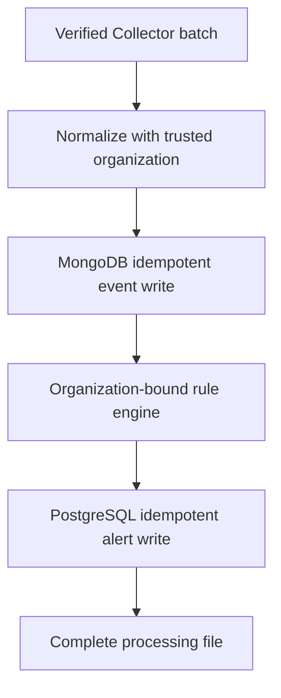
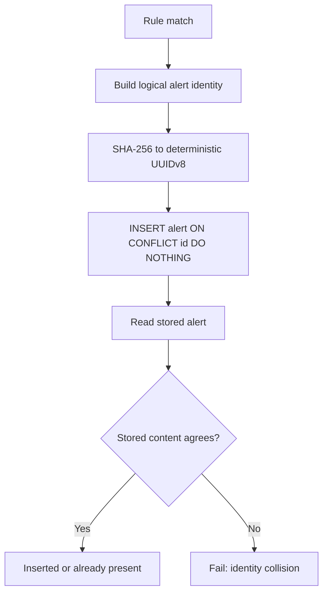
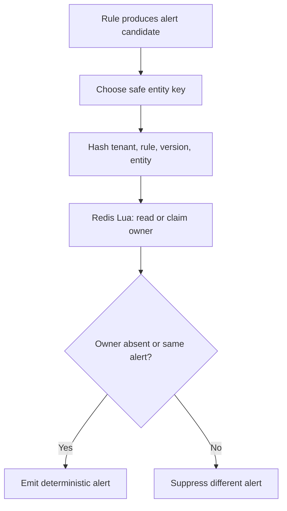
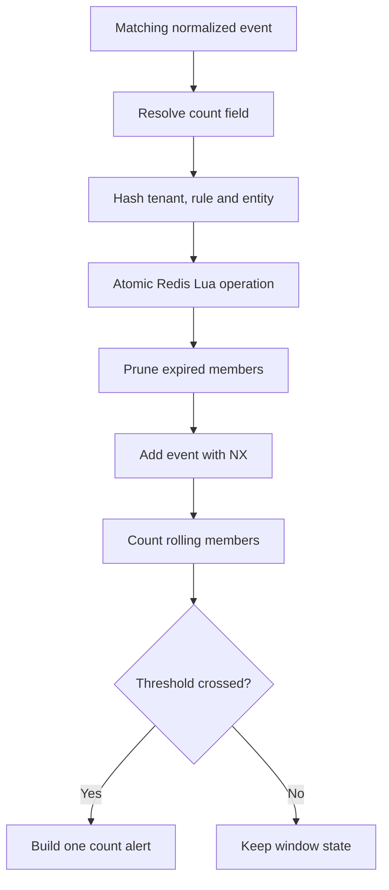

# BE-DET-01A through 01F: Detection Rules and Ingestion Integration

## Goal

Convert a trusted subset of Sigma-inspired YAML into safe, reusable match
predicates and evaluate normalized OCSF-shaped events against those predicates.

BE-DET-01A implements the pure compiler and evaluator. BE-DET-01B loads active
match rules from PostgreSQL into an organization-bound, class-indexed cache.
Stateful rule data stays behind Redis-specific contracts rather than entering
the in-memory compiled-rule cache.

BE-DET-01C adds count rules backed by exact rolling windows in Redis.
BE-DET-01D adds an atomic Redis cooldown lease that suppresses duplicate alert
emission across concurrent Backend workers. Sequence tracking remains a
separate post-MVP milestone.

BE-DET-01E gives every production rule alert a deterministic UUID and persists
it idempotently in PostgreSQL. This makes BullMQ retries safe before the rule
engine is connected to the ingestion worker in the next milestone.

BE-DET-01F connects that pipeline to the Collector processing worker. The
trusted `COLLECTOR_ORG_ID` is attached during normalization, all normalized
events are evaluated (including exact MongoDB replays), and generated alerts
are persisted before the processing file is completed.

## BE-DET-01F ingestion integration



The organization comes from deployment configuration, never from the event
payload. `EvaluateAndPersistRuleAlertsService` rejects any normalized event
whose `org_id` differs from its configured boundary.

The worker deliberately evaluates replayed normalized events. A crash can
happen after MongoDB accepted the events but before PostgreSQL accepted the
alerts. Skipping existing MongoDB events on retry would therefore lose the
alert. Deterministic alert IDs turn the PostgreSQL retry into an insert-or-read
operation.

Cooldown leases now store the deterministic alert ID as their owner. The same
logical alert may reconstruct itself during a retry, while a different alert
for the same rule/entity remains suppressed. This closes the failure window in
which Redis accepted a cooldown lease but PostgreSQL was temporarily
unavailable.

The production composition root now owns and closes MongoDB, PostgreSQL, and
the non-BullMQ Redis client. BullMQ keeps its dedicated Redis connection because
its blocking/retry semantics differ from ordinary application commands.

## BE-DET-01E idempotent alert persistence



The logical identity contains:

1. trusted organization ID;
2. PostgreSQL rule ID;
3. compiled rule hash;
4. sorted matched event IDs.

Sorting makes the identity independent of event ordering. Length-prefixing
each value before hashing prevents ambiguous concatenation. The UUID uses the
RFC 9562 version-8 layout, which is intended for application-defined UUIDs.

Why not generate a fresh random UUID on every evaluation? A job may succeed in
PostgreSQL and crash before BullMQ records completion. BullMQ then retries the
job. A random ID would create a second row; a deterministic ID reaches the
existing primary key and becomes an idempotent no-op.

`PersistRuleAlertsService` does not blindly trust a primary-key conflict. It
reads the stored record and compares all security-relevant fields. The same ID
with different rule, severity, tags, metadata, or matched events is treated as
an identity collision and fails closed.

## BE-DET-01D alert-cooldown flow



A Lua script atomically reads the current owner and, when absent, stores the
deterministic alert ID with a millisecond TTL. A separate `GET`, then `SET`,
would have a race in which two workers can both observe no key and claim it.
The same owner is admitted on retry; a different alert ID is rejected.

Rules opt into cooldown with a bounded duration:

```yaml
alert:
  cooldown: "5m"
```

Accepted units are seconds (`s`), minutes (`m`), and hours (`h`), with a
maximum resolved duration of 24 hours. A missing `alert.cooldown` means no
cooldown, preserving the behavior of existing rules.

The Redis key hashes organization ID, database rule ID, compiled YAML hash,
and entity key. The compiled hash gives a changed rule a fresh cooldown
namespace. Count rules use `detection.count.field` as their entity. Match rules
use `event_id`, which safely suppresses exact replay without guessing whether a
host, user, process, or IP is the rule's intended correlation entity. A future
schema milestone may add an explicit match-rule grouping field.

Cooldown is fail-closed: if an opted-in rule matches but Redis cooldown storage
is not configured, evaluation raises an error instead of emitting an alert that
may be a duplicate.

## BE-DET-01C count-rule flow



The Redis value is a sorted set whose scores are evaluation timestamps and
whose members are event IDs. One Lua script performs prune, idempotent insert,
TTL refresh, and read atomically, so concurrent workers cannot lose increments
or emit two alerts for the same threshold crossing.

Why not `INCR` followed by `EXPIRE` on every event? Reapplying `EXPIRE` keeps
an old counter alive as long as traffic continues, so events older than the
declared window remain counted. A sorted set lets the engine delete precisely
the members outside `(now - window, now]` before it calculates the count.

Count rules use this subset:

```yaml
detection:
  selection:
    message|contains: Failed password
  condition: selection
  count:
    field: src_endpoint.ip
    threshold: 10
    timewindow: "5m"
```

The `field` must resolve to a string, finite number, or boolean. Missing,
object, array, and oversized string values are not grouped. Tenant, database
rule ID, and grouping value are SHA-256 hashed before becoming Redis key parts,
so raw identities and IP addresses do not leak into operational key names. The
compiled YAML hash is also part of the key: changing a rule creates a fresh
state namespace instead of mixing counts from two rule definitions.

An exact event replay uses Redis `ZADD NX`, so it does not increase the count.
An alert is emitted when the window moves from `threshold - 1` to `threshold`;
events above the threshold do not create an alert storm. Once old members age
out, a later crossing can alert again.

## BE-DET-01B loading flow

1. `PostgresActiveMatchRuleSource` pages through `public.rules` using exact
   `org_id`, `status = active`, and `type = match` filters.
2. `OrganizationRuleLoader` compiles each YAML document and verifies that its
   title, severity, weight, class, and category agree with the indexed database
   columns.
3. A bad new rule is rejected. A bad update reuses its last-known-good compiled
   version.
4. `OrganizationRuleCache.replace()` constructs all indexes first and publishes
   one complete snapshot assignment.
5. `ReloadableOrganizationSigmaRuleEngine` uses the class index during event
   evaluation and exposes the database UUID as `RuleAlert.ruleId`. The YAML
   identity remains available as `metadata.sigmaId`.

If PostgreSQL loading fails, no snapshot replacement occurs. Existing compiled
rules therefore continue operating. Concurrent reload calls share one in-flight
reload so an older query cannot overwrite a newer result.

### Why bind an engine to one organization?

An organization is a security boundary, not merely a query filter. Binding the
source, loader, cache, and engine instance to one `organizationId` avoids taking
the tenant identity from an event payload and prevents one cache from mixing
rules belonging to different tenants.

## The five-stage mental model

1. **Parse** untrusted YAML text into `unknown` data.
2. **Validate** every structure, field path, operator, and operand type.
3. **Compile** the validated selections and condition expression once.
4. **Dispatch** an event only to rules for its OCSF class and category.
5. **Evaluate** the compiled predicates and build safe alert objects.

The YAML document is never converted into JavaScript source and `eval` is never
used. Compilation here means building closures from known operators.

## Runtime flow

```text
YAML source
  -> parseYamlRuleDocument()
  -> compileSigmaMatchRule()
       -> compile each selection
       -> parse AND/OR/NOT condition into an AST
       -> create matches(event) predicate
  -> StatelessSigmaRuleEngine.evaluate(events)
       -> OCSF class/category pre-filter
       -> execute predicate
       -> build RuleAlert
```

## Boolean parser precedence

From strongest to weakest:

1. Parentheses
2. `NOT`
3. `AND`
4. `OR`

Therefore `a OR b AND NOT c` means `a OR (b AND (NOT c))`.

The parser is a recursive-descent parser:

- `parseOr()` calls `parseAnd()`
- `parseAnd()` calls `parseUnary()`
- `parseUnary()` handles `NOT`
- `parsePrimary()` handles selection names and parentheses

Each layer consumes only its own grammar, which naturally implements
precedence without evaluating user-authored code.

## Selection semantics

- Fields inside one mapping are combined with `AND`.
- A list of mappings is combined with `OR`.
- A list of scalar targets for one field is combined with `OR`.
- Detection selections are combined by the condition AST.
- Dot-notation resolution reads only own properties and blocks prototype keys.

Supported modifiers are `contains`, `startswith`, `endswith`, `re`, `gt`,
`gte`, `lt`, `lte`, `in`, `not`, and `exists`. An absent modifier means exact
matching.

This is a documented Sigma-compatible subset, not a claim of full Sigma 2.x
compatibility. Full Sigma also includes wildcards, modifier chains, keyword
searches, and quantifiers such as `1 of selection*`.

## Security controls

- 128 KiB YAML input limit
- one YAML document only
- unique mapping keys
- bounded alias expansion
- bounded condition length, token count, and parenthesis depth
- bounded selections and fields
- explicit operator allow-list
- safe dot paths; `__proto__`, `prototype`, and `constructor` are blocked
- conservative regex grammar and length limits
- no dynamic JavaScript generation or execution

## Rebuild-it-yourself exercise

To practise without copying the implementation:

1. Write `resolveField(event, ["actor", "user", "name"])` and test missing
   fields and inherited properties.
2. Write exact and `contains` comparison factories.
3. Compile one selection mapping into an `every()` predicate.
4. Tokenize `selection AND NOT filter`.
5. Draw its AST and implement the four recursive parser functions.
6. Add class/category dispatch.
7. Only then add YAML parsing and validation at the outer boundary.
8. Implement an in-memory `tryAcquire()` with a map and expiry timestamps.
9. Write a concurrency test where 20 callers contend for the same lease.
10. Replace the map operation with Redis `SET key 1 PX ttl NX` and confirm only
    one caller receives `OK`.
11. Hash a logical alert identity twice and confirm it produces the same UUID.
12. Insert that alert twice with PostgreSQL `ON CONFLICT DO NOTHING`.
13. Change the severity while reusing the ID and verify your application rejects
    the collision instead of silently accepting different content.

## Recommended reading

- Sigma Rules Specification: https://sigmahq.io/sigma-specification/specification/sigma-rules-specification.html
- YAML package documentation: https://eemeli.org/yaml/
- TypeScript narrowing: https://www.typescriptlang.org/docs/handbook/2/narrowing.html
- OWASP ReDoS: https://owasp.org/www-community/attacks/Regular_expression_Denial_of_Service_-_ReDoS
- Redis sorted sets: https://redis.io/docs/latest/develop/data-types/sorted-sets/
- Redis Lua scripting and atomicity: https://redis.io/docs/latest/develop/programmability/eval-intro/
- Redis `SET` options (`NX`, `PX`): https://redis.io/docs/latest/commands/set/
- Redis distributed-lock pattern and limitations: https://redis.io/docs/latest/develop/clients/patterns/distributed-locks/
- PostgreSQL `INSERT ... ON CONFLICT`: https://www.postgresql.org/docs/current/sql-insert.html
- RFC 9562 UUID version 8: https://www.rfc-editor.org/rfc/rfc9562.html#name-uuid-version-8

Read the Sigma sections on maps, lists, modifiers, field existence, and
condition precedence first. Compare them with the supported subset above.
