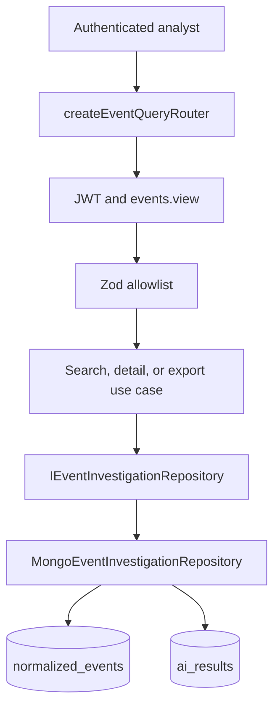

# Event Investigation Architecture

## Responsibility

The `events` module provides authenticated, read-only investigation access to
normalized OCSF events. LOG-01A implements search, detail, and bounded export
without exposing the raw archived event or the tenant identifier.

## Runtime flow

`src/main.ts` is the composition root. It passes the connected MongoDB client
to `createEventQueryDependencies()`, which constructs one
`MongoEventInvestigationRepository` and injects it into the three use cases.
The resulting use cases are passed through `startServer()` and `createApp()` to
the router mounted at `/api/v1/events`.

## Endpoints

| Endpoint | Purpose |
| --- | --- |
| `GET /api/v1/events/search` | Search normalized events with bounded filters and deterministic pagination |
| `GET /api/v1/events` | Compatibility alias for event search |
| `GET /api/v1/events/:eventId` | Return one tenant-scoped event and its latest tenant-scoped AI/SHAP result |
| `GET /api/v1/events/export` | Export the same filtered result set as CSV or JSON, capped at 10,000 rows |

## Security boundaries

- `authenticateRequest()` validates the JWT, active session, and active user.
- `requirePermission("events.view")` permits Admin, Security Engineer, and SOC
  Analyst roles.
- The organization comes only from the authenticated principal. Query-string
  `orgId` input is ignored.
- Every MongoDB event and AI query includes `org_id`.
- MongoDB projections and DTO mapping exclude `_id`, `org_id`, `raw_event`,
  validation internals, and AI input feature storage.
- Query fields, sort fields, page sizes, export limits, dates, and event IDs are
  allowlisted by Zod.
- CSV text beginning with `=`, `+`, `-`, or `@` is neutralized before download.

## Query behavior

Search defaults to the 24 hours ending at `to`; when `to` is omitted it uses
the current time. Sorting always includes `event_id` as a deterministic
tie-breaker. Page size is capped at 200. Export reads in batches of 200 and is
hard-capped at 10,000 records.

MongoDB bootstrap owns tenant-first indexes for time, severity, class, source
and destination IP, username, hostname, collector, and AI event lookup. Message
search uses the controlled MongoDB text index; user input is always a string
value and is never interpreted as a MongoDB query object.

## Failure behavior

- Invalid inputs return `400 VALIDATION_ERROR`.
- Missing and cross-tenant event IDs produce the same
  `404 RESOURCE_NOT_FOUND` response.
- Infrastructure failures are forwarded to the shared error middleware.
- An event without a stored AI result is valid and returns `aiAnalysis: null`.
