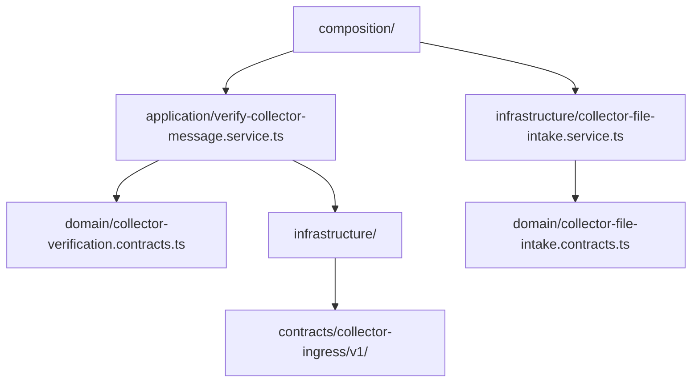
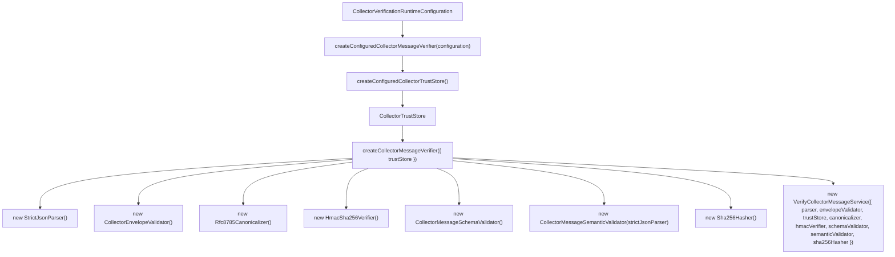
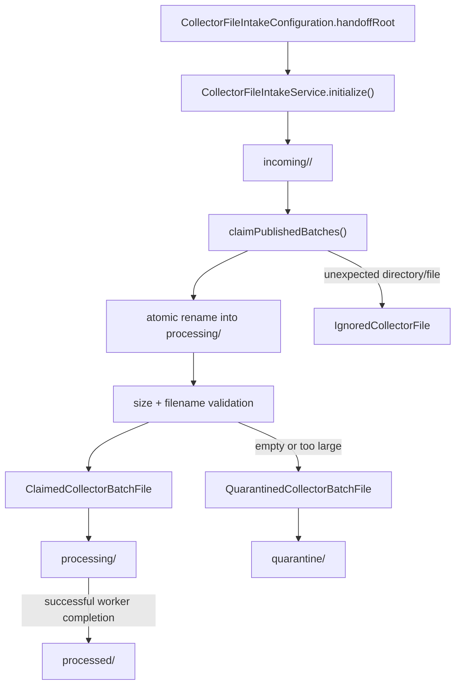
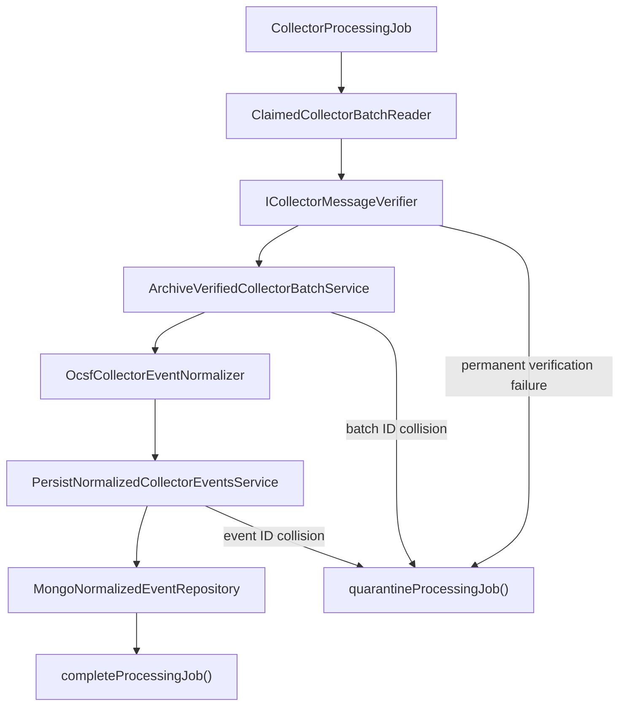
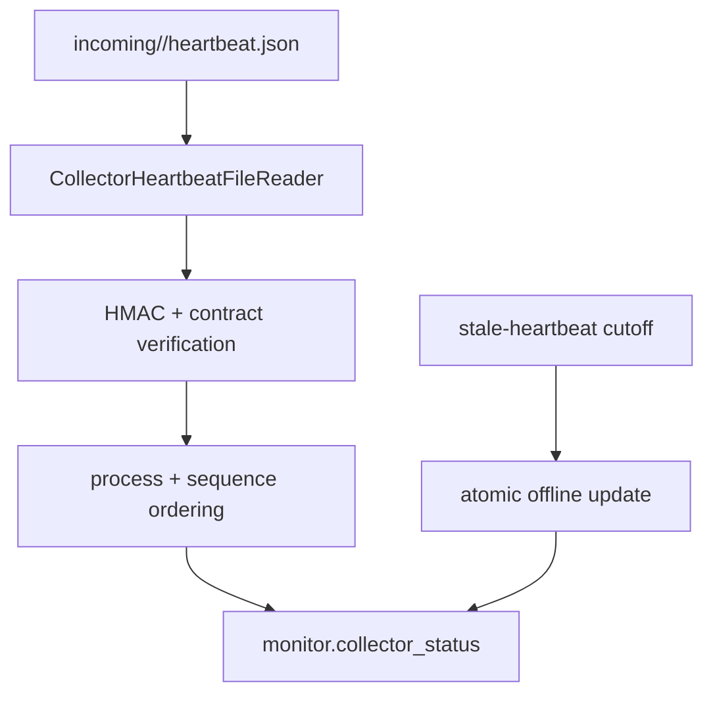
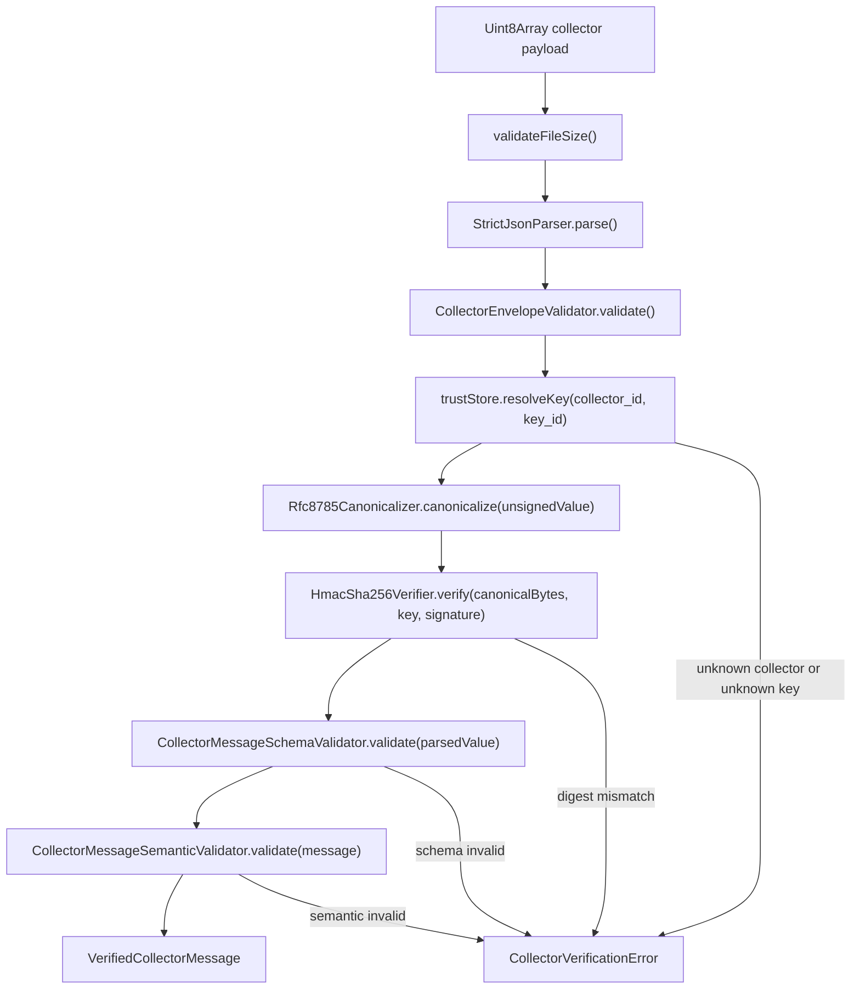
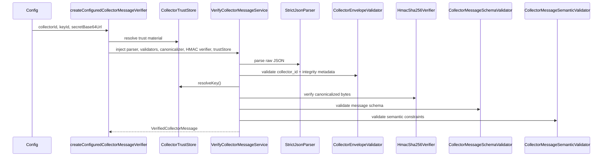

# Ingestion Module Architecture

The ingestion module verifies collector payloads before the backend treats them as trusted data. It owns the filesystem claim boundary, durable BullMQ handoff, raw-batch archival, baseline OCSF projection, idempotent normalized-event persistence, heartbeat monitoring, and terminal batch-file movement. This is a security boundary: untrusted input is parsed, envelope-checked, trust-validated, canonicalized, HMAC-verified, schema-checked, and semantically validated before persistence.

## Responsibility

- Validate collector ingress envelope and trust metadata.
- Build a trusted key store from runtime configuration.
- Verify HMAC integrity using a canonicalized payload representation.
- Reject malformed, untrusted, or semantically invalid collector messages.
- Archive verified batches idempotently using `batch_id` and the canonical digest.
- Preserve stable Collector event IDs while projecting events into `normalized_events`.
- Detect similar event content with a non-unique deduplication hash.
- Consume the identity-scoped heartbeat snapshot without moving or deleting it.
- Reject stale, replay-colliding, and excessively future-dated heartbeats.
- Mark Collectors offline when their last accepted heartbeat becomes stale.
- Move successful files to `processed/` and permanent failures to `quarantine/`.

## Folder and Dependency Map

## Composition Root

`createConfiguredCollectorMessageVerifier()` builds a trust store and passes it into `createCollectorMessageVerifier()`, which instantiates the actual parser, validators, canonicalizer, and HMAC verifier. `CollectorFileIntakeService` is a separate infrastructure component that claims published batch files from the collector handoff root before later processing steps consume them.

## File Intake Flow

## BE-ING-01E Processing Flow

The worker persists the raw verified batch before normalized events. MongoDB's unique `batch_id` and `event_id` indexes provide retry-safe idempotency. Reusing an ID with different verified content is a collision and quarantines the source file. `dedup_hash` is deliberately non-unique: it signals similar content but never acts as event identity or drops a legitimate repeated security event.

After storage succeeds, `completeProcessingJob()` atomically renames the claimed file from `processing/` to `processed/`. If the process crashes after this rename but before BullMQ records completion, the reader can securely reread the file from `processed/`; HMAC and queued-digest verification run again, persistence returns existing records, and completion returns `already_completed`.

Filesystem and MongoDB failures escape the application services so BullMQ can retry them. Contract, identity, HMAC, batch-ID, digest, and event-ID collision failures are permanent quarantine outcomes.

## BE-ING-01F Heartbeat Flow

The Collector owns publication and atomically replaces `heartbeat.json`; the backend only reads the fixed identity-scoped snapshot. A verified heartbeat updates PostgreSQL only when it is newer than the stored Collector process/sequence. Exact replays are ignored, older values cannot overwrite newer state, and reusing the same process/sequence with different signed content is rejected as a collision.

The stored heartbeat data contains operational fields and the canonical unsigned SHA-256 digest, but never the HMAC signature. `shutting_down` maps to backend status `offline`. A separate cutoff operation marks `online` or `degraded` rows offline after the configured stale interval.

## Verification Flow

## Runtime Sequence

## Security Model

- Trust is based on a configured collector identity + key mapping, not on the message body itself.
- `removeIntegrityValue()` strips the `integrity.value` field before canonicalization to ensure the HMAC is calculated over the unsigned document.
- RFC 8785 canonicalization is applied before HMAC verification to avoid representation differences across JSON encoders.
- Verification fails early on malformed HMACs, unknown collectors, unknown key IDs, schema mismatches, or semantic violations.
- The file-intake service only claims, recovers, completes, or quarantines files; it does not parse or verify collector content.

## Important Components

- [`application/verify-collector-message.service.ts`](./application/verify-collector-message.service.ts): orchestrates the full verification pipeline.
- [`composition/configured-ingestion-verification.dependencies.ts`](./composition/configured-ingestion-verification.dependencies.ts): builds a runtime trust store and verifier.
- [`composition/ingestion-verification.dependencies.ts`](./composition/ingestion-verification.dependencies.ts): instantiates parser, validators, canonicalizer, HMAC verifier, and service.
- [`infrastructure/collector-trust.configuration.ts`](./infrastructure/collector-trust.configuration.ts): creates trust-store configuration from runtime settings.
- [`infrastructure/collector-trust.store.ts`](./infrastructure/collector-trust.store.ts): resolves trusted collector IDs and signing keys.
- [`infrastructure/collector-file-intake.service.ts`](./infrastructure/collector-file-intake.service.ts): claims, recovers, and quarantines collector batch files on disk.
- [`infrastructure/ocsf-collector-event.normalizer.ts`](./infrastructure/ocsf-collector-event.normalizer.ts): projects verified baseline OCSF events while preserving source identity and raw evidence.
- [`application/persist-normalized-collector-events.service.ts`](./application/persist-normalized-collector-events.service.ts): enforces event-level retry idempotency and detects event-ID collisions.
- [`application/process-collector-processing-job.service.ts`](./application/process-collector-processing-job.service.ts): coordinates worker-side verification, raw archival, normalization, and normalized persistence.
- [`application/consume-collector-heartbeat.service.ts`](./application/consume-collector-heartbeat.service.ts): verifies, orders, maps, and persists the current heartbeat snapshot.
- [`application/mark-stale-collectors-offline.service.ts`](./application/mark-stale-collectors-offline.service.ts): applies the configured heartbeat-expiry cutoff.
- [`infrastructure/collector-heartbeat-file.reader.ts`](./infrastructure/collector-heartbeat-file.reader.ts): securely reads the fixed heartbeat snapshot without claiming or moving it.
- [`infrastructure/hmac-sha256.verifier.ts`](./infrastructure/hmac-sha256.verifier.ts): confirms collector integrity.
- [`infrastructure/json/rfc8785-canonicalizer.ts`](./infrastructure/json/rfc8785-canonicalizer.ts): canonicalizes payloads before signing.
- [`contracts/collector-ingress/v1/ARCHITECTURE.md`](../../../../contracts/collector-ingress/v1/ARCHITECTURE.md): source of the versioned collector message contract.
