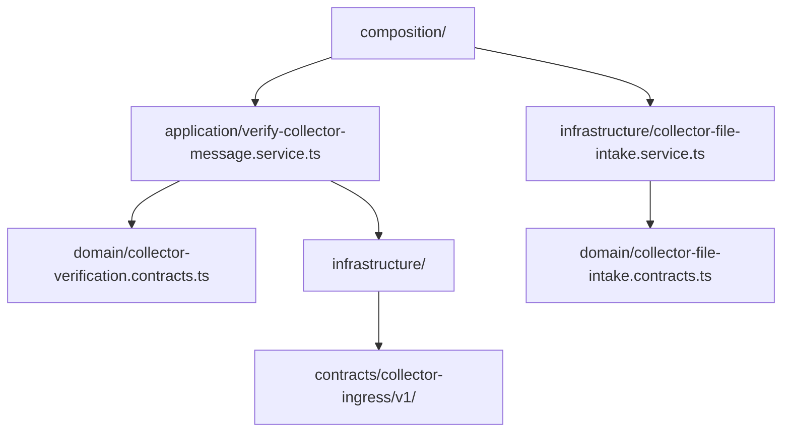
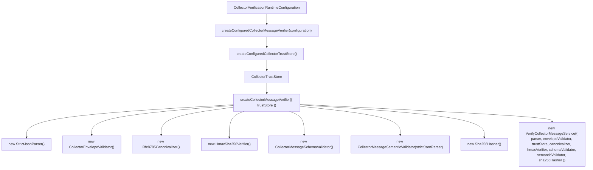
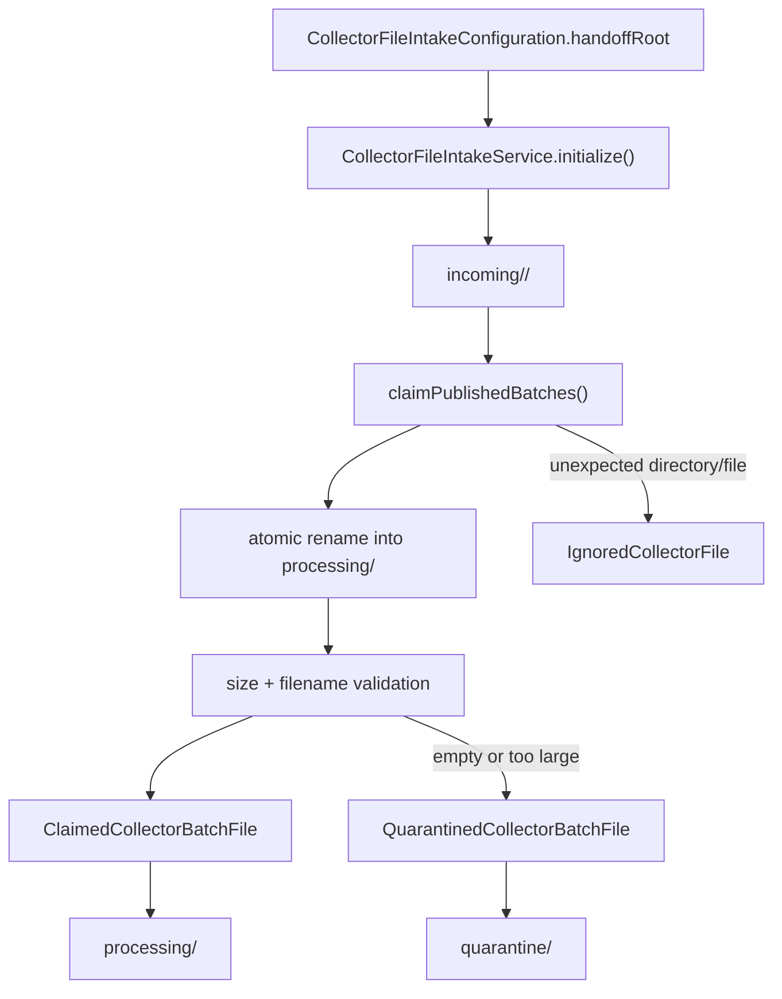
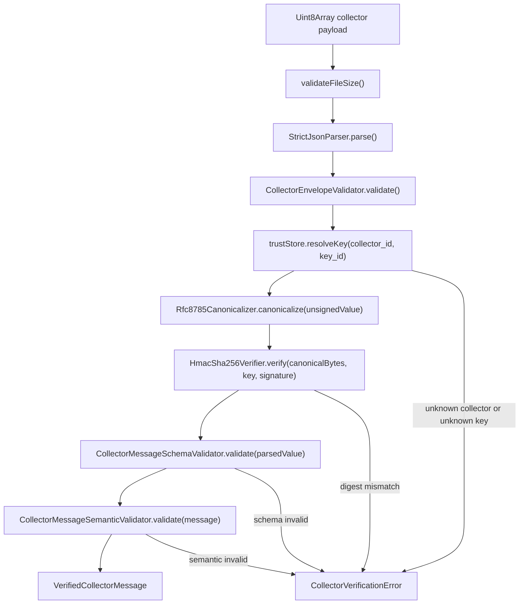
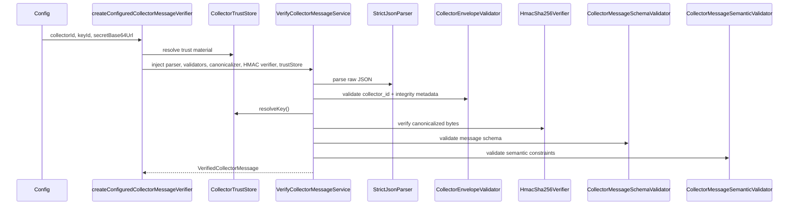

# Ingestion Module Architecture

The ingestion module verifies collector payloads before the backend treats them as trusted data. It also owns the filesystem claim boundary for collector batch files. This is a security boundary: untrusted input is parsed, envelope-checked, trust-validated, canonicalized, HMAC-verified, schema-checked, and semantically validated before it becomes a `VerifiedCollectorMessage`, while batch files are claimed and quarantined through a controlled handoff directory.

## Responsibility

- Validate collector ingress envelope and trust metadata.
- Build a trusted key store from runtime configuration.
- Verify HMAC integrity using a canonicalized payload representation.
- Reject malformed, untrusted, or semantically invalid collector messages.

## Folder and Dependency Map

## Composition Root

`createConfiguredCollectorMessageVerifier()` builds a trust store and passes it into `createCollectorMessageVerifier()`, which instantiates the actual parser, validators, canonicalizer, and HMAC verifier. `CollectorFileIntakeService` is a separate infrastructure component that claims published batch files from the collector handoff root before later processing steps consume them.

## File Intake Flow

## Verification Flow

## Runtime Sequence

## Security Model

- Trust is based on a configured collector identity + key mapping, not on the message body itself.
- `removeIntegrityValue()` strips the `integrity.value` field before canonicalization to ensure the HMAC is calculated over the unsigned document.
- RFC 8785 canonicalization is applied before HMAC verification to avoid representation differences across JSON encoders.
- Verification fails early on malformed HMACs, unknown collectors, unknown key IDs, schema mismatches, or semantic violations.
- The file-intake service only claims, recovers, or quarantines files; it does not parse or verify collector content.

## Important Components

- [`application/verify-collector-message.service.ts`](./application/verify-collector-message.service.ts): orchestrates the full verification pipeline.
- [`composition/configured-ingestion-verification.dependencies.ts`](./composition/configured-ingestion-verification.dependencies.ts): builds a runtime trust store and verifier.
- [`composition/ingestion-verification.dependencies.ts`](./composition/ingestion-verification.dependencies.ts): instantiates parser, validators, canonicalizer, HMAC verifier, and service.
- [`infrastructure/collector-trust.configuration.ts`](./infrastructure/collector-trust.configuration.ts): creates trust-store configuration from runtime settings.
- [`infrastructure/collector-trust.store.ts`](./infrastructure/collector-trust.store.ts): resolves trusted collector IDs and signing keys.
- [`infrastructure/collector-file-intake.service.ts`](./infrastructure/collector-file-intake.service.ts): claims, recovers, and quarantines collector batch files on disk.
- [`infrastructure/hmac-sha256.verifier.ts`](./infrastructure/hmac-sha256.verifier.ts): confirms collector integrity.
- [`infrastructure/json/rfc8785-canonicalizer.ts`](./infrastructure/json/rfc8785-canonicalizer.ts): canonicalizes payloads before signing.
- [`contracts/collector-ingress/v1/ARCHITECTURE.md`](../../../../contracts/collector-ingress/v1/ARCHITECTURE.md): source of the versioned collector message contract.
