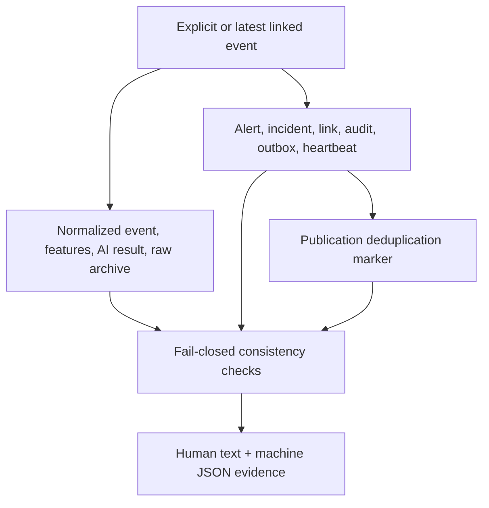

# SYS-01A System Proof Architecture

SYS-01A is a read-only verification boundary for the real Trivikrama pipeline.
It does not generate success data, insert records, repair missing evidence, or
replace any detector. It selects one incident-linked event and independently
checks the records already committed by the Collector, ingestion worker,
detection engines, correlator, audit repository, notification outbox, and
Redis publisher.

## Evidence flow



## Required default stages

1. An incident-linked event is selected.
2. Its tenant-scoped normalized OCSF document is present and not schema-invalid.
3. The matching verified raw batch has a 64-character canonical digest and
   internally consistent event count.
4. All 20 model-contract features are finite numbers.
5. A tenant- and batch-matching, non-fallback AI result is present. Anomalies
   must include at least one SHAP contribution.
6. At least one persisted alert references the selected event.
7. Exactly one tenant-scoped incident link exists, and persisted alert/event
   counts equal the incident counters.
8. The immutable `incident_create` audit exists.
9. A non-dead-letter notification outbox record exists.
10. The notification is published and its Redis deduplication marker agrees.
11. A tenant-scoped Collector heartbeat exists.

## Integrity and security invariants

- The organization comes from trusted runtime configuration, never stored
  evidence or user-controlled report data.
- Cross-tenant MongoDB, PostgreSQL, heartbeat, notification, or incident data
  fails the proof.
- Every latest-event SQL lookup is parameterized by organization.
- Reports contain identifiers, counts, scores, model metadata, hashes, and
  timestamps, but never raw log bodies, HMAC/JWT secrets, database URLs, or
  credentials.
- Missing evidence remains `FAIL`; the harness never synthesizes a successful
  record. Diagnostic relaxations are explicit command flags and remain visible
  in stage details.
- Output filenames are sanitized and created with exclusive-write semantics so
  an earlier evidence report is never silently overwritten.
- Repository pagination verifies the full incident evidence set, with bounded
  safety limits to avoid unbounded proof-time memory use.

## Command

```bash
npm run proof:system -- [event-id]
```

With no event ID, the harness selects the most recently linked event for
`COLLECTOR_ORG_ID`. It saves a text report and a JSON report under
`artifacts/system-proof/` and exits non-zero when any required stage fails.

Diagnostic-only flags:

- `--allow-pending-notification`
- `--allow-missing-heartbeat`
- `--output-dir=<directory>`
- `--event-id=<event-id>`

The two `--allow-*` flags are for isolating deployment problems. They must not
be used for the final professor-facing proof.
