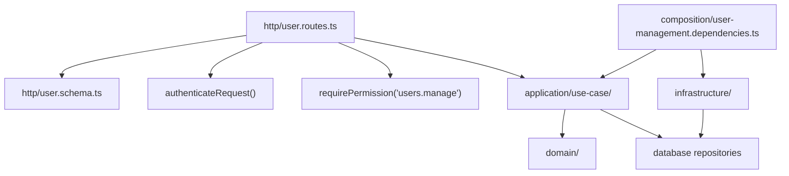
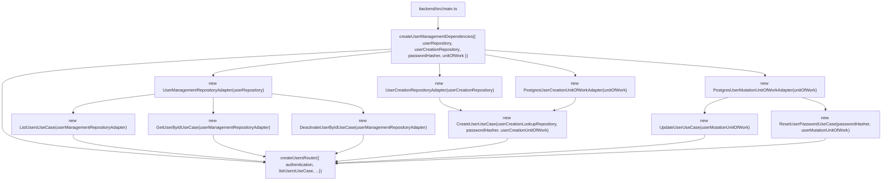
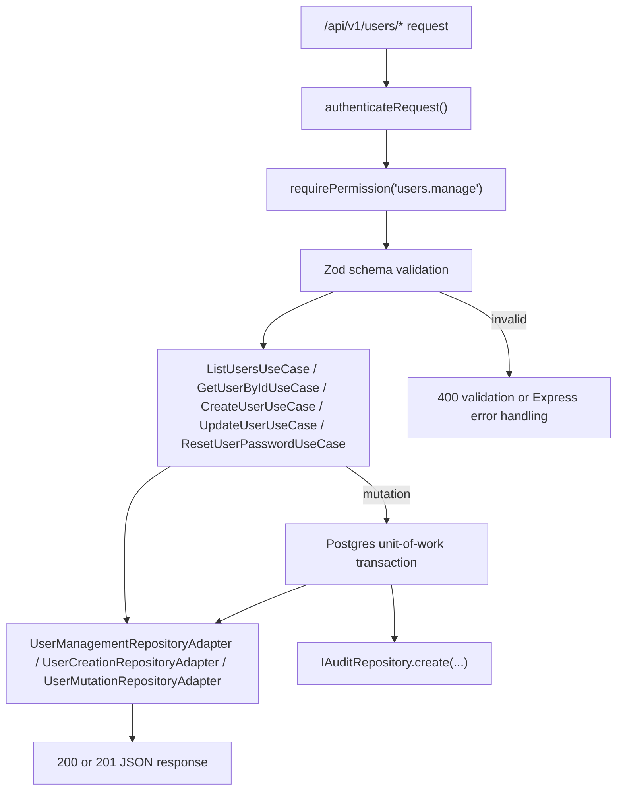

# Users Module Architecture

The users module owns the organization-scoped user management API. Every request is authenticated, checked for the `users.manage` permission, and then processed by a use case that may read a user or mutate it inside a PostgreSQL transaction with an audit record.

## Responsibility

- List users for the authenticated organization.
- Fetch a single user by ID.
- Create, update, deactivate, and reset passwords for users.
- Coordinate transactional mutation + audit writes with the shared unit-of-work.

## Folder Layout and Dependencies

## Composition Root and DI

`createUserManagementDependencies()` builds repository adapters and transaction wrappers from shared repository and unit-of-work contracts, then injects them into the concrete use cases.

## Request Flow

## Data and Security Flow

- The principal comes from `request.user` and provides `orgId`, `userId`, `role`, and username metadata.
- `listUsersQuerySchema`, `getUserParamsSchema`, `createUserBodySchema`, `updateUserBodySchema`, and `resetUserPasswordBodySchema` validate query, param, and body inputs separately.
- `orgId` is taken from `AuthenticatedPrincipal` rather than from request data, so every list and mutation is organization-scoped.
- For create/update/reset flows, the mutation use case writes the user record and audit data in the same transaction boundary through `IUnitOfWork.execute()`.

## Important Components

- [`http/user.routes.ts`](./http/user.routes.ts): route registration and request validation.
- [`http/user.schema.ts`](./http/user.schema.ts): Zod schemas for list/get/create/update/reset requests.
- [`application/use-case/list-users.use-case.ts`](./application/use-case/list-users.use-case.ts): list users in the authenticated org.
- [`application/use-case/list-getuser.use-case.ts`](./application/use-case/list-getuser.use-case.ts): fetch a single user by ID.
- [`application/use-case/create-user.use-case.ts`](./application/use-case/create-user.use-case.ts): create a user with validation and audit metadata.
- [`application/use-case/update-user.use-case.ts`](./application/use-case/update-user.use-case.ts): update an existing user record.
- [`application/use-case/reset-user-password.use-case.ts`](./application/use-case/reset-user-password.use-case.ts): reset a user password.
- [`composition/user-management.dependencies.ts`](./composition/user-management.dependencies.ts): module composition root.
- [`infrastructure/`](./infrastructure): adapter layer between shared repositories and user-management contracts.

