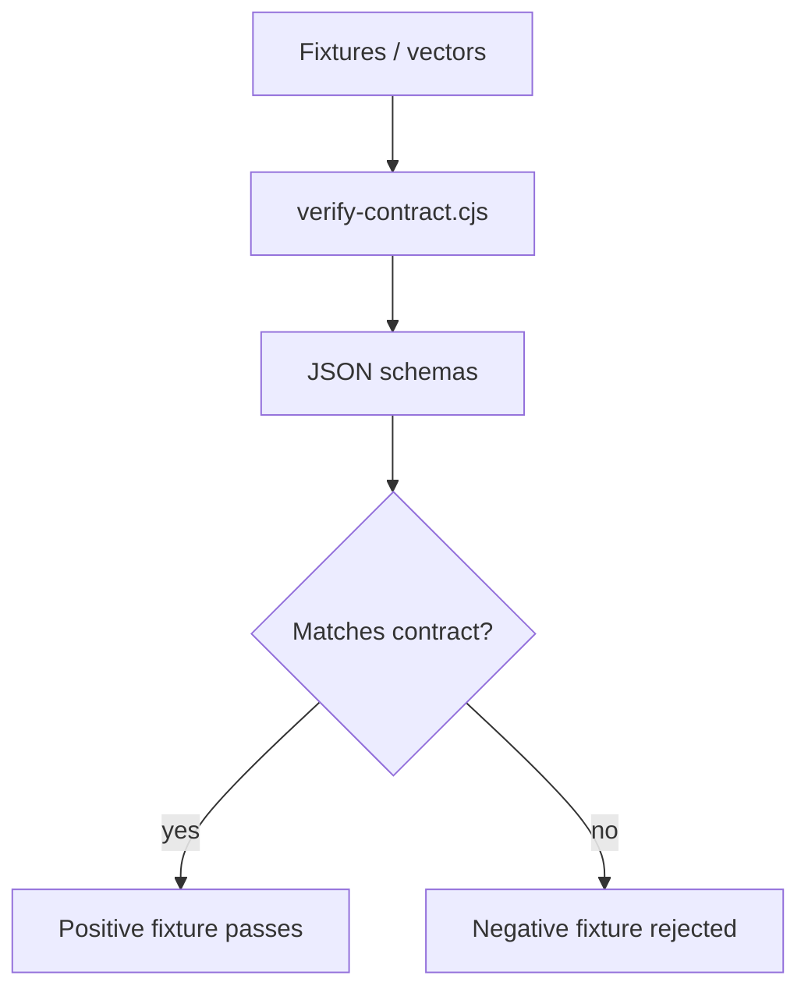

# Collector Ingress Contract v1

This package defines the versioned collector ingress contract used by the backend ingestion module and contract verification scripts.

## Responsibility

- Define the message, batch, heartbeat, rejection, and integrity shapes for collector ingress.
- Provide fixture data for positive and negative contract checks.
- Verify the contract with the local Node.js script.

## Main Components

- `schemas/`: JSON Schema definitions for shared, batch, heartbeat, and rejected-event payloads.
- `fixtures/`: signing vectors and sample payloads used by contract tests.
- `scripts/verify-contract.cjs`: local verification script.
- `package.json`: package entry for the contract bundle.

## Contract Flow

## Usage

- The backend ingestion module consumes these contracts to verify collector messages.
- The fixture set covers both successful messages and common rejection cases such as digest mismatch, duplicate keys, and batch tampering.

