## 1.Rule Compiler Project Statement

SIEM contains a **domain-specific compiler for cybersecurity detection rules**.

The source language is a restricted, Sigma-inspired rule language represented in YAML. The compiler accepts a human-readable security rule, parses and validates it, constructs an Abstract Syntax Tree (AST) for its Boolean condition, transforms field conditions into executable predicate functions, and evaluates normalized OCSF security events to produce alerts.

This is not a compiler for a general-purpose programming language such as C or Java. It is a compiler for a **Domain-Specific Language (DSL)** designed to express cybersecurity detection logic.

>  The system compiles a human-readable Sigma-inspired YAML security rule into an optimized executable predicate, runs that predicate against an OCSF security event, and produces an alert when the rule's AST evaluates to `true`.

---

## 2. What Problem Does It Solve?

Security engineers need to describe suspicious behavior without writing application code for every threat. For example, they may want to express:

> Detect a failed administrator login, but ignore the event if it originated from an approved IP address.

The engineer writes that behavior as a rule. Trivikrama compiles the rule once and then executes the compiled representation against many security events.

Without compilation, the application would repeatedly parse and interpret YAML for every event. With compilation, parsing and validation happen during rule loading, while event processing performs fast in-memory function calls.

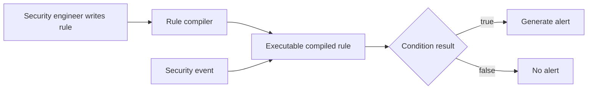

---

## 3. Role of YAML

YAML is the **concrete input format** used to write and store a rule. It provides mappings, lists, numbers, strings, and nested structures that are easy for a human to read.

For example:

```yaml
level: high
weight: 0.8
```

YAML tells the parser that `level` contains the string `high` and that `weight` contains the number `0.8`.

YAML does **not** decide what `level`, `weight`, `selection`, or `contains` mean. Those meanings are defined by the Sigma-inspired DSL and implemented by the Trivikrama compiler.

The relationship is:

| Item | Role |
|---|---|
| YAML | Concrete syntax and serialization format |
| Sigma-inspired rule schema | Vocabulary and meaning of the detection language |
| Rule compiler | Translates the rule into an executable representation |
| OCSF event | Runtime input to the compiled rule |
| Rule alert | Runtime output when the rule matches |

An easy comparison is:

| Traditional compiler | Trivikrama compiler |
|---|---|
| C source file | Sigma-inspired YAML rule |
| C grammar and semantics | Detection-rule schema and semantics |
| Variables and expressions | Selections, fields, and Boolean conditions |
| Executable program | Compiled `matches(event)` predicate |
| Program input | OCSF security event |
| Program output | Rule alert or no alert |

---

## 4. Role of a Sigma Rule

Sigma is a cybersecurity rule format used to describe suspicious log patterns in a product-independent way. A Sigma-style rule normally describes:

- The event class to which the rule applies.
- The event fields that must match.
- The operators used for matching.
- How named selections are combined.
- The severity and metadata of a resulting alert.

Trivikrama implements a **restricted Sigma-inspired subset**, not the complete Sigma specification.

The implemented subset supports:

- Exact equality.
- `contains`.
- `startswith`.
- `endswith`.
- Regular expressions.
- Numeric comparisons: `gt`, `gte`, `lt`, and `lte`.
- List membership using `in`.
- Inequality using `not`.
- Field-presence checks using `exists`.
- Boolean `AND`, `OR`, and `NOT`.
- Parentheses.
- Nested event fields using dot notation.

BE-DET-01A and BE-DET-01B currently implement **single-event, stateless match rules**. Count rules, sequence rules, Redis state, and cooldown behavior are later extensions and should not be presented as already implemented by these tickets.

---

## 5. Compiler-Design FLOW
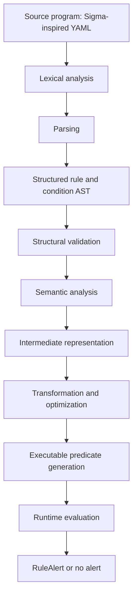

### Mapping compiler concepts to the implementation

| Compiler concept | Trivikrama implementation |
|---|---|
| Source language | Restricted Sigma-inspired rule language |
| Source representation | YAML text |
| Lexical analysis | YAML library tokenization and custom condition tokenizer |
| Parsing | YAML parsing and recursive-descent Boolean parsing |
| AST | Identifier, NOT, AND, and OR nodes |
| Symbol checking | Verify that condition identifiers refer to declared selections |
| Type checking | Verify severity, weight, priority, operator operands, and field definitions |
| Semantic analysis | Validate rule meaning, operator compatibility, paths, and supported rule type |
| Intermediate representation | Compiled metadata, predicate closures, and captured condition AST |
| Optimization | Pre-split paths, precompiled regex, priority ordering, and class index |
| Code generation | Construction of executable predicate closures |
| Runtime | `matches(event)` evaluates an OCSF event |
| Result | A `RuleAlert` when the result is true |

The code-generation stage does not emit a `.js` file and does not use `eval`. It constructs executable function objects from trusted, allow-listed operations. This is called **closure generation** or **predicate generation**.

---

## 6. Complete Compiler Pipeline

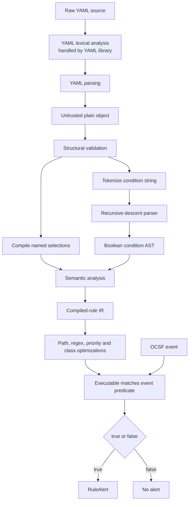

The pipeline has two phases:

### Compilation time

The rule is parsed, checked, transformed, and stored in compiled form.

### Runtime

Security events are passed to the compiled rule. The original YAML is not reparsed for every event.

---

## 7. Running Example: Source Rule

The following rule detects a failed login for an administrator but ignores approved source IP addresses.

```yaml
title: Suspicious Administrator Login
id: suspicious-admin-login-001
status: active
level: high
weight: 0.8
priority: 700

logsource:
  class_uid: 3002
  category_uid: 3

detection:
  selection:
    message|contains: Failed password
    actor.user.name|startswith: admin

  filter:
    src_endpoint.ip|in:
      - 10.0.0.10
      - 10.0.0.11

  condition: selection AND NOT filter

tags:
  - attack.credential_access
  - attack.t1110
```

In plain English:

> If the event is an authentication event, its message contains `Failed password`, and its username starts with `admin`, create an alert unless the source IP is in the approved list.

---

## 8. Stage 1: YAML Parsing

The compiler first receives the YAML as a string. The YAML parser converts it into a nested JavaScript object.

Conceptual result:

```typescript
{
  title: "Suspicious Administrator Login",
  id: "suspicious-admin-login-001",
  status: "active",
  level: "high",
  weight: 0.8,
  priority: 700,

  logsource: {
    class_uid: 3002,
    category_uid: 3
  },

  detection: {
    selection: {
      "message|contains": "Failed password",
      "actor.user.name|startswith": "admin"
    },

    filter: {
      "src_endpoint.ip|in": ["10.0.0.10", "10.0.0.11"]
    },

    condition: "selection AND NOT filter"
  }
}
```

The parser protects the system by rejecting malformed input, multiple YAML documents, duplicate mapping keys, excessive aliases, and source text larger than the implemented limit.

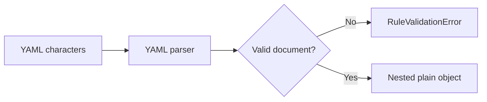

---

## 9. Stage 2: Structural and Type Validation

The compiler does not trust the parsed object. It validates every important part.

For the example rule, it verifies:

| Field | Required rule |
|---|---|
| `title` | Non-empty string |
| `id` | Valid lowercase rule identifier |
| `status` | Must be `active` in this compiler |
| `level` | Valid severity such as `high` or `critical` |
| `weight` | Finite number from 0 to 1 |
| `priority` | Integer from 1 to 1000 |
| `logsource.class_uid` | Non-negative integer |
| `logsource.category_uid` | Optional non-negative integer |
| `detection` | Mapping containing selections and a condition |

Examples of compile-time errors:

```yaml
weight: 25
```

This fails because the allowed range is 0 to 1.

```yaml
level: dangerous
```

This fails because `dangerous` is not a recognized severity.

This stage is comparable to structural checking and type checking in a conventional compiler.

---

## 10. Stage 3: Selection Compilation

The example contains two named selections: `selection` and `filter`.

### Compiling `selection`

```yaml
selection:
  message|contains: Failed password
  actor.user.name|startswith: admin
```

Each field expression is divided into three pieces:

```text
field path + operator + target value
```

#### First field condition

```yaml
message|contains: Failed password
```

becomes:

| Part | Value |
|---|---|
| Field path | `message` |
| Compiled segments | `["message"]` |
| Operator | `contains` |
| Target | `Failed password` |

Conceptual predicate:

```typescript
event =>
  typeof event.message === "string" &&
  event.message.includes("Failed password")
```

#### Second field condition

```yaml
actor.user.name|startswith: admin
```

becomes:

| Part | Value |
|---|---|
| Field path | `actor.user.name` |
| Compiled segments | `["actor", "user", "name"]` |
| Operator | `startswith` |
| Target | `admin` |

Conceptual predicate:

```typescript
event =>
  resolveField(event, ["actor", "user", "name"])
    .startsWith("admin")
```

Fields inside one selection mapping are combined with `AND`:

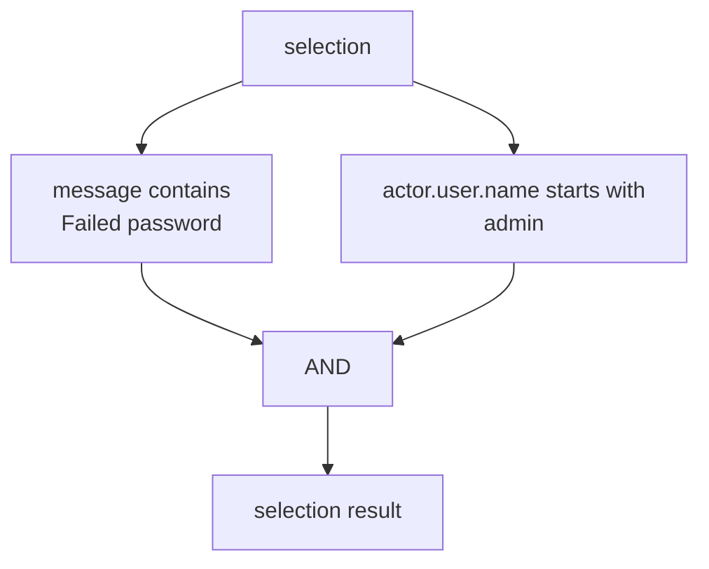

### Compiling `filter`

```yaml
filter:
  src_endpoint.ip|in:
    - 10.0.0.10
    - 10.0.0.11
```

becomes:

| Part | Value |
|---|---|
| Field path | `src_endpoint.ip` |
| Compiled segments | `["src_endpoint", "ip"]` |
| Operator | `in` |
| Targets | `10.0.0.10`, `10.0.0.11` |

Conceptual predicate:

```typescript
event =>
  event.src_endpoint.ip === "10.0.0.10" ||
  event.src_endpoint.ip === "10.0.0.11"
```

---

## 11. Stage 4: Lexical Analysis of the Condition

The condition is a small expression language embedded inside the YAML rule:

```text
selection AND NOT filter
```

The custom tokenizer scans the condition and produces this token stream:

```text
IDENTIFIER("selection")
AND
NOT
IDENTIFIER("filter")
```

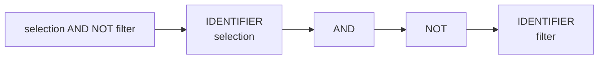

The tokenizer recognizes:

- Selection identifiers.
- `AND`.
- `OR`.
- `NOT`.
- Left parenthesis `(`.
- Right parenthesis `)`.

For example, `selection && filter` is rejected because `&&` is not a token in this language.

---

## 12. Stage 5: Grammar and Recursive-Descent Parsing

The Boolean condition follows this grammar:

```text
expression     := orExpression

orExpression  := andExpression ("OR" andExpression)*

andExpression := unaryExpression ("AND" unaryExpression)*

unaryExpression := "NOT" unaryExpression
                 | primary

primary        := IDENTIFIER
                 | "(" orExpression ")"
```

The implementation uses these parser levels:

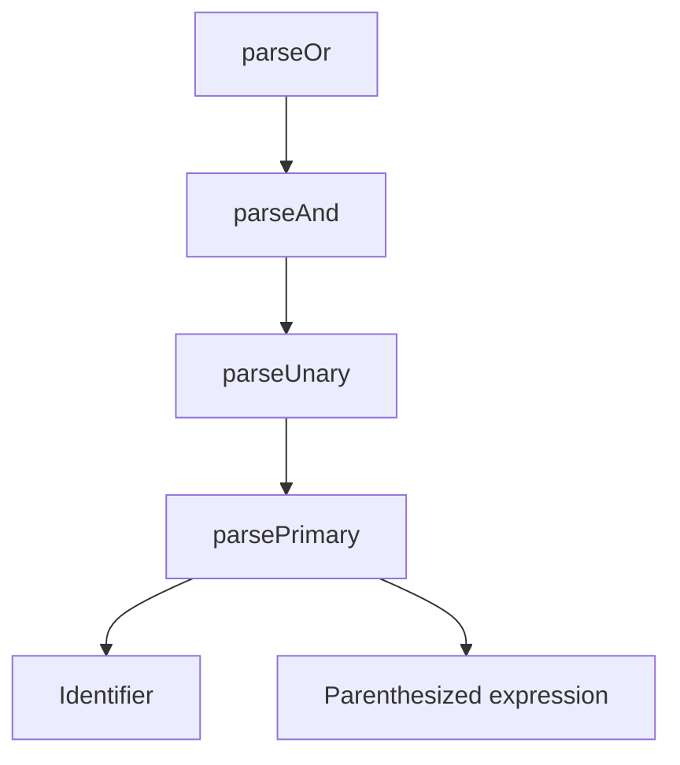

This structure implements operator precedence:

1. Parentheses.
2. `NOT`.
3. `AND`.
4. `OR`.

For example:

```text
a OR b AND NOT c
```

is parsed as:

```text
a OR (b AND (NOT c))
```

---

## 13. Stage 6: Parse Tree and AST Nodes

### Concrete parse structure

For:

```text
selection AND NOT filter
```

the grammar recognizes this structure:

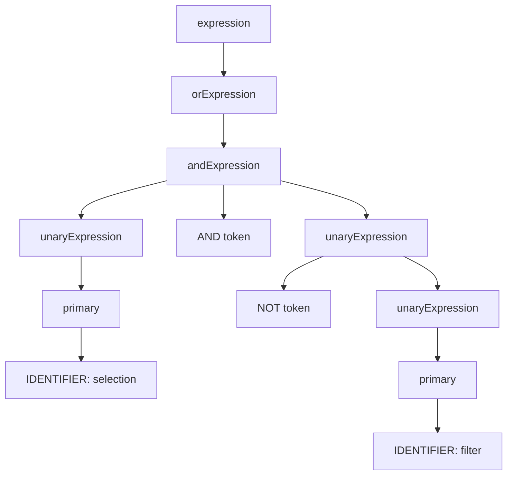

The parse structure contains grammar-specific nodes such as `expression`, `andExpression`, and `primary`.

### Abstract Syntax Tree

The compiler removes grammar details that are no longer needed and keeps only the logical meaning:

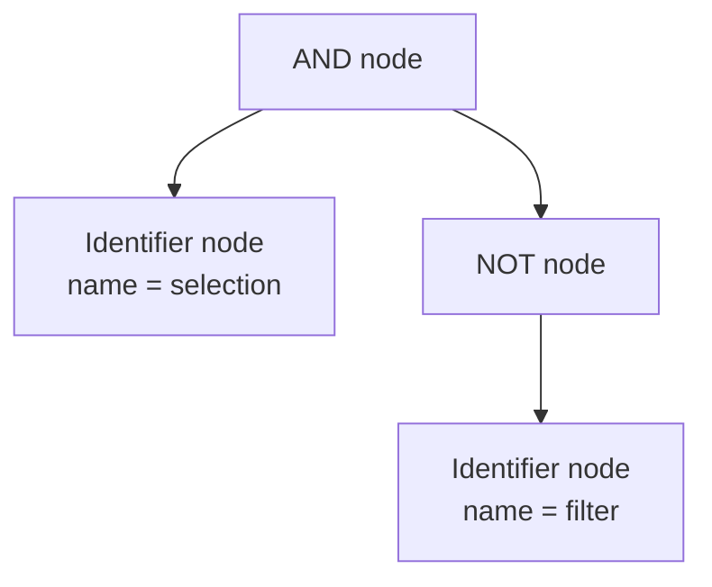

The actual AST shape is conceptually:

```typescript
{
  type: "and",
  left: {
    type: "identifier",
    name: "selection"
  },
  right: {
    type: "not",
    operand: {
      type: "identifier",
      name: "filter"
    }
  }
}
```

### Actual AST node types

```typescript
type ConditionExpression =
  | {
      type: "identifier";
      name: string;
    }
  | {
      type: "not";
      operand: ConditionExpression;
    }
  | {
      type: "and" | "or";
      left: ConditionExpression;
      right: ConditionExpression;
    };
```

#### Identifier node

Represents a reference to a named selection:

```typescript
{ type: "identifier", name: "selection" }
```

#### NOT node

Represents a unary logical operation:

```typescript
{
  type: "not",
  operand: { type: "identifier", name: "filter" }
}
```

#### AND/OR node

Represents a binary logical operation:

```typescript
{
  type: "and",
  left: expression1,
  right: expression2
}
```

The presence of a defined grammar, tokenizer, recursive-descent parser, operator precedence, and explicit AST is central evidence that this is a compiler-design implementation.

---

## 14. Stage 7: Semantic Analysis

Syntax analysis determines whether the condition follows the grammar. Semantic analysis determines whether the valid syntax has a valid meaning.

Consider:

```text
selection AND missing_filter
```
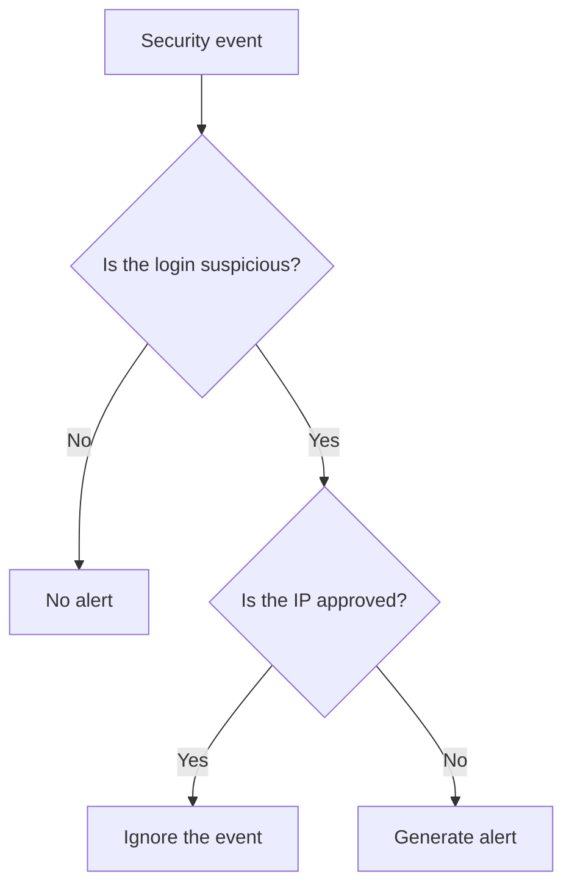

This follows the grammar:

```text
IDENTIFIER AND IDENTIFIER
```

But if `missing_filter` is not declared inside `detection`, the compiler rejects it.

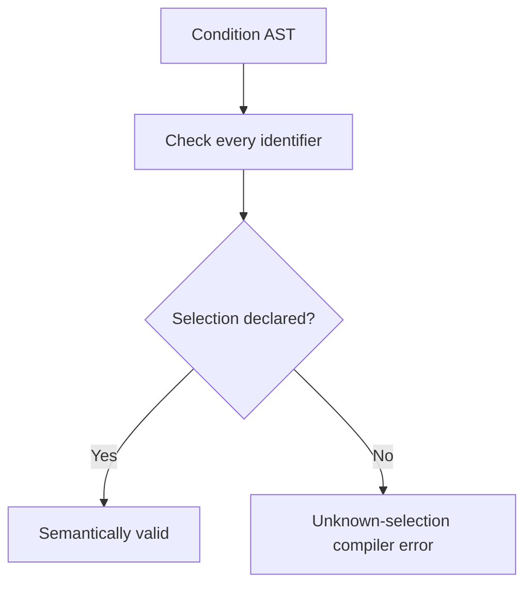

This resembles symbol-table checking in a conventional compiler:

| Conventional language | Detection DSL |
|---|---|
| Variable declaration | Named selection in `detection` |
| Variable reference | Identifier in `condition` |
| Undeclared-variable error | Unknown-selection error |

Semantic analysis also checks:

- Whether an operator is supported.
- Whether an operator receives the correct target type.
- Whether a field path is syntactically safe.
- Whether numeric targets are finite.
- Whether regular expressions satisfy safety limits.
- Whether the rule is an implemented stateless match rule.

---

## 15. Stage 8: Intermediate Representation

After parsing and validation, the compiler produces a `CompiledSigmaMatchRule`.

Conceptually, this compiled representation contains:

```text
CompiledSigmaMatchRule
├── Database/Sigma identity
├── Title and description
├── Severity and weight
├── Priority
├── OCSF class/category filter
├── Original condition text
├── Compiled hash
└── matches(event) executable predicate
    ├── Selection predicate map
    └── Captured condition AST
```

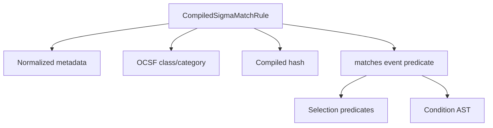

The AST and selection predicates are captured by the generated `matches(event)` closure. They do not need to be reconstructed during every event evaluation.

---

## 16. Stage 9: Predicate Generation

The compiler transforms each validated source condition into a trusted predicate function.

For example:

```yaml
message|contains: Failed password
```

is lowered conceptually into:

```typescript
value =>
  typeof value === "string" &&
  value.includes("Failed password")
```

The full rule is lowered conceptually into:

```typescript
function matches(event) {
  if (event.class_uid !== 3002) {
    return false;
  }

  if (event.category_uid !== 3) {
    return false;
  }

  const selection =
    event.message.includes("Failed password") &&
    event.actor.user.name.startsWith("admin");

  const filter =
    event.src_endpoint.ip === "10.0.0.10" ||
    event.src_endpoint.ip === "10.0.0.11";

  return selection && !filter;
}
```

This code is an explanation of the generated behavior. The real implementation creates closures instead of generating and executing source-code strings.

This is safer because:

- The user cannot insert arbitrary JavaScript.
- Only supported operators can execute.
- `eval` and `new Function` are not used.
- Field paths are checked before execution.
- Regular expressions are constrained and compiled once.

---

## 17. Stage 10: Compile-Time Optimizations

### Pre-split field paths

```text
actor.user.name
```

is converted once into:

```typescript
["actor", "user", "name"]
```

### Precompiled regular expressions

A `|re` pattern is converted into a `RegExp` object at compilation time rather than for every event.

### Priority ordering

Compiled rules are sorted so higher-priority rules run first.

### OCSF class index

BE-DET-01B groups compiled rules by `class_uid`:

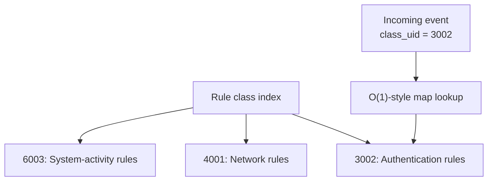

An authentication event is not evaluated against unrelated network or system-activity rules.

---

## 18. Stage 11: Runtime Event

The compiled rule is evaluated against this event:

```json
{
  "event_id": "event-001",
  "class_uid": 3002,
  "category_uid": 3,
  "message": "Failed password for admin-root",
  "actor": {
    "user": {
      "name": "admin-root"
    }
  },
  "src_endpoint": {
    "ip": "203.0.113.10"
  }
}
```

### 18.1 Log-source evaluation

```text
Required class_uid   = 3002
Event class_uid      = 3002
Result               = true

Required category_uid = 3
Event category_uid    = 3
Result                = true
```

The event is applicable to the rule.

### 18.2 `selection` evaluation

First condition:

```text
"Failed password for admin-root"
contains
"Failed password"
= true
```

Second condition:

```text
"admin-root"
starts with
"admin"
= true
```

Because fields in the selection are ANDed:

```text
selection = true AND true = true
```

### 18.3 `filter` evaluation

```text
Event IP = 203.0.113.10
Approved IPs = 10.0.0.10, 10.0.0.11

filter = false
```

### 18.4 AST evaluation

The compiler evaluates this AST:

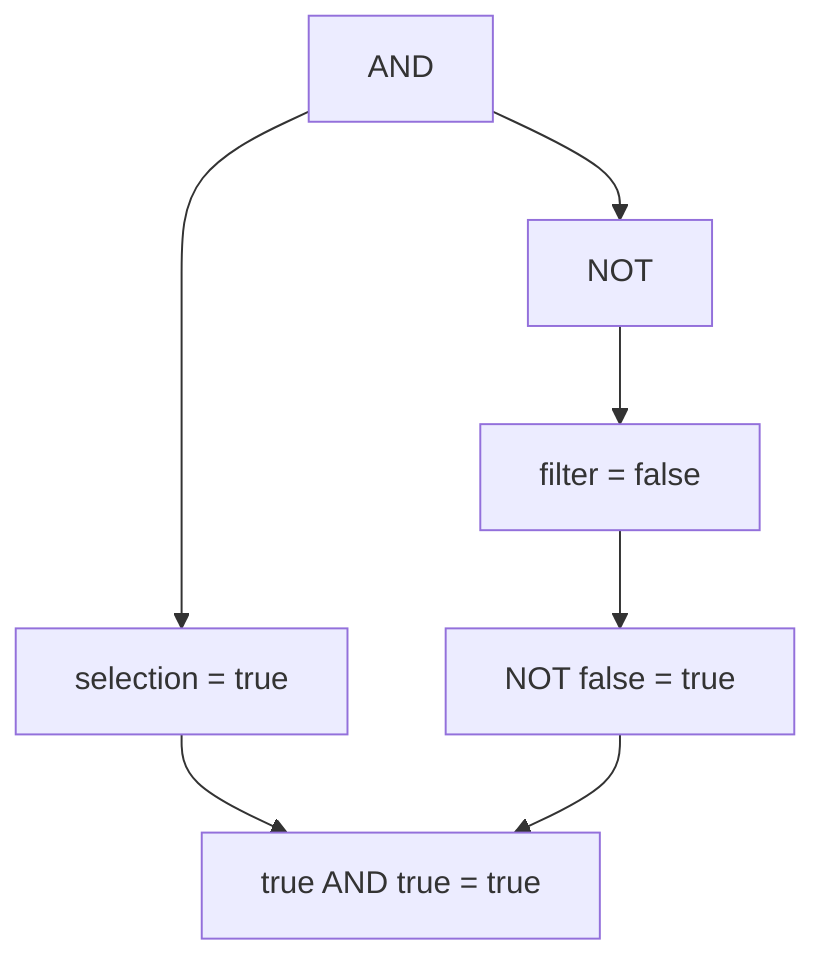

Therefore, the final rule result is `true`.

---

## 19. Stage 12: Final Generated Alert

Because the compiled rule returned `true`, the evaluator produces a `RuleAlert`:

```json
{
  "alertId": "generated-alert-uuid",
  "ruleId": "database-rule-id",
  "ruleName": "Suspicious Administrator Login",
  "ruleDescription": "",
  "severity": "high",
  "weight": 0.8,
  "matchedEvents": ["event-001"],
  "matchedCondition": "selection AND NOT filter",
  "tags": [
    "attack.credential_access",
    "attack.t1110"
  ],
  "metadata": {
    "ruleType": "match",
    "sigmaId": "suspicious-admin-login-001",
    "classUid": 3002,
    "categoryUid": 3
  }
}
```

The complete example is therefore:

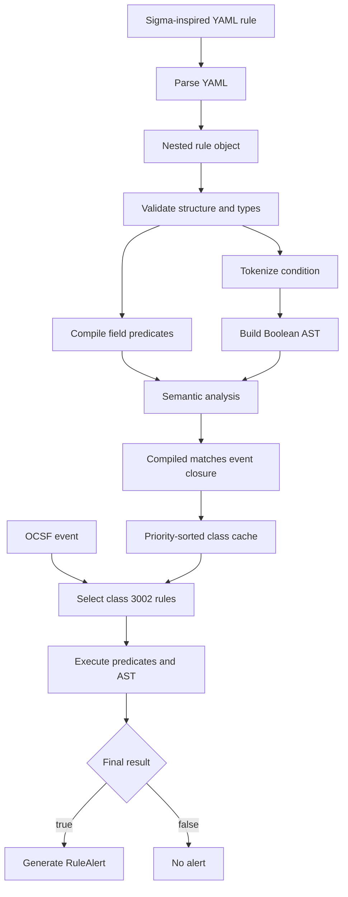

---

## 20. Role of BE-DET-01A and BE-DET-01B

### BE-DET-01A: Compiler and stateless evaluator

BE-DET-01A implements:

- Safe YAML parsing.
- Rule validation.
- Field-condition compilation.
- Condition tokenization.
- Recursive-descent parsing.
- AST construction.
- Semantic selection-reference checking.
- Predicate generation.
- Stateless event evaluation.
- Alert construction.

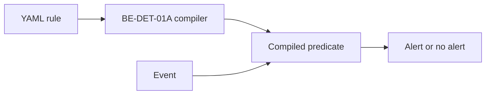

### BE-DET-01B: Loading, caching, and execution environment

BE-DET-01B implements:

- Loading active match rules from PostgreSQL.
- Binding an engine to one organization.
- Compiling database rules using BE-DET-01A.
- Checking that database metadata agrees with YAML metadata.
- Reusing a previous valid compiled rule when an update is invalid.
- Building an in-memory class index.
- Publishing a complete cache snapshot.
- Preventing evaluation before initial loading.

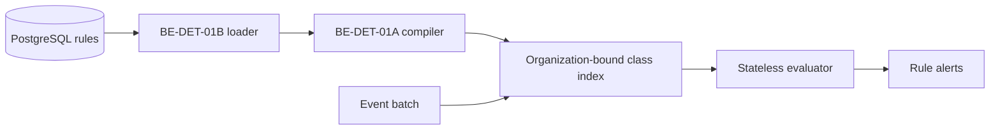

The relationship is:


### It does implement

- A cybersecurity DSL.
- Lexical analysis for the condition language.
- A formally explainable grammar.
- Recursive-descent parsing.
- Operator precedence.
- Explicit AST node types.
- Structural and semantic validation.
- Symbol/reference checking.
- Transformation to executable predicates.
- An in-memory compiled representation.
- Compile-time optimizations.
- Runtime execution.

### It does not currently implement

- Machine-code generation.
- Assembly generation.
- A `.js` output file.
- A general-purpose programming language.
- Full Sigma compatibility.
- Redis-backed count rules in these two tickets.
- Sequence rules in these two tickets.
- A standalone optimizer pass.

These missing elements do not make it “not a compiler.” DSL compilers often generate interpretable plans, closures, bytecode, queries, or other executable representations rather than machine code.

---


## 24. Final Model

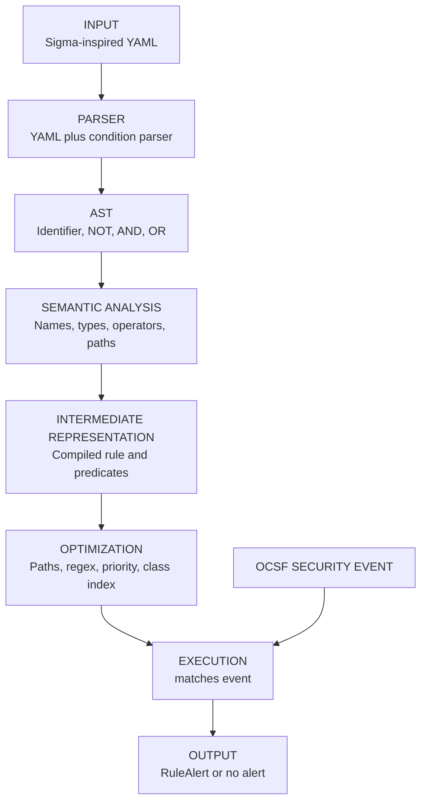


```text
YAML provides the syntax.
Sigma provides the detection-rule meaning.
The tokenizer identifies condition tokens.
The parser builds the Boolean AST.
Semantic analysis verifies the rule's meaning.
The compiler generates executable predicates.
The cache stores and indexes compiled rules.
The evaluator runs them against OCSF events.
A true result produces a RuleAlert.
```

---

A concise project-state picture is:

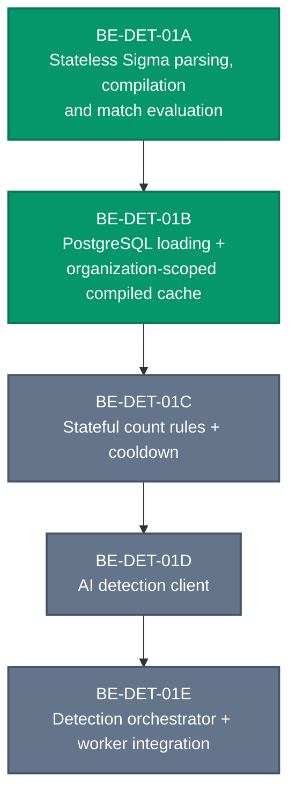
